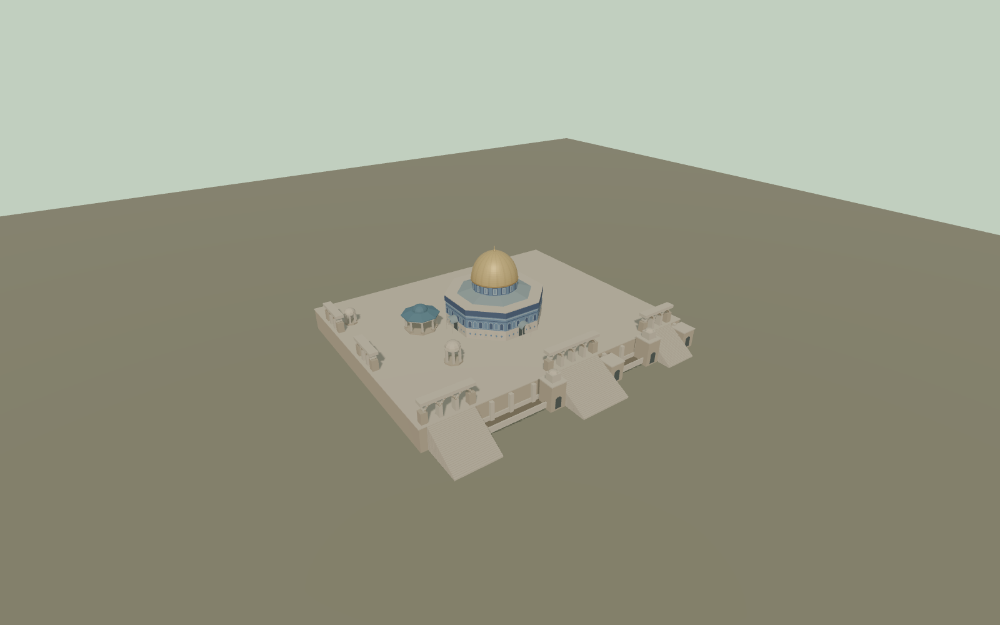

# Mini Israel · Dome of the Rock exhibit

A miniature gold dome and blue octagonal shrine on a raised stone display terrace. The 2022 flyover shows the open blue-roofed pavilion and two recessed planting wells between the stairs. These details are built into the source recipe. [Dated viewer preview](exhibit-preview.webp) · [2022 flyover](https://www.youtube.com/watch?v=7Zerh5_QLVA&t=444s)

The park-wide photograph identifies the terrace and its adjacent plaza. The north-up aerial image constrains the terrace’s size and northwest-facing stairs. In the final fit, the closest stair edge is about 12 cm from the rendered footway. The viewer shows the exhibit for the footage’s publication date, July 1, 2022. Its present condition remains unverified. [Placement review](placement-report.json)

Existing limestone, floor tile, ceramic mosaic, standing-seam and painted-metal surfaces. Linear tints and metric UVs. No private or embedded images. [Photographs and placement notes](reference-observations.json)

Run `node content/worldgen/source/places/sv/sv8/mini_israel_dome_of_the_rock/models/generate-dome-exhibit.mjs` to rebuild the master. Use the targeted structure import and landmark LOD commands for the four viewer tiers.
