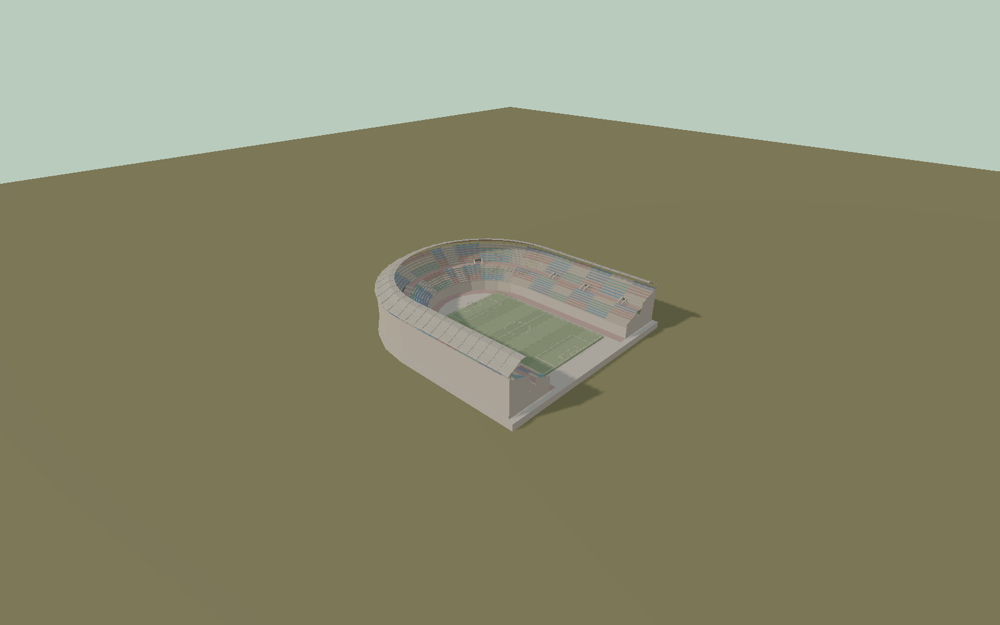

# Mini Israel · Teddy Stadium exhibit

A miniature football stadium with a U-shaped double-tier bowl, an open end, a ribbed canopy and multicolored seating around a green pitch. The exhibit sits inside Mini Israel at Latrun. [Drone footage](https://www.youtube.com/watch?v=7Zerh5_QLVA&t=452s) · [Placement controls](map-frame.json)

Four shared surfaces use metric UVs for the plinth, concrete, canopy and colored seat bands. Turf and pitch lines use vertex colors and no texture. The checked-in recipe builds the master and four distance tiers. [Model review](qa.json)

Run `node content/worldgen/source/places/sv/sv8/mini_israel_teddy_stadium/models/generate-teddy-exhibit.mjs` to rebuild the master. Use the normal structure import and landmark LOD commands for the viewer assets.
