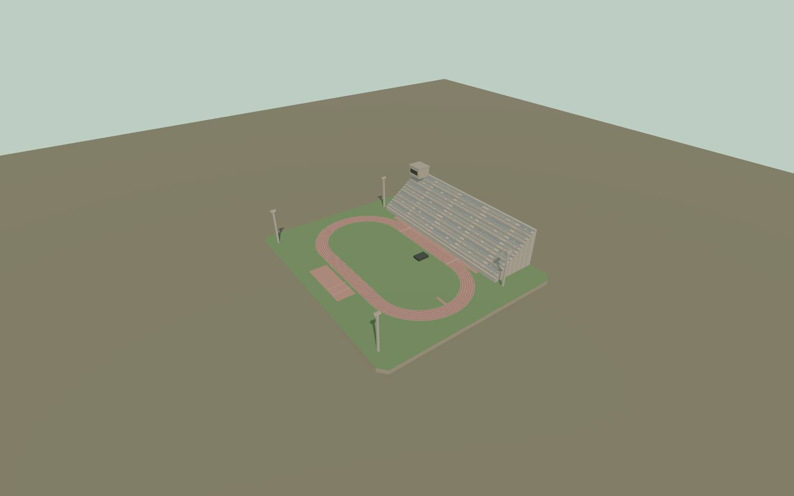

# Mini Israel · Track-and-field stadium exhibit

A low athletics miniature with a terracotta oval, sprint straight, pale lane stripes, turf, a single raked grandstand and four slim lamp standards. The world viewer places the exhibit in its documented appearance on May 17, 2012. The archived visitor photograph and the neighboring Teddy Stadium determine the approximate signed footprint. The present-day display condition remains unresolved. [Archived visitor view](https://virtualglobetrotting.com/map/mini-israel-track-and-field-stadium/view/google/) · [Placement review](placement-report.json)

Limestone, concrete and painted-metal graphs are shared. The field and lane markings use linear vertex tints with no embedded images.

Rebuild the source with `node content/worldgen/source/places/sv/sv8/mini_israel_track_and_field_stadium/models/generate-track-exhibit.mjs`. The targeted structure import and landmark LOD commands build the four viewer levels.
