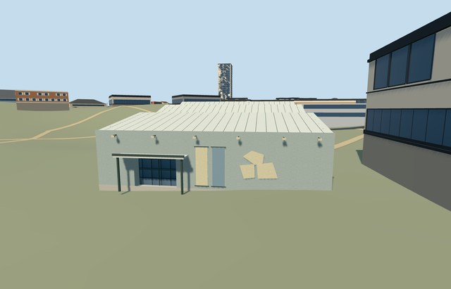

# museum_of_philistine_culture — Museum of Philistine Culture

Reviewed2026-10-22. **Completed medium-fi museum exterior; approximate native placement.**

## Built and inspected

Mapped blue-gray Ashdod museum exterior, largely blank front wall/raised coping, three reconstructed stepped folded white sheet-roof bays and dark opaque glazed ends. Actual1.1m recessed entrance/closed soffit/threshold under a slim projecting canopy/two slender posts. Two blank low-frequency banner fields, three irregular pale sign plaques and six schematic wall lights. One author/inspect/fix pass refined wall hue, neutral unseen roof ends and native whole-site framing. Original neighboring school/residential/tile-roof buildings retained. Text, logo/bird art, exhibition imagery and flags omitted.

## Shared materials and browser LODs

Four existing256px graphs: plaster_lime blue-gray render/blank pale sign fields; stone_limestone_raw footing/plinth/threshold; metal_painted light sheet roofs/canopy, dark frames, blank blue banner and lights; storefront opaque glazing. Generic limestone substitutes for concrete footing and plaster/painted metal for blank signs/banner substrate. No new graph/private atlas/embedded image. Six textured draws/one skyline draw; linear tints, separate POSITION/NORMAL streams and equal CPU/GPU byte accounting. Each native textured run reads each graph once; all LOD unloads dispose model geometry.

| Level | Triangles | Bytes | Draws |
| --- | ---: | ---: | ---: |
| skyline | 128 | 13064 | 1 |
| district | 328 | 37772 | 6 |
| street | 904 | 94880 | 6 |
| closeup | 904 | 94880 | 6 |

Four authored LODs 128 / 328 / 904 / 904 triangles within1k/4k/16k/64k caps. Initial skyline+district geometry 50836 bytes, shared cached material bakes separate. Six GLBs have zero Khronos errors/warnings;112 actual mesh/contact probes and3 actual PMTiles13/14/15 cases (one detailed owned parent) pass. Inspected48 current portable/shared/medium-fi/native frames, all LODs, failure/loading lifecycle and Economy/High noon/late light. Physical device timings remain pending.

## Geographic placement

Q23894294 identifies the candidate project; named museum POI and rectangle on way236735359/native35184608824191 identify the actual building. Use the existing reviewed map-axis anchor[34.640361389,31.798977432], about166m southwest of the candidate reference, rather than that displaced reference point. InternalX east-southeast along short front wall/internalZ south-southwest toward entrance approach, heading0/native axes baked in. Own this single parent only; preserve428 resident/516 wider independent buildings, including southern way236736164. Original201x201/6m Mapzen grid, roads and23,429.121163m² water retained. Uncovered approach datum32.137921627028405m/floor0.2m; boundary grades-0.641..+0.770m leave modest foundation/slight burial. Ground beneath roof-only canopy/approach retained. Failure keeps429 originals; every LOD unload restores ground/water and zero live geometry. Exact paving/thresholds/accessibility unverified.

## Fidelity and limits

Medium-fi exterior from two ordinary front oblique pictures and the actual mapped rectangle. No height/levels tag: working wall5.5m/raised coping about5.8m, entrance3.35m/canopy3.55m, three folded bays rising7.4/8.6/9.4m above floor. Roof bay inventory/profile, side/rear/clerestory layout and small rear service hatch reconstructed; hidden elevations are simplified. Skyline omits facade fields and flattens entrance recess; district/street/closeup retain recess/soffit and identity fields, finer LODs add broad seams/wall lights. Blank plaques/banner fields preserve arrangement without text/logo/bird/art. Shared plaster/painted-metal/stone substitute for original render, sheet roof, signboard/banner and concrete. No furnished exhibition, artifacts, copied graphics, flags or authored surrounding school. Physical phone/laptop/dense-city timing remains pending.

## Targeted checks

Selected generation/import/placement, strict medium-fi, scene/sim30 and recipe lint pass. Sim30 sha256:416787be32647bdb02ff188f1ad614e385061feb1751807c82f13c374287cc1f. Pins: [qa.json](qa.json); [source controls](map-frame.json).

## Viewed references

- https://commons.wikimedia.org/wiki/File:PikiWiki_Israel_84972_the_museum_of_philistine_culture_in_ashdod.jpg — Zeller Zalmanson Pikiwiki Israel; 2022-01-25; CC-BY-2.5. Viewed only; no copied pixels.

- https://commons.wikimedia.org/wiki/File:Museum_of_Philistine_culture_Ashdod.jpg — Laliv g; 2017-09-03; CC-BY-SA-4.0. Viewed only; no copied pixels.

- https://www.openstreetmap.org/way/236735359 — named museum and original building rectangle, ©OpenStreetMap contributors ODbL-1.0. Standard PMTiles/Mapzen; no bespoke research.

## Completion checklist

- [x] Rebuildable source, import, four authored LODs and shared materials.
- [x] Current actual source/shared/native renders, geometry and lifecycle checks.
- [x] Unique mapped identity, signed orientation and approximate native exterior fit.
- [x] Ground beneath canopy/approach, all independent buildings and original roads/terrain/water retained.
