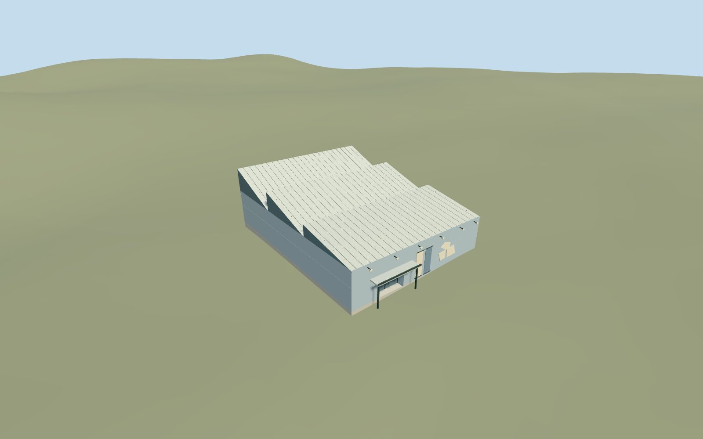

# Museum of Philistine Culture, Ashdod

Mapped exterior of the Corinne Mamane Museum of Philistine Culture in Ashdod: compact blue-gray rendered rectangular building, three reconstructed folded white sheet-roof bays/clerestory ends, largely blank front facade and raised coping, actual recessed glazed entrance under a projecting dark-edged canopy, two restrained blank banner fields and three abstract pale sign plaques. Preserve independent nearby school/tile-roof buildings and original approach. No furnished exhibition, copied inscriptions, bird logo, banner artwork, archaeological artifacts or flags.

## Evidence and reconstruction

Published dimensions and reconstructed details are separated in spec.json. Primary references:

- [Reference](https://commons.wikimedia.org/wiki/File:PikiWiki_Israel_84972_the_museum_of_philistine_culture_in_ashdod.jpg)
- [Reference](https://commons.wikimedia.org/wiki/File:Museum_of_Philistine_culture_Ashdod.jpg)

Mapped exterior of the Corinne Mamane Museum of Philistine Culture in Ashdod: compact blue-gray rendered rectangular building, three reconstructed folded white sheet-roof bays/clerestory ends, largely blank front facade and raised coping, actual recessed glazed entrance under a projecting dark-edged canopy, two restrained blank banner fields and three abstract pale sign plaques. Preserve independent nearby school/tile-roof buildings and original approach. No furnished exhibition, copied inscriptions, bird logo, banner artwork, archaeological artifacts or flags.

## Model and axes

904 triangles; 2,642 vertices; 6 material groups; 109,832 bytes. Native bounds: -17.001, -0.791, -18.453 to 17.109, 9.615, 18.451. Source hash: `sha256:fc02460b1a5b88c782ae60d460e11a266408be901d63ea90b5cba4e273131a63`.

{"x":"east","y":"up","z":"south"}

The geographic proposal uses exact-QID OpenStreetMap evidence. Map-derived orientation and estimated architectural details require real-site visual review; preview eligibility is distinct from geographic/fidelity approval. Map attribution: © OpenStreetMap contributors, ODbL-1.0.

## Reproduce

Run `node packages/worldgen/scripts/generate-additional-landmarks.mjs --ids=museum_of_philistine_culture` (or add `--check`). The generator preserves manually edited masters by checking their baseline hashes. Import through the standard authored-model workflow with optimization disabled; then capture all QA cameras, including shared-surface views.

## Pending work

- Mapped exterior of the Corinne Mamane Museum of Philistine Culture in Ashdod: compact blue-gray rendered rectangular building, three reconstructed folded white sheet-roof bays/clerestory ends, largely blank front facade and raised coping, actual recessed glazed entrance under a projecting dark-edged canopy, two restrained blank banner fields and three abstract pale sign plaques. Preserve independent nearby school/tile-roof buildings and original approach. No furnished exhibition, copied inscriptions, bird logo, banner artwork, archaeological artifacts or flags.
- Q23894294 identifies the museum project, while the standard map gives a named museum POI on way236735359/native35184608824191 at[34.6403619647,31.7989785706]. Use the reviewed map-axis coordinate[34.640361389,31.798977432], about166m southwest of the candidate reference, and this one matching footprint. InternalX east-southeast along the short front wall; internalZ south-southwest toward the entrance approach. Heading0; signed native east/south geometry baked in. Keep way236736164 and all other nearby buildings independent.
- No mapped height/levels. Two ordinary exterior pictures guide a working5.5m wall body/5.9m coping,3.35m entrance mouth/3.55m canopy, and three folded roof bays rising to7.4/8.6/9.4m. Exact roof section/bay inventory, hidden rear/side elevations and dimensions are reconstructed from front oblique views and map rectangle. Blank sign/banner fields preserve approximate arrangement while omitting text/logo/artwork. Existing plaster_lime, stone_limestone_raw, metal_painted and storefront graphs; no private textures/copied pixels.
- Standard Protomaps20261020 plus original MapzenTerrarium201x201/6m grid. Uncovered south-southwest entrance approach fixes datum32.137921627028405m; working floor0.2m above provider. Only mapped occupied main building floor cuts ground; roof-only entrance canopy projects over retained original approach. Original roads, water and independent buildings retained. Approximate native exterior fit inspected on the original grid; boundary grades-0.641..+0.770m leave a modest base/slight uphill burial. Exact pavement slope, paving and accessibility remain unverified. No bespoke terrain research or custom flattening.

This bundle follows the medium-fi standard. Medium-fi appearance and geographic fit are reviewed separately. Hash-bound visual acceptance is recorded separately after capture inspection.
