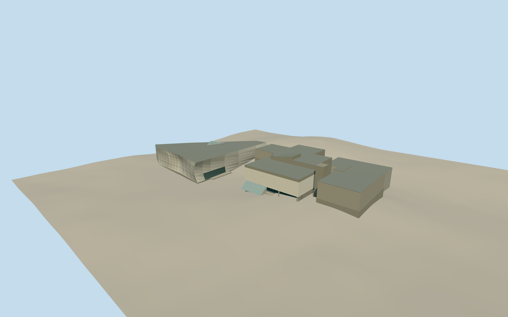

# Tel Aviv Museum of Art

Tel Aviv Museum of Art combines the lifted pale limestone gallery and recessed entrance of the main building with the angular pale concrete Amir wing.

Authoring state: **review-in-qa.json**. Current completion evidence is in [qa.json](qa.json) and the [completion ledger](../../../../qualla-structures/batches/qualla-003.PROGRESS.md).

- [Tel Aviv Museum of Art](https://qualla.com/tel-aviv-museum-of-art/)

Main building roof elevations, part of the 2018–2019 building update, bay dimensions and the northern structure’s detail are estimates.

Amir facade folds, panel spacing and sectional heights are representative geometry based on the measured site and architect’s written description.

The separate Eyal Ofer Pavilion, freestanding sculpture, museum interiors and neighboring civic institutions are outside this site.

Build: `node content/worldgen/source/places/sv/sv8/tel_aviv_museum_of_art/models/generate-tel-aviv-museum-of-art.mjs`. Add `--check` to verify exact regeneration. 5531 triangles; 6 materials; no embedded photographs.
