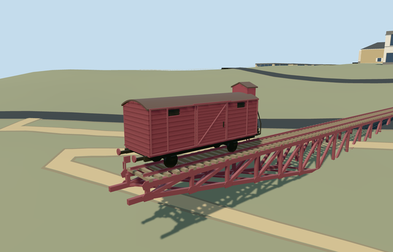

# cattle_car_memorial_to_the_deportees_yad_vashem — Cattle Car Memorial to the Deportees, Yad Vashem

Reviewed2026-10-22. **Completed medium-fi exterior with an approximate point-anchored native placement.**

## Built and inspected

Built the red-brown two-axle wagon, barrel roof, closed braced sliding doors, recessed upper vents, four wheels/chassis, buffers/coupler and distinctive raised brake cabin with three inset windows, supported steps and handrails. Authored both open tapered trusses, gussets/cross-braces, ties and rails along the existing mapped line. Two ordinary photos guided this author/inspect/fix pass. Corrected truss/buffer joints, step stringers, wheel contact, distant budgets, color and duplicate procedural bridge. No copied lettering, car interior, visitors or independent campus objects.

## Shared surfaces and browser LODs

Four existing256px graphs across seven roles/five textured draws: wood_weatherboard on the wagon, wood_plain on cabin/sleepers, metal_painted as a restrained weathered-steel/roof substitute, storefront on three opaque inset panes. No new graph, private atlas or embedded image. Skyline uses one mean-color draw. Each requested graph reads once; all model geometries release on unload.

| Level | Triangles | Bytes | Draws |
| --- | ---: | ---: | ---: |
| skyline | 926 | 90796 | 1 |
| district | 2836 | 249156 | 5 |
| street | 6012 | 538300 | 5 |
| closeup | 6780 | 610804 | 5 |

Four authored LODs:926/2836/6012/6780 triangles;90796/249156/538300/610804 bytes. Initial skyline plus district geometry339952 bytes. Separate POSITION/NORMAL streams and equal CPU/GPU accounting. Six GLBs:zero Khronos errors/warnings;86 mesh/contact probes;48 current source/shared/medium-fi/native frames inspected. Physical laptop/phone/tablet and dense-city timings pending.

## Geographic placement

Approximate native exterior fit accepted. Shared campus Q156591 plus independent named node5477091205/native17597663135621; disused rail ways1435803658/1435803659 fix the east-northeast axis and endpoints. Wagon occupies the western truncated end; brake cabin faces higher land. Photo GPS elsewhere on campus is not used. One actual level15 POI case; no matching13/14 point. Existing replaceRoads removes only the two authored bridge/connected-rail records after successful loading. All801 other transportation records and all153 resident/257 wider buildings remain unchanged; failure retains original rails/bridge. Original201x201/6m hill/roads input and zero-water-area input retained, no terrain cutout or modification. Far rail head sits0.35m above sampled land-end grade; the deeper truss enters the retained bank. All LOD/failure/unload/ground-water restoration and material-sharing checks pass. Exact cliff/bank excavation, track-bed engineering, path clearance and accessibility remain unverified.

## Fidelity and limits

Completed as a medium-fi mapped exterior visualization. Point and rail segments supply no vertical dimensions. Body8.6x2.68m, working1.435m gauge,0.43m wheel radius, barrel crest3.96m/brake cabin4.67m above rail and0.65..7.2m tapered truss depth are picture-led estimates. Exact wagon class, sections, panel/step/gusset inventory, original rust, hidden underside/cabin and foundation are unverified. Fine rivets/inscriptions omitted; no invented writing. Coarse original hill partly buries landward members. Every other campus building remains independent; four earlier fit drafts and North reference gap remain pending.

## Targeted checks

Six GLBs, zero Khronos errors/warnings;86 mesh/contact probes;one actual level15 POI case;48 inspected frames. Selected generation/import/placement, strict medium-fi, scene/sim30 and lint pass. Sim30 sha256:01319f54a8b888352e62176d0a3539a7e0dd447642b221ab38f922a4560640cd. Current pins: [qa.json](qa.json). Editable controls: [map-frame.json](map-frame.json).

## Completion checklist

- [x] Reproducible source/import, four authored LODs and existing shared surfaces.
- [x] Current geometry, source/shared/LOD/native images and loading lifecycle reviewed in this pass.
- [x] Distinct named point, approximate facing and exterior terrain contact reviewed.
- [ ] Complete the remaining six Yad Vashem members; this memorial does not complete the campus.

## Viewed references

- https://commons.wikimedia.org/wiki/File:Yad_Vashem_Israel_Memorial_Deportees.jpg — Grauesel; Unknown; uploaded2005-06-26; CC-BY-SA-3.0 (GFDL migration). Viewed only; no copied pixels.

- https://commons.wikimedia.org/wiki/File:Yad_Vashem_Holocaust_Memorial_Cattle_Car_(43274171421).jpg — Gary Todd; 2018-07-08 16:40; CC0-1.0. Viewed only; no copied pixels.

- https://www.openstreetmap.org/node/5477091205 — named independent memorial point. ©OpenStreetMap contributors, ODbL1.0.
