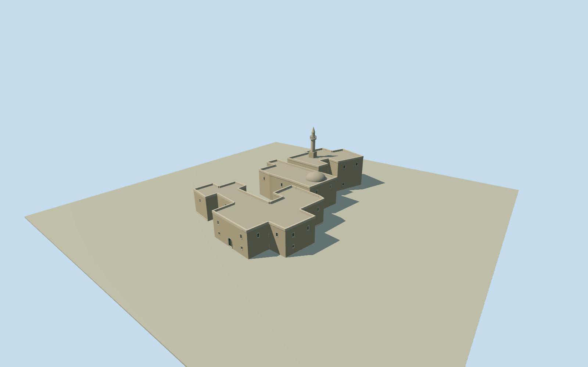

# David's Tomb

Named Mount Zion tomb blocks and attached Upper Room on three complete native plans: irregular stepped pale limestone walls, deep courtyard recesses, flat roof terraces with physical parapets, small recessed window/arched-door openings, the native mapped roof dome and a slender historic roof minaret. Excludes neighboring Dormition Abbey, cemetery, sculpture and interiors.

Authoring state: **review-in-qa.json**. Current completion evidence is in [qa.json](qa.json) and the [completion ledger](../../../../qualla-structures/batches/qualla-002.PROGRESS.md).

- [David's Tomb](https://qualla.com/david-s-tomb/)

Complete original named tomb and immediately attached Upper Room plans retain their signed shape and courtyard recesses. Native layer integers are not interpreted as measured elevations. Body heights7.6/9.2/11.2m, dome rise, minaret dimensions/attachment and small façade openings are photographic medium-fi estimates, not a measured architectural survey.

The exact Qualla-published1878Bonfils exterior is the unambiguously public-domain visual control for stone, stepped massing, arches, low dome and slender minaret. Current native plans/roof dome are separate controls. Modern fittings, restored details and the survival of every1878roof item are not asserted; interiors/curtains and unrelated archaeological imagery are excluded.

Exterior assembly only: no Tomb sarcophagus, religious textiles or inscriptions, Upper Room interior, neighboring Dormition Abbey/other monasteries, cemetery, memorial sculpture or landscape reconstruction. No photographic textures or exterior image links embedded in OSM tags were used.

Host terrain/foundation and courtyard contact are approximate. Footings extend0.4m below a fixed western dry-approach datum; source terrain is preserved and no platform/blanket ground opening is introduced.

Build: `node packages/worldgen/scripts/generate-authored-places.mjs --ids=davids_tomb`. Add `--check` to verify exact regeneration. 6746 triangles; 4 materials; no embedded photographs.
