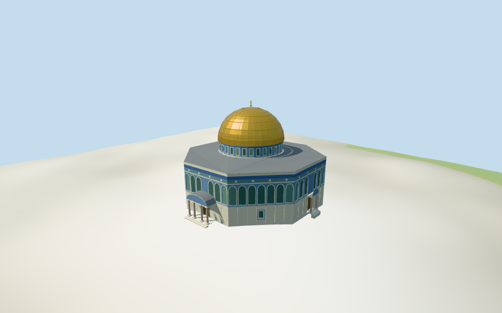

# Dome of the Rock

Individual medium-fi Dome of the Rock:gold paneled dome/orb-ring finial,blue mosaic drum and octagonal upper facade,pale marble lower wall,repeated round-arched glazed/blind fields and broad patterned-color parapet bands,sloping lead roof,broad columned south porch/curved canopy and smaller paired-column portals. Five existing shared256² graphs and four browser LODs. Two raw map controls retained;correspondence approximate,heights nominal/fine architecture estimated,unseen north/west entrances and exact terrain joins unverified. Separate Dome of the Chain/compound monuments excluded.

## Evidence and reconstruction

Published dimensions and reconstructed details are separated in spec.json. Primary references:

- [Reference](https://commons.wikimedia.org/wiki/File:Jerusalem-2013(2)-Temple_Mount-Dome_of_the_Rock_(SE_exposure).jpg)
- [Reference](https://commons.wikimedia.org/wiki/File:Dome_of_the_Rock,_South_Facade_(2008)_06.jpg)
- [Reference](https://commons.wikimedia.org/wiki/File:Dome_of_the_Rock,_Facade_(2008)_05.jpg)

Five existing shared256² marble,mosaic,raw limestone,standing-seam metal and bronze graphs;seven merged groups including local green-blue glazing. Bronze tinted gold abstracts gold sheeting;shared mosaic/vertex-tint bands suggest ceramic rather than replicate unique artwork. Linear tints,metric UVs and faceted architecture;zero embedded images,unique facade bitmaps,baked light or invented lettering.

## Model and axes

16,828 triangles; 50,484 vertices; 7 material groups; 2,023,632 bytes. Native bounds: -26.863, -1.306, -27.380 to 28.734, 38.351, 29.796. Source hash: `sha256:6837eb4f0233c4ad60b91e6fba775ba41614e2fbee57ee0a5d1a340a8b14459b`.

{"x":"east-northeast toward separate Dome of the Chain","y":"up","z":"south-southeast toward broad southern portico"}

Standard viewer DEM reused from nearby al_aqsa_mosque extract;datum747.520775m. Whole perimeter-0.96 to1.60m relative to it. Floor1.951m is maximum perimeter sample plus0.35m,an approximate raised attachment plane. Marble footings crossY=0 and extend below retained terrain. No courtyard/platform flattening,ground cutout or road replacement. Exact thresholds,steps,platform/arcade/street/base joins,altitude and walking remain unverified.

## Reproduce

Run `node packages/worldgen/scripts/generate-additional-landmarks.mjs --ids=dome_of_the_rock` (or add `--check`). The generator preserves manually edited masters by checking their baseline hashes. Import through the standard authored-model workflow with optimization disabled; then capture all QA cameras, including shared-surface views.

## Pending work

- Earlier Q172077 candidate was reference-only with no exact mapped identity. The current standard PMTiles archive supplies one named Dome of the Rock POI attached to octagonal whole35184376798368 (OSM way/4709536),and a separate named rock/dome part35184663925531. Both lie at the reference location and match the pictured isolated octagon/gold cap. This resolves approximate physical correspondence;the archive does not expose a Wikidata tag,so no new exact-QID OSM match is claimed. Anchor[35.23528665304184,31.778017413436032] is the mapped dome bounding-box center,about4.33m from the earlier reference-only point. Heading0.150746793741rad aligns the mapped south facet:Native+X east-northeast,+Z south-southeast broad porch,−Z north-northwest. No horizontal rescale. Three inspected pictures distinguish the southern portico/eastern side entrance;unseen north/west entrance details remain estimated. Dome of the Chain,Ascension,Prophet,other pavilions,platform/arcades and al_aqsa_mosque Al-Qibli remain separate host content.
- Current whole17m and dome part34m are nominal height controls,not survey data. Earlier reference-only facts contain no numeric dimensions. Picture-led above-floor partitions:marble base to6.1m,blue tile facade6.1–14.1m,parapet bands14.1–17m,sloped lead roof17–17.8m,patterned drum17.8–22m,gold cap22–34m and orb/ring finial36.4m. South porch6m entablature/8.8m curved canopy;three smaller side/north/west entrances6m lintel/8.6m decorated tympanum. Four entrance locations are aligned to alternating mapped facets;the unseen north/west repeats,widths/projections and details are estimates. Upper round-arched panels,drum lights,marble joints and ceramic color bands are abstractions;fine motifs,calligraphy,current finish and exact profiles unverified.
- Standard viewer DEM reused from nearby al_aqsa_mosque extract;datum747.520775m. Whole perimeter-0.96 to1.60m relative to it. Floor1.951m is maximum perimeter sample plus0.35m,an approximate raised attachment plane. Marble footings crossY=0 and extend below retained terrain. No courtyard/platform flattening,ground cutout or road replacement. Exact thresholds,steps,platform/arcade/street/base joins,altitude and walking remain unverified.
- Individual medium-fi exterior from three inspected2008/2013 pictures plus standard viewer PMTiles/DEM. Octagonal wall/dome plan retained;nominal17/34m tags and estimated architectural partitions. Four portals align to alternating facets;visible south/east pictures guide the broad/paired-column distinction,unseen north/west details are estimates. Shared mosaic and blue/green/cream bands are an abstraction of patterned ceramic,not a replica of calligraphy or historic artwork. Gold metal graph abstracts gold-clad sheets;bronze doors have simplified flat fields. Fine carved capitals,door studs,leaded art,tile motifs,engineering,current finish and precise platform/step/base joins excluded or unverified. Facade/drum recesses and shallow open columned porches terminate at closed doors;no prayer-hall interior or free traversal claim. Dome of the Chain,Ascension,Prophet,platform/arcades,Al-Qibli and other compound buildings remain host content. Synthetic neighbors and physical-device timing unverified.

This bundle follows the medium-fi standard. Medium-fi appearance and geographic fit are reviewed separately. Hash-bound visual acceptance is recorded separately after capture inspection.

## Additional geographic data

©OpenStreetMap contributors;Protomaps;Mapzen/USGS terrain tiles.
