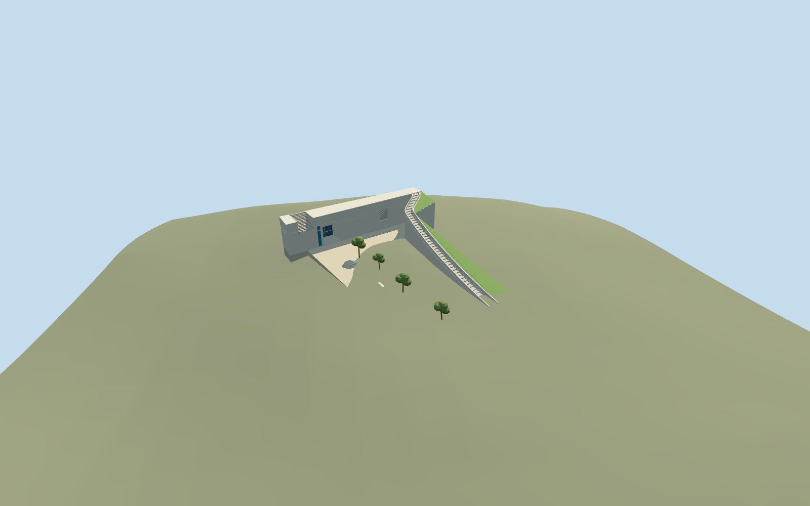

# Exhibition Pavilion, Yad Vashem

Exhibitions Pavilion and its part of the open Square of Hope. The recessed portal, stepped end wall, planted wing and curved stair retain their visible forms.

## Evidence and reconstruction

Published dimensions and reconstructed details are separated in spec.json. Primary references:

- [Reference](https://commons.wikimedia.org/wiki/File:Yad_Vashem_View.jpg)
- [Reference](https://www.yadvashem.org/museum/art/about.html)

Exhibitions Pavilion and its part of the open Square of Hope. The recessed portal, stepped end wall, planted wing and curved stair retain their visible forms.

## Model and axes

3,800 triangles; 9,818 vertices; 8 material groups; 403,728 bytes. Native bounds: -17.261, -2.207, -32.686 to 23.860, 7.360, 25.553. Source hash: `sha256:b3caf208e7eb197a45cbc7618e39fc06713b43263a769eab04f9fb86f60431b3`.

{"x":"east","y":"up","z":"south"}

The geographic proposal uses exact-QID OpenStreetMap evidence. Map-derived orientation and estimated architectural details require real-site visual review; preview eligibility is distinct from geographic/fidelity approval. Map attribution: © OpenStreetMap contributors, ODbL-1.0.

## Reproduce

Run `node packages/worldgen/scripts/generate-additional-landmarks.mjs --ids=exhibitions_pavilion_yad_vashem` (or add `--check`). The generator preserves manually edited masters by checking their baseline hashes. Import through the standard authored-model workflow with optimization disabled; then capture all QA cameras, including shared-surface views.

## Pending work

- The court and visual threshold elevations are fitted to the standard terrain and photographs. Exact threshold levels, planting and transitions beyond the local square remain approximate.
- The detached terrace architecture and interiors remain outside this model.

This bundle follows the medium-fi standard. Medium-fi appearance and geographic fit are reviewed separately. Hash-bound visual acceptance is recorded separately after capture inspection.
