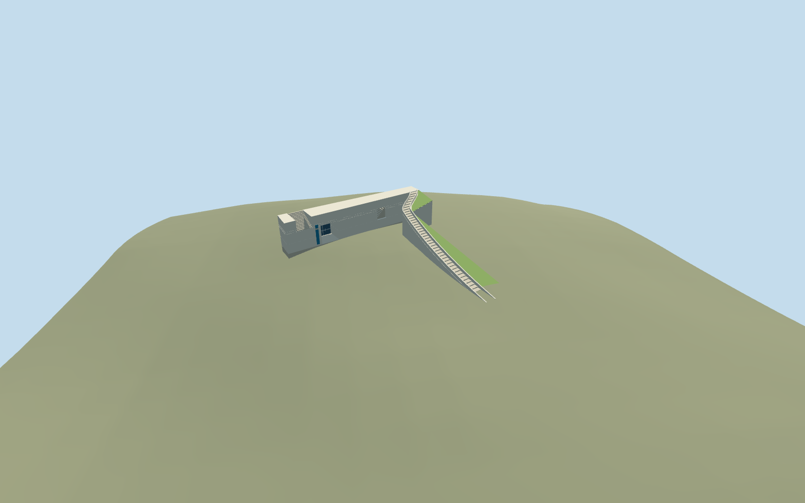

# Exhibition Pavilion, Yad Vashem

Exhibition Pavilion, Yad Vashem: an open courtyard-facing L-shaped reconstruction inside the distinct nine-corner mapped range. Preserve the empty court; author the tall blank end wall with a deep entrance, actual stair-window aperture and upper stair notch, plus the curved rising exterior stair wing, solid low concrete guards and planted sloping roof. Keep Art Museum, independent upper plaza, courtyard paving/trees/benches and other campus buildings outside this asset. Internal room arrangements and exhibition displays are not modeled.

## Evidence and reconstruction

Published dimensions and reconstructed details are separated in spec.json. Primary references:

- [Reference](https://commons.wikimedia.org/wiki/File:Yad_Vashem_View.jpg)
- [Reference](https://www.yadvashem.org/museum/art/about.html)

Exhibition Pavilion, Yad Vashem: an open courtyard-facing L-shaped reconstruction inside the distinct nine-corner mapped range. Preserve the empty court; author the tall blank end wall with a deep entrance, actual stair-window aperture and upper stair notch, plus the curved rising exterior stair wing, solid low concrete guards and planted sloping roof. Keep Art Museum, independent upper plaza, courtyard paving/trees/benches and other campus buildings outside this asset. Internal room arrangements and exhibition displays are not modeled.

## Model and axes

2,020 triangles; 4,590 vertices; 5 material groups; 192,876 bytes. Native bounds: -17.261, -0.163, -16.533 to 23.860, 8.826, 25.553. Source hash: `sha256:ececada98c3f2e88b1800c1a9386e86a4681338ecf47d57d9eb69385a672e8f8`.

{"x":"east","y":"up","z":"south"}

The geographic proposal uses exact-QID OpenStreetMap evidence. Map-derived orientation and estimated architectural details require real-site visual review; preview eligibility is distinct from geographic/fidelity approval. Map attribution: © OpenStreetMap contributors, ODbL-1.0.

## Reproduce

Run `node packages/worldgen/scripts/generate-additional-landmarks.mjs --ids=exhibitions_pavilion_yad_vashem` (or add `--check`). The generator preserves manually edited masters by checking their baseline hashes. Import through the standard authored-model workflow with optimization disabled; then capture all QA cameras, including shared-surface views.

## Pending work

- Exhibition Pavilion, Yad Vashem: an open courtyard-facing L-shaped reconstruction inside the distinct nine-corner mapped range. Preserve the empty court; author the tall blank end wall with a deep entrance, actual stair-window aperture and upper stair notch, plus the curved rising exterior stair wing, solid low concrete guards and planted sloping roof. Keep Art Museum, independent upper plaza, courtyard paving/trees/benches and other campus buildings outside this asset. Internal room arrangements and exhibition displays are not modeled.
- Shared campus Q156591 plus distinct way245190611/native35184617279443. The official Pavilion page places it between Art Museum and Book of Names. The existing PMTiles outline and ordinary campus aerial fix this independent range beside the Art Museum. The large mapped polygon includes the open Square of Hope area: do not fill it with a solid box or roof. Its courtyard/end-wall and curved-stair assignment is a picture-led reconstruction. Internal+X follows the mapped southeast axis; +Z faces southwest toward the curved planted wing. The end-wall portal faces-X into the courtyard. Heading0 bakes the signed axes into model east/south. No invented member Wikidata item; portal/notch/window positions are approximate.
- No map heights or internal plan exist. Picture-led working end wall6.8m, portal4.3m high/4m wide with3.8m recess, stair window2.1..4.8m, upper notch4.4..6.8m. The curved exterior stair rises about6.3m with sparse low concrete guards; tread inventory varies by LOD. Sloped planted roof and closed underground mass are reconstructed from the aerial, not surveyed. Hidden galleries, rear enclosure, roof extent, internal circulation, escalator and exact dimensions/accessibility are unverified. Plain colour signage contains no copied art, photographs, lettering or memorial names.
- Reuse the unmodified Protomaps20261020/Mapzen201x201/6m hill, with no custom terrain. Uncovered attachment internal[16,-20], datum802.3763713098676m; working floor sampled at the original courtyard ground near internal[16,-6.8], plus0.06m. Cut only the occupied end-wall/stair-wing floors and seal them; preserve original open-courtyard ground and all outside approaches. The main mapped footprint owns a building replacement but is not a ground-cutout polygon. Protective footings stay within occupied geometry. Original coarse hill does not describe the excavated, level Square of Hope or its upper plaza; inspect buried stairs, portal and footing before activating. Do not flatten the independent precinct.

This bundle follows the medium-fi standard. Medium-fi appearance and geographic fit are reviewed separately. Hash-bound visual acceptance is recorded separately after capture inspection.
