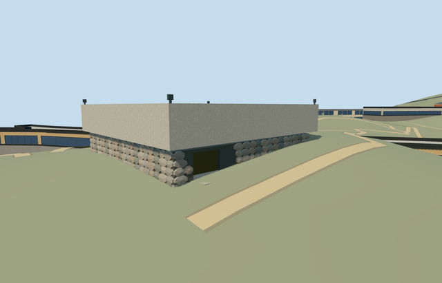

# hall_of_remembrance_yad_vashem — Hall of Remembrance, Yad Vashem

Reviewed 2026-10-22. **Completed medium-fi mapped exterior with approximate native placement.**

## Built and inspected

Built the exact mapped square Hall of Remembrance exterior: recessed irregular faceted fieldstone base, broad pale concrete fascia, inset shadow joint, closed underside, thick rim and depressed inner roof, west-end recessed bronze gate and small roof floodlights. Kept all three identity features at skyline distance. Refined stone coverage/irregularity, removed an erroneous projecting spacer and softened the concrete material during the same authoring pass. Ordinary southwest and aerial pictures guided the reconstruction. No copied door sculpture, inscriptions, memorial floor/flame or furnished interior.

## Shared surfaces and browser LODs

Four existing 256px graphs across ten roles merged into six textured draws: continuous raw basalt grain on modeled fieldstones/mortar, plain concrete shared across fascia/roof/floor, painted metal for the inset spacer/frames/lights and cast bronze for the simplified gate. No new graph, private atlas or embedded image. The raw stone graph supplies grain rather than drawn block joints; geometric facets and four restrained tints supply the fieldstone structure. Each requested graph reads once; every model geometry is released on unload.

| Level | Triangles | Bytes | Draws |
| --- | ---: | ---: | ---: |
| skyline | 564 | 61376 | 1 |
| district | 2064 | 236812 | 6 |
| street | 5046 | 574140 | 6 |
| closeup | 9630 | 1096448 | 6 |

Four authored LODs: 564 / 2,064 / 5,046 / 9,630 triangles. Initial skyline plus district geometry is 298,188 bytes; close-up is 1,096,448 bytes. All levels stay within browser budgets, with one skyline draw and six textured draws. Separate POSITION/NORMAL buffer views and equal CPU/GPU accounting. Six GLBs have zero Khronos errors/warnings; 114 actual mesh/contact probes; 48 current inspected source/shared/medium-fi/native views. Physical device and dense-city timings remain pending.

## Geographic placement

Approximate native exterior fit accepted. Independent Ohel Yizkor Q6826871 is attributed by the source photograph structured data; named way 74078348 / native 35184446167180 fixes the roof outline. The southwest photo fixes the gate/front; heading 0 has signed east-northeast/south-southeast internal axes baked into model east/south coordinates. Two actual overlapping PMTiles 14/15 cases pass; no overlapping level 13 feature was present. One owned footprint is replaced; all 152 independent resident/all 256 wider records remain, including the History Museum. Original 201x201/6m hill, roads and zero-water-area input remain unchanged. Cut only occupied inset base; retain forecourt ground and ground beneath eaves. Uncovered control, modelWorldY approximately0, current four-LOD/failure/unload/ground-water restoration and material-sharing probes pass. Failure keeps 153 originals. Floor 0.06 m above the front control provides a workable approach; coarse uphill grade partly buries lower stones and exact threshold/accessibility levels are not certified.

## Fidelity and limits

Completed as a medium-fi mapped exterior with approximate native placement. Map height is absent: stone base 3 m, inset spacer 0.3 m, concrete rim 7.2 m above floor and depressed roof 4.1 m above floor are picture-led estimates. Stone inventory, hidden elevations, door treatment, roof depth and floodlights are reconstructed. The bronze gate is simplified geometric work, not a copy of the sculptural panel. The original coarse slope reaches 2.09 m above the working datum and hides some uphill base stones; no precinct flattening/custom terrain was used. Synthetic flat views cannot approve native fit. All other Yad Vashem structures remain independent; the History Museum remains an inactive terrain-fit draft. Physical laptop/phone/tablet and dense-city measurements remain pending.

## Targeted checks

Six GLBs, zero Khronos errors/warnings; 114 mesh/contact probes; two actual map-overlap cases; 48 inspected frames. Selected generation/import/placement, strict medium-fi, scene/sim30, collection checks and lint pass. Sim30 sha256:0a6a8bea7a6ef8d5981b0b3cc4edd8ede5d4f4f86ac17225de9bff3d0a799eec. Pins: [qa.json](qa.json). Editable controls: [map-frame.json](map-frame.json).

## Completion checklist

- [x] Reproducible source, import, four authored LODs and existing shared material bindings.
- [x] Current source/shared/LOD/native images, geometry and lifecycle checked in this authoring pass.
- [x] Distinct identity, signed map orientation and approximate native exterior fit reviewed.
- [ ] Complete the other nine Yad Vashem members. This building does not complete the campus.

## Viewed references

- https://commons.wikimedia.org/wiki/File:Hall_of_Remembrance,_Yad_Vashem,_2019_(01).jpg — Bahnfrend; 2019-04-18; CC-BY-SA-4.0. Viewed only; no copied pixels.

- https://commons.wikimedia.org/wiki/File:Yad_Vashem_View.jpg — Andrew Shiva / Wikipedia (Godot13); 2013-11-15; CC-BY-SA-4.0 and attribution-only permission. Viewed only; no copied pixels.

- https://www.openstreetmap.org/way/74078348 — named Hall of Remembrance. ©OpenStreetMap contributors, ODbL1.0.

- https://www.wikidata.org/wiki/Q6826871 — independent Ohel Yizkor identity, linked by the Commons source photograph structured data.
