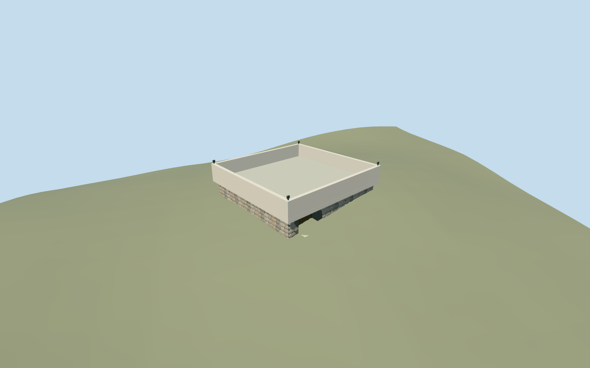

# Hall of Remembrance, Yad Vashem

Hall of Remembrance (Ohel Yizkor), Yad Vashem: exact mapped square roof on a recessed rough fieldstone base, large blank concrete fascia, continuous shadow gap, depressed inner roof and thick parapet, recessed west-end front bronze entrance and small roof floodlights. Individual faceted boulders appear nearby; all LODs keep the stone/concrete contrast and off-centre entry. Interior memorial floor, flame, names/inscriptions and site sculptures are excluded. All other Yad Vashem buildings and memorials remain separate.

## Evidence and reconstruction

Published dimensions and reconstructed details are separated in spec.json. Primary references:

- [Reference](https://commons.wikimedia.org/wiki/File:Hall_of_Remembrance,_Yad_Vashem,_2019_(01).jpg)
- [Reference](https://commons.wikimedia.org/wiki/File:Yad_Vashem_View.jpg)

Hall of Remembrance (Ohel Yizkor), Yad Vashem: exact mapped square roof on a recessed rough fieldstone base, large blank concrete fascia, continuous shadow gap, depressed inner roof and thick parapet, recessed west-end front bronze entrance and small roof floodlights. Individual faceted boulders appear nearby; all LODs keep the stone/concrete contrast and off-centre entry. Interior memorial floor, flame, names/inscriptions and site sculptures are excluded. All other Yad Vashem buildings and memorials remain separate.

## Model and axes

9,630 triangles; 28,866 vertices; 6 material groups; 1,158,644 bytes. Native bounds: -16.372, -0.357, -16.118 to 16.626, 7.990, 16.626. Source hash: `sha256:62094171ac560902f3c87d8a2b32665644e185d43c7572eb9961b0b0d6cd55fd`.

{"x":"east","y":"up","z":"south"}

The geographic proposal uses exact-QID OpenStreetMap evidence. Map-derived orientation and estimated architectural details require real-site visual review; preview eligibility is distinct from geographic/fidelity approval. Map attribution: © OpenStreetMap contributors, ODbL-1.0.

## Reproduce

Run `node packages/worldgen/scripts/generate-additional-landmarks.mjs --ids=hall_of_remembrance_yad_vashem` (or add `--check`). The generator preserves manually edited masters by checking their baseline hashes. Import through the standard authored-model workflow with optimization disabled; then capture all QA cameras, including shared-surface views.

## Pending work

- Hall of Remembrance (Ohel Yizkor), Yad Vashem: exact mapped square roof on a recessed rough fieldstone base, large blank concrete fascia, continuous shadow gap, depressed inner roof and thick parapet, recessed west-end front bronze entrance and small roof floodlights. Individual faceted boulders appear nearby; all LODs keep the stone/concrete contrast and off-centre entry. Interior memorial floor, flame, names/inscriptions and site sculptures are excluded. All other Yad Vashem buildings and memorials remain separate.
- Independent Ohel Yizkor Q6826871 is identified by the Commons photograph structured-data link; distinct named PMTiles way74078348/native35184446167180 fixes the four roof corners. Internal+X follows the southeast front edge east-northeast; internal+Z faces the forecourt south-southeast. The southwest exterior picture fixes the off-centre entrance at the west end of that front edge. Heading0 with signed axes baked into east/south model coordinates; do not substitute the campus centroid or remove the nearby History Museum.
- No map height is supplied. Picture-led working stone base3.0m,0.3m inset roof spacer, broad concrete fascia reaching7.2m above occupied floor, depressed inner roof4.1m above floor and parapet thickness about0.65m. Stone inventory, hidden elevations/door details, roof depth and small floodlights are reconstructed. Original front-approach datum sets the working floor; thresholds/accessibility are not surveyed.
- Reuse original Protomaps20261020 and unmodified Mapzen201x201/6m hill. Uncovered forecourt provider internal[-8,14.2], datum805.5107922282233m. Occupied floor sits0.06m above it. Cut ground only within the inset occupied base, seal it with the floor, and preserve original grade beneath the roof overhang and surrounding forecourt. A local footing meets the coarse uphill/downhill boundary; no terrace flattening, broad slab or custom terrain. Corrected native front/rear/roof/whole-site views inspected during this authoring pass. Approximate exterior fit accepted: forecourt control remains exposed and the working entry floor is0.06m above it; no broad slab, floating entrance or large exposed footing. Original coarse slope partly buries uphill lower fieldstones (boundary ground reaches2.09m above datum), so buried base portions and exact threshold/accessibility levels are not certified. Distinct History Museum and every other independent building remain unchanged. Fixed the erroneously offset roof spacer and refined stone coverage before accepting these views.

This bundle follows the medium-fi standard. Medium-fi appearance and geographic fit are reviewed separately. Hash-bound visual acceptance is recorded separately after capture inspection.
