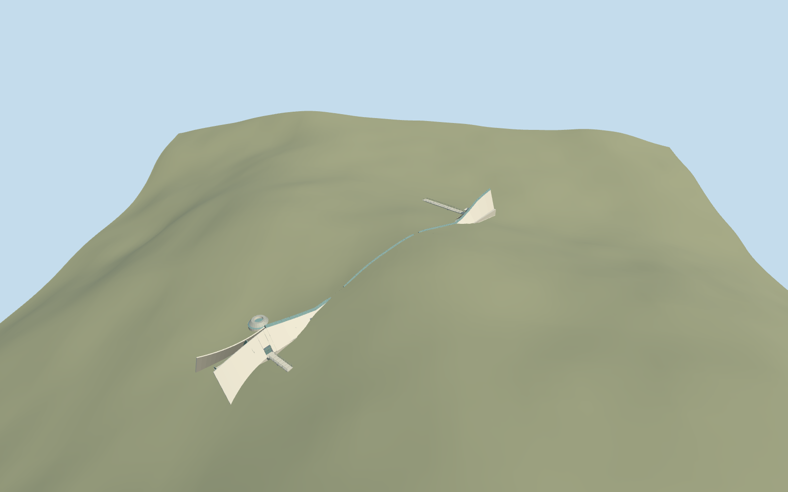

# Holocaust History Museum, Yad Vashem

The Holocaust History Museum preserves its triangular concrete spine, photographed side entrance, west overlook and flared wings, two mapped access bridges and the circular Hall of Names roof light. The glass ridge clears the buried central stretch and breaks at the native road and footpath. The model covers the exterior and controls the transition to the standard terrain.

## Evidence and reconstruction

Published dimensions and reconstructed details are separated in spec.json. Primary references:

- [Reference](https://commons.wikimedia.org/wiki/File:Yad_Vashem_View.jpg)
- [Reference](https://commons.wikimedia.org/wiki/File:ExteriorHolocaustHistoryMuseumYadVashemMar112023_08.jpg)
- [Reference](https://commons.wikimedia.org/wiki/File:Yad_Vashem_entrance.jpg)

The Holocaust History Museum preserves its triangular concrete spine, photographed side entrance, west overlook and flared wings, two mapped access bridges and the circular Hall of Names roof light. The glass ridge clears the buried central stretch and breaks at the native road and footpath. The model covers the exterior and controls the transition to the standard terrain.

## Model and axes

5,570 triangles; 15,250 vertices; 5 material groups; 619,264 bytes. Native bounds: -92.131, -10.540, -67.767 to 97.792, 14.379, 61.321. Source hash: `sha256:17ef0404269e92eb41766ee19eaa5d1bd187068914be80aa62ba86610e7d4c6e`.

{"x":"east","y":"up","z":"south"}

The geographic proposal uses exact-QID OpenStreetMap evidence. Map-derived orientation and estimated architectural details require real-site visual review; preview eligibility is distinct from geographic/fidelity approval. Map attribution: © OpenStreetMap contributors, ODbL-1.0.

## Reproduce

Run `node packages/worldgen/scripts/generate-additional-landmarks.mjs --ids=holocaust_history_museum_yad_vashem` (or add `--check`). The generator preserves manually edited masters by checking their baseline hashes. Import through the standard authored-model workflow with optimization disabled; then capture all QA cameras, including shared-surface views.

## Pending work

- The central ridge and access grades follow the coarse standard terrain. The count of west stairs, exact roof grades, local retaining landscape and rail dimensions are reconstructed from photographs.
- The integrated Hall of Names roof position and rim profile are approximate. Underground rooms, exhibitions and the visitor route inside the museum remain outside the exterior scope.

This bundle follows the medium-fi standard. Medium-fi appearance and geographic fit are reviewed separately. Hash-bound visual acceptance is recorded separately after capture inspection.
