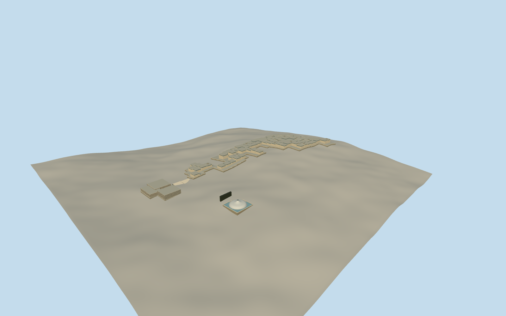

# Israel Museum

The Israel Museum’s terraced Jerusalem stone galleries, glazed circulation pavilions, and the white Shrine of the Book above its square pool and black basalt wall.

Authoring state: **review-in-qa.json**. Current completion evidence is in [qa.json](qa.json) and the [completion ledger](../../../../qualla-structures/batches/qualla-003.PROGRESS.md).

- [Israel Museum](https://qualla.com/israel-museum/)

The native contours and three mapped pavilion heights fix the campus layout. Gallery-by-gallery roof schedules, sections, surface transitions and smaller terraces are estimated from the recorded modular design.

The model includes the standing gallery and visitor buildings and the Shrine of the Book above ground. The Jerusalem maquette, artworks, interiors and museum annexes are outside the scope.

The Shrine’s exterior profile uses the photographer’s verified CC0 original. The wall dimensions recorded by Kiesler include the portion beside the sunken court. Its above-terrace height, wall orientation and any local terrain contact are estimates.

Build: `node content/worldgen/source/places/sv/sv9/israel_museum/models/generate-israel-museum.mjs`. Add `--check` to verify exact regeneration. 14489 triangles; 6 materials; no embedded photographs.
