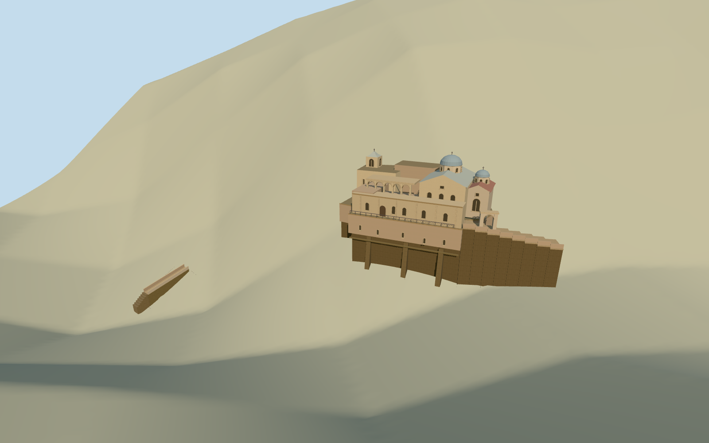

# Monastery of Saint George of Choziba

Saint George’s three-level limestone monastery, domed chapels, cliff ledge and stone footbridge in Wadi Qelt.

Authoring state: **review-in-qa.json**. Current completion evidence is in [qa.json](qa.json) and the [completion ledger](../../../../qualla-structures/batches/qualla-004.PROGRESS.md).

- [Monastery of Saint George of Choziba](https://qualla.com/monastery-of-saint-george-of-choziba/)

Draft exterior: approximate photographic proportions and simplified ornament. It is not a survey, photogrammetric reconstruction or approved current geographic replacement.

The two post-rebuilding illustrations and the Patriarchate confirm the ordered levels, domes and cliffside construction. Model heights follow image proportions relative to the measured plan.

Terrain sampling/contact, geographic alignment and site activation remain pending. Runtime LODs are produced by the registered after-import pipeline and require visual review.

Reference photos remain in the local Qualla corpus; only provenance, paths and hashes are retained here.

Build: `node content/worldgen/source/places/sv/sv9/monastery_of_saint_george_of_choziba/models/generate-monastery-of-saint-george-of-choziba.mjs`. Add `--check` to verify exact regeneration. 5139 triangles; 8 materials; no embedded photographs.
