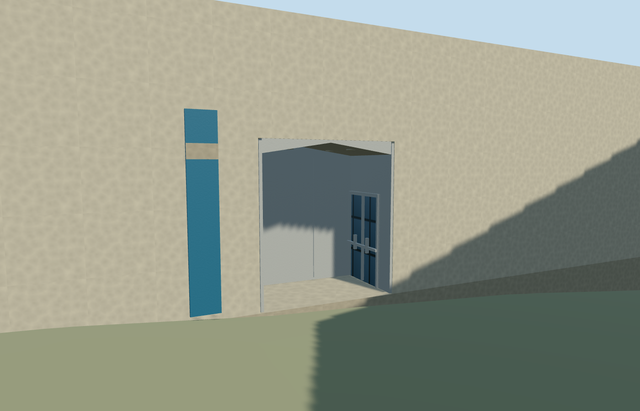

# museum_of_holocaust_art_yad_vashem — Museum of Holocaust Art, Yad Vashem

Reviewed 2026-10-22. **Authored and imported exterior draft. Native terrain fit rejected; placement inactive and member incomplete.**

## Built and inspected

Authored the independent mapped Museum of Holocaust Art gallery: long narrow near-blank concrete envelope, genuine rectangular courtyard portal, deep metal-lined vestibule, folded closed soffit and inset glazed side doors, pale flat roof/parapet and plain blue wayfinding cue. Three labelled ordinary exterior photographs on the museum's own page and the previously viewed campus aerial guided this author/inspect/fix pass. Closed the initially unsealed folded ceiling edges before the final captures. The independently mapped Exhibition Pavilion, Square of Hope paving/gardens and other campus members remain outside this asset. No copied artwork, text, photographs or inscriptions.

## Shared surfaces and browser LODs

Four existing 256px graphs across six roles/five textured draws: concrete_plain for pale walls and flooring; metal_painted for the metal vestibule, door frames and plain blue banner; storefront for inset dark side-door glazing; gravel for the light flat roof. Painted metal is a stylistic substitute for the photographed satin/brushed lining, and the hidden roof finish is unverified. No new graph, private atlas or embedded image. Each requested graph reads once, and unload releases all model geometry.

| Level | Triangles | Bytes | Draws |
| --- | ---: | ---: | ---: |
| skyline | 130 | 12968 | 1 |
| district | 214 | 25024 | 5 |
| street | 262 | 29488 | 5 |
| closeup | 334 | 35692 | 5 |

Four distinct authored LODs preserve the mapped envelope and actual portal recess. Initial skyline plus district geometry is 37,992 bytes; final per-level counts and bytes are in the table. One skyline draw/five textured draws. Separate POSITION/NORMAL buffer views and matching CPU/GPU bytes. Six GLBs have zero Khronos errors/warnings; 114 actual mesh/contact probes; 47 current inspected source/shared/medium-fi/native views, including the corrected ceiling. Physical phone/tablet/laptop and dense-city timings remain pending.

## Geographic placement — pending

Native terrain fit rejected; placement remains inactive draft. Shared campus Q156591 and distinct way74078306/native35184446167138 identify this member. Its mapped narrow footprint fixes the signed south-southeast long axis and southwest courtyard face. A named map point and labelled official photos guide the approximate portal position, not a surveyed doorway. Three actual PMTiles13/14/15 overlap cases pass. Replacement retains all152 independent resident/all256 wider records, including History Museum, Hall of Remembrance and Visitors Centre. Original201x201/6m hill, roads and zero-water-area input remain unchanged. Only the occupied mapped gallery floor cuts terrain; the outside courtyard approach and uncovered control retain original ground. Failure keeps153 originals; every LOD unload restores ground/water and zero live geometry. ModelWorldY is approximately0. However, the coarse boundary ground spans -3.74 to+0.81m relative to the control. The protective downhill foundation is too exposed, and the sloping outside ground does not reproduce the excavated level Square of Hope or photographed threshold. Independent neighbouring shells also obscure part of the broad front view; the dedicated entry and rear views cover the model itself. Do not count it complete or activate the proposal.

## Fidelity and limits

Reviewed source exterior as a medium-fi reconstruction; geographic completion pending. No mapped height exists: the6.8m gallery wall,4.2m portal,3.8m entry width,2.32m recess,2.6m side door, ceiling folds, parapet, fixtures and banner dimensions are picture-led estimates. The underground gallery arrangement, hidden rear/roof, planted upper terraces and exact approach/accessibility levels are unverified. Shared gravel approximates the hidden roof; painted metal approximates the vestibule lining. The deep foundation accommodates coarse terrain and is not a verified architectural basement. Shared site QID retained; no invented member QID. No furnished galleries, copied artwork/text/poster, independent courtyard/landscape/buildings, precinct flattening or bespoke terrain research. Hall of Remembrance stays ready; History Museum, Visitors Centre and this Art Museum stay inactive fit drafts.

## Targeted checks

Six GLBs, zero Khronos errors/warnings; 114 mesh/contact probes; three actual map-overlap cases; 47 inspected frames. Selected generation/import/draft placement, strict medium-fi, scene/sim30 and lint checks pass. Sim30 sha256:25f8fdbee5447ade7c29baf7f82ce325955dee56b2a992326676b16838de78a1. Pins: [qa.json](qa.json). Editable controls: [map-frame.json](map-frame.json). Native fit remains rejected.

## Completion checklist

- [x] Reproducible source/import, four authored LODs and existing shared material bindings.
- [x] Current source/shared/LOD/native images, geometry and lifecycle reviewed in this authoring pass.
- [ ] Resolve native foundation, courtyard approach and threshold fit; inspect before activation.
- [ ] Complete all ten Yad Vashem members; currently only Hall of Remembrance is ready.

## Viewed references

- https://www.yadvashem.org/museum/art/about.html — Yad Vashem; photographer uncredited; undated; Copyright Yad Vashem; viewed only, no copied pixels. Viewed only; no copied pixels.

- https://www.yadvashem.org/museum/art/about.html — Yad Vashem; photographer uncredited; undated; Copyright Yad Vashem; viewed only, no copied pixels. Viewed only; no copied pixels.

- https://www.yadvashem.org/museum/art/about.html — Yad Vashem; photographer uncredited; undated; Copyright Yad Vashem; viewed only, no copied pixels. Viewed only; no copied pixels.

- https://commons.wikimedia.org/wiki/File:Yad_Vashem_View.jpg — Andrew Shiva / Wikipedia (Godot13); 2013-11-15; CC-BY-SA-4.0; attribution-only permission also stated. Viewed only; no copied pixels.

- https://www.openstreetmap.org/way/74078306 — distinct mapped Art Museum gallery footprint. ©OpenStreetMap contributors, ODbL1.0.

- https://www.yadvashem.org/museum/art/about.html — labelled official entry and Square of Hope photos; shared site identity retained.
