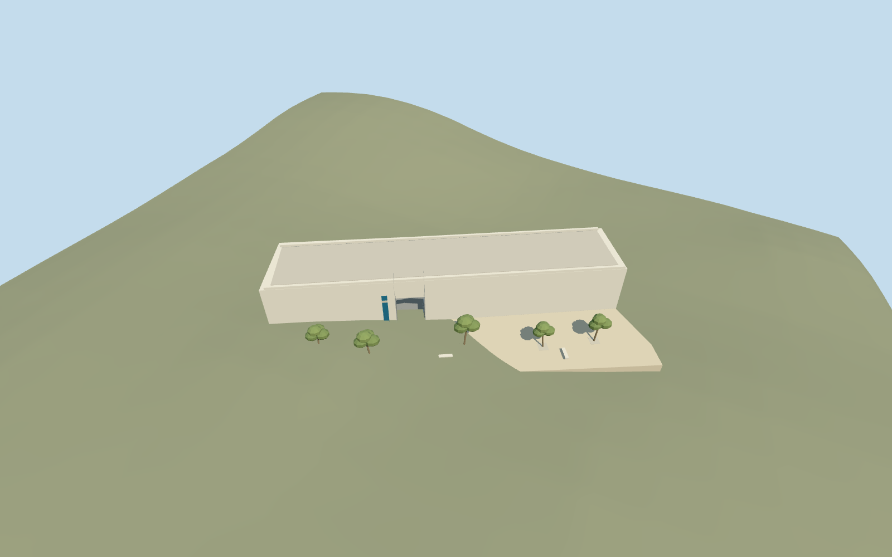

# Museum of Holocaust Art, Yad Vashem

Museum of Holocaust Art gallery and its part of the open Square of Hope. The long concrete elevation, recessed entry and metal-lined vestibule face the courtyard.

## Evidence and reconstruction

Published dimensions and reconstructed details are separated in spec.json. Primary references:

- [Reference](https://www.yadvashem.org/museum/art/about.html)
- [Reference](https://commons.wikimedia.org/wiki/File:Yad_Vashem_View.jpg)

Museum of Holocaust Art gallery and its part of the open Square of Hope. The long concrete elevation, recessed entry and metal-lined vestibule face the courtyard.

## Model and axes

2,398 triangles; 6,986 vertices; 8 material groups; 284,952 bytes. Native bounds: -22.751, -3.498, -22.401 to 15.040, 7.210, 29.048. Source hash: `sha256:30fb0c9a0fe500662c3c278c4b81da83b96657976022e36531862deb0d8e78df`.

{"x":"east","y":"up","z":"south"}

The geographic proposal uses exact-QID OpenStreetMap evidence. Map-derived orientation and estimated architectural details require real-site visual review; preview eligibility is distinct from geographic/fidelity approval. Map attribution: © OpenStreetMap contributors, ODbL-1.0.

## Reproduce

Run `node packages/worldgen/scripts/generate-additional-landmarks.mjs --ids=museum_of_holocaust_art_yad_vashem` (or add `--check`). The generator preserves manually edited masters by checking their baseline hashes. Import through the standard authored-model workflow with optimization disabled; then capture all QA cameras, including shared-surface views.

## Pending work

- The court and visual threshold elevations are fitted to the standard terrain and photographs. Exact threshold levels, planting and transitions beyond the local square remain approximate.
- The detached terrace architecture and interiors remain outside this model.

This bundle follows the medium-fi standard. Medium-fi appearance and geographic fit are reviewed separately. Hash-bound visual acceptance is recorded separately after capture inspection.
