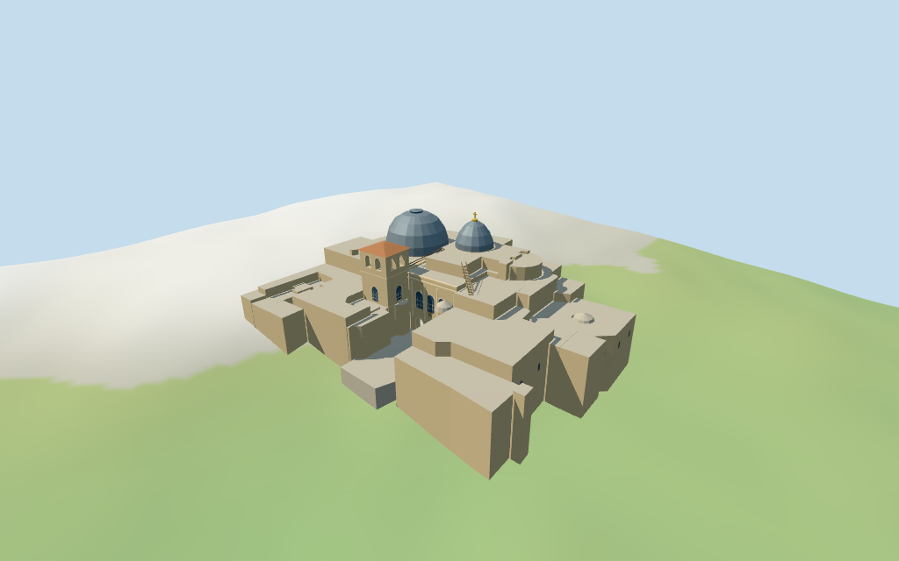

# Church of the Holy Sepulchre

Individual connected church exterior with unequal mapped Rotunda/Catholicon domes, upper crown/cross, square paired-arch bell tower/red hip, two-level arched south facade, open entrance court, stepped mapped ranges, small chapel cupolas and roof terraces/stairs.

## Evidence and reconstruction

Published dimensions and reconstructed details are separated in spec.json. Primary references:

- [Reference](https://image-database.nes.lsa.umich.edu/items/show/222)
- [Reference](https://commons.wikimedia.org/wiki/File:Church_of_the_Holy_Sepulchre_by_Gerd_Eichmann_(cropped).jpg)

Three existing shared256-square graphs supply weathered limestone, gray standing-seam metal and red tile, with linear tints and metric UVs. Glass, small wood rails/ladder and gold cross use vertex colors; no unique facade bitmap or embedded image.

## Model and axes

6,194 triangles; 18,582 vertices; 8 material groups; 747,800 bytes. Native bounds: -54.125, -9.839, -36.729 to 50.957, 36.750, 46.779. Source hash: `sha256:020fe19046fdc746e46bcad19c3b2e7c37f419373cd6e60d9519de7ba99a003e`.

{"x":"east along the two principal domes","y":"up","z":"south toward entrance court"}

Two inspected roof/facade pictures and standard viewer PMTiles/DEM guide the church exterior. Mapped principal height intervals are preserved; untagged roles/roofs, details and ground joins are approximations. Interior/below-grade volumes, separate east police range, city and vegetation remain outside this asset. © OpenStreetMap contributors, ODbL-1.0.

## Reproduce

Run `node packages/worldgen/scripts/generate-additional-landmarks.mjs --ids=N0326` (or add `--check`). The generator preserves manually edited masters by checking their baseline hashes. Import through the standard authored-model workflow with optimization disabled; then capture all QA cameras, including shared-surface views.

## Pending work

- Exact-QID outline/current main and selected exterior part polygons control fit. Mapped principal height intervals are preserved; component roles, untagged range/terrace heights, cupola curves, roof stairs, doors, windows, rails and ladder are picture-led approximations.
- NativeY0 follows coarse standardDEM770.4363m. The estimated0.75m church/court plane, retaining foundations, terraces and stairs must bridge coarse sloping ground; precise street/church levels and joins are unverified. No surveyed or certified walking collision.
- Skyline preserves main compound, unequal domes, square bell/red cap, small front cupola and court, using dark surface belfry panes. District restores lower parts and open belfry arches; street/closeup add recessed front/visible bell panes, sparse inferred secondary surface windows, arch bands, eaves, joined roof stairs and a simplified ladder/cross. Full interiors, Aedicule/chapels, underground StHelena volume, exact sculpture/lettering and separate east police range are excluded.
- The two references show different roof conditions; gray metal principal domes and red bell tile follow the newer view, with simplified low-frequency shared surfaces. Surrounding city, visitors and vegetation remain host content. Physical laptop/phone measurements remain pending.

This bundle follows the medium-fi standard. Medium-fi appearance and geographic fit are reviewed separately. Hash-bound visual acceptance is recorded separately after capture inspection.

## Additional geographic data

© OpenStreetMap contributors; Protomaps; Mapzen/USGS terrain tiles.
