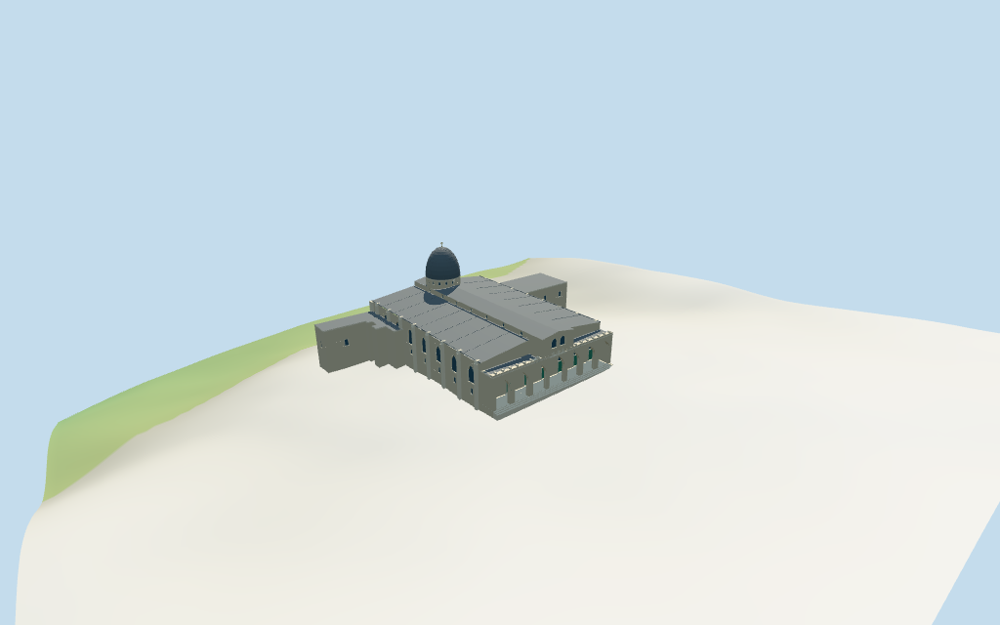

# N0413 — Al-Aqsa Mosque: Al-Qibli prayer hall

Reviewed2026-10-16 against current model bytes. Accepted for the stated medium-fi exterior and approximate horizontal fit. Nominal heights,fine profiles,current finish and exact site joins retain explicit limits.

## Built exterior

Inspected all11 current portable views,including the1024×640 summary. Individual southern Al-Qibli prayer hall:seven genuinely open pointed porch arches,closed green panel doors/pointed fanlights behind them,raised nave and lead-grey sloping roofs,ribbed silver dome/low drum/finial,sparse crenels,buttresses,lancets/oculi and lower attached wings. Recessed fields include simplified door studs and fanlight bars. Corrected clerestory fields hidden by aisle roofs and a southern oculus blocked by the nave mass. Fine architecture,lower-wing profiles and exact ground joins remain approximate.

## Shared surfaces and browser levels

Inspected all11 current shared/geographic views. Five existing256² limestone,raw limestone,standing-seam metal,plain wood and bronze graphs;six merged groups including local blue-grey glazing. Wood abstracts green door panels and metal abstracts lead cladding. Linear tints,metric UVs and flat architectural normals;zero embedded images,new facade bitmaps,baked light or invented lettering. Graphs read once;unload leaves zero live model geometries. Geographic captures use flat terrain;portable/medium-fi retain the standard DEM. Ground contact is not newly surveyed by these images.

| Level | Triangles | Bytes | Draws |
| --- | ---: | ---: | ---: |
| skyline | 850 | 59,096 | 1 |
| district | 2,554 | 227,252 | 6 |
| street | 7,062 | 685,288 | 6 |
| closeup | 13,745 | 1,369,720 | 6 |

Initial skyline plus district geometry: **286,348 bytes**. Master **2,012,264 bytes /16,737 triangles**;runtime **2,011,676 bytes**. Five shared256² graphs,six merged groups,zero embedded images. Shared graph definitions/runtime texture generation are additional.

Inspected all27 current medium-fi views:Economy/High,noon/late,three distances,silhouette,six details,four matched whole levels and four transitions. Skyline850 retains seven open arches,raised nave/sloping roofs,lower attached wings,silver dome/drum and finial. District2554 adds shared surfaces,green doors,sparse facade/clerestory/annex fields and larger buttresses/arch surrounds. Street7062 adds fuller recessed windows/oculi/fanlights,drum lights,portal relief,crenels and trim. Close-up13745/master16737 refine curves,door studs,fanlight bars and dome/roof ribs. The terrain fixture has a deep southern fall;below-floor masses are conservative footings. Synthetic neighborhood context and physical phone/laptop timing remain unverified.

## Geographic fit and limits

Retained way/280309331 /Q12192963 identifies the southern Al-Qibli main prayer hall,not the entire Al-Aqsa compound or the separate golden Dome of the Rock. Current standard PMTiles whole35184652398163 and dome part35184663933670 retain32 raw outline points/properties. Earlier exact-QID whole/multilingual tags/facts and current named POI retained. Anchor[35.235542683,31.776175889] and heading0.175752450172rad unchanged,no horizontal rescale. Native+X east-northeast toward the east side wall,+Z south-southeast toward the silver dome/southern retaining edge,−Z north-northwest toward the seven-arch entrance and open forecourt. Three inspected pictures resolve signed facing,approximate3° uncertainty. Four compound minarets,separate pavilions,Dome of the Rock,other compound/town buildings and public forecourt remain host content. Current whole height20m and dome part35m are nominal controls. Retained Wikidata37m height/55m width/80m length lack linked reference URLs and are consistency hints,not surveyed dimensions. The mapped whole includes attached lower west/east wings;the derived main hall is approximately55×81m. Estimated above-floor partitions:side walls14m/sloping lead roofs14.4–16.8m,raised central nave18.8m/eave and20m ridge;north seven-arch porch11.6m roof/12.4m parapet;dome drum20–23m and cap35m/finial37m. Lower attached wings8.5–10m are estimates;the whole20m tag does not survey each subsection. Open porch arches,door/window/oculus/portal/buttress/cornice/crenel/roof-rib details are picture-led approximations. Precise profiles,construction and current finish unverified. Standard viewer DEM datum734.068928m;whole perimeter-9.67 to2.75m relative to it. Floor3.198m uses the highest retained north-front sample plus0.45m,so the porch does not sit below the coarse forecourt samples. This declares an approximate raised attachment plane,not surveyed thresholds. Adaptive limestone footings crossY=0 and extend below retained samples;the south edge has a deep retained-terrain fall. The DEM is not used to infer exact historical retaining-wall courses,steps,street or courtyard paving. Exact contact,altitude,walking and site joins remain unverified. No terrain flattening,ground cutout or road replacement. All288 viewer-footprint checks cover the whole and dome controls and preserve46 separate mapped buildings at every source/runtime/LOD representation. Native+Z points to the south-southeast dome/retaining edge,−Z to the north-northwest entrance/forecourt,+X east-northeast. Approximate horizontal fit and the declared Y=0 anchor/raised floor convention accepted. Compound monuments,pavilions,minarets and city walls remain separate. No cutout,flattening or road replacement;exact thresholds,stairs,street/court/base contact,altitude and walking remain unverified.

## Verification

**49 current frames inspected;503 front-side geometry checks;288 viewer-footprint checks.** Six Khronos validations have zero errors/warnings/images. Targeted source byte reproduction,scene validation,30-tick simulation and current model/input/recipe/capture-image/report/material bindings pass. Graphs read once;unload leaves zero live geometries. Full source checkpoint remains N0410–N0427.

Source: `sha256:276f8b4e59ae982284ec1e0c1a3e81c93e4783469a38260d4a56faa6408f1b8e`

Runtime: `sha256:66a43c2cfb04758908aa4fc39d28e190de410dfa3ccb8c8259226c94e690451c`

Input: `sha256:9ef1969a3d3cd597e3ed574e30a7597cf39f8acad4175f49c4bac494446b3594`

Simulation: `sha256:cea0c59832632068b83645ebd3919b97d33e53cd5e2382e8d0b3dec463fd23b2`

Commands:targeted generate/import/LOD/register `--ids=N0413`;generation `--check`;portable reflections/antialias/fitted shadows;shared reflections/adaptive clipping/bounded placement;medium-fi reflections;scene validation and30-tick simulation. Bulk captures remain ignored.

## Inspected references

[Andrew Shiva /Wikipedia /Godot13 — 2013-11-15](https://commons.wikimedia.org/wiki/File:Jerusalem-Al-Quds-2013(2)-Aerial-Qibli_Mosque-_(cropped).jpg). CC-BY-SA-4.0. Inspected enlarged southern aerial of the prayer hall: broad ribbed silver-grey dome and finial near the south end,low round drum,raised long lead-grey central roof and sloping side roofs. Warm limestone south wall has buttresses,pointed windows and round upper openings above the older retaining wall. Northern forecourt is behind the roof. Adjacent city walls/excavations,trees,people and separate Dome of the Rock remain host content.

[Andrew Shiva /Wikipedia /Godot13 — 2013-11-14](https://commons.wikimedia.org/wiki/File:Jerusalem-2013-Temple_Mount-Al-Aqsa_Mosque_(NE_exposure).jpg). CC-BY-SA-4.0. Inspected enlarged northeast exterior: seven pointed front porch arches with taller decorated central portal,green doors under the covered porch,small upper relief/window fields and sparse crenellated parapet. Raised central nave facade has paired pointed lights;the long east wall has buttresses,large pointed recess/window fields and upper lancets. Grey lead roofs and silver dome sit behind. The nearby small domed pavilion,forecourt fixtures and town are separate.

[Andrew Shiva /Wikipedia /Godot13 — 2013-11-14](https://commons.wikimedia.org/wiki/File:Jerusalem-2013(2)-Temple_Mount-Al-Aqsa_Mosque,_portal_(north_exposure).jpg). CC-BY-SA-4.0. Inspected enlarged portal interior detail: green double panel door with studs below a pointed stone/lattice fanlight and pale limestone surround. Door panels and fanlight rhythm guide simplified shared-material fields. Fine lattice,carving,lettering,fixtures,carpets and the interior hanging lamp are not reproduced.

## Remaining scope

Individual medium-fi Al-Qibli prayer-hall exterior from three actually inspected Andrew Shiva2013 pictures plus standard viewer PMTiles/DEM. Exact way/280309331 /Q12192963,whole35184652398163 and dome part35184663933670 retain32 raw points/properties and the earlier whole/tags/facts/current same-ID multilingual POI. Whole20m and dome35m tags are nominal;unsourced Wikidata37m/55m/80m facts are consistency hints. Fine roof/drum/finial/portal/window/door/buttress/parapet shapes and lower-wing heights/facade bays are estimates or abstractions. The attached wings use their individual mapped outlines and simpler estimated window rhythm. Fine carving,masonry chronology,inscriptions,leaded artwork,engineering,interior furnishings,current restoration finish and hidden site joins remain excluded or unverified. The seven-arch porch is shallow modeled exterior space terminated by closed door/window fields;no modeled prayer-hall interior or free traversal claim. Separate Dome of the Rock,compound minarets,pavilions,forecourt fixtures,trees and city walls are excluded. The south-facing lower mass is a terrain footing,not an archaeological-wall reconstruction. No bespoke surveys or redistributed photographs;physical-device timing unverified.
