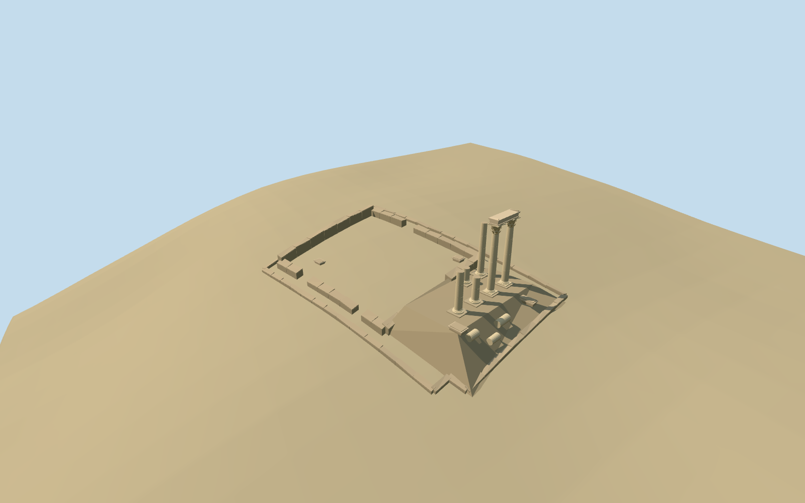

# N0557 — Temple of Hercules

Reviewed 2026-10-19 in one continuous author/build/inspect/fix round.

## Appearance

Inspected48 current source/shared/medium-fi/native/fallback views during this same construction pass. Specific Amman temple: two tall plain segmented shafts with original simplified Corinthian capitals/short joining lintel, four broken uncapped shafts at different heights, molded bases/local masonry feet, low interrupted cella/perimeter walls and earthen portico approach. Fallen drums and cornice fragments follow the actual authored mound. Fixed reversed wall faces, formerly level/floating caps, visible stone drum joints, solid chipped lintel ends and distant lintel underside before final inspection. No fluted shafts, complete temple roof/cella, restored missing column rows or copied inscriptions/sculpture atlas.

## Shared materials and browser levels

Three existing256-square graphs: stone_travertine for columns/lintel, stone_limestone_raw for wall/rubble/joints, stone_sandstone_raw for occupied earth. Each is read once, metric UVs/linear tints, zero embedded images. Master10878triangles/1307864bytes; levels700/3274/8702/10878triangles,74900/330520/792304/975100bytes, initial405420bytes, at most three runtime draws. Separate GPU streams and equal CPU/GPU accounting; unloading frees model geometry. Shared Corinthian helper remains unchanged; a model-specific adapter omits its fluted shaft and supplies plain segmented shafts.

| Level | Triangles | Bytes | Draws |
| --- | ---: | ---: | ---: |
| skyline | 700 | 74900 | 1 |
| district | 3274 | 330520 | 3 |
| street | 8702 | 792304 | 3 |
| closeup | 10878 | 975100 | 3 |

Inspected noon/late/economy/high context, silhouette, all four levels/transitions and three details. Skyline keeps six standing/broken shaft silhouettes, the open lintel underside, low ruin extent/mound and fallen fragments. District restores molded bases/Corinthian capital silhouette, street adds smooth drum joints, caps and leafy forms; close-up increases original capital/volute density. Flat shared stage at the anchor datum partly buries or exposes low grade-following wall feet; source/native/medium-fi terrain views establish intended contact. Synthetic surrounding buildings are comparison context. Three current graphs stay consistent through LOD upgrades.

## Approximate map fit

Exact-QID OSMway245144085/Q20423672 and named PMTilesbuilding/ruinsPOI35184617232917 fix approximately41.2x25.4m extent. Anchor35.934864492,31.953746126, heading0/native east-south; internal ENE axis-.254732188921rad. Northeast-photo caption/east-facing appearance and independent museum northwest support approximate signed facing. Individual shaft/cella-wall inventory and surviving-pair layout are picture-led, retaining roughly3m/20degree uncertainty. Only corresponding temple shell replaced with2cm tolerance/zero residual; all1156 independent resident records/museum/native6m hill terrain/paths and367.30036236997694m2 native water retained. Loaded1156/failure1157 original records; unloading restores surfaces/releases geometry. Separate hand-of-Hercules point about42m west, sculpture garden and other precinct structures remain independent. No broad precinct slab, ground/water cutout or terrain flattening.

## Limits

Accepted medium-fi standing temple exterior from three ordinary2009/2012/2013 photos and standard PMTiles/Mapzen, carried through one construction/inspection/fix pass. Exact column placement/heights, capitals, fractures, fallen-block/wall inventory and ancient phases are simplified picture/map estimates. Front occupied earthen fill and individual footings fit coarse terrain; the0.603292m datum-relative common base floor and several-meter surrounding DEM variation are visualization contact estimates, not surveyed mound/foundation or visitor-route engineering. Native ground remains visible through the ruined cella. Hand of Hercules, museum/Temenos/watchtower/sculpture garden and city are not claimed authored. Physical phone/laptop/dense-city timing remains pending.

## Selected checks

Six Khronos files: zero errors/warnings.298 actual mesh/contact probes; 48 current inspected views. Scene validation/sim30 and strict selected medium-fi audit pass. Source and runtime hashes/material bindings/LOD caps verified.

Rebuild: node packages/worldgen/scripts/generate-additional-landmarks.mjs --ids=N0557; node packages/worldgen/scripts/import-next-1000-models.mjs --ids=N0557; node packages/tooling/scripts/generate-landmark-lods.mjs --ids=N0557 --force.

Source: sha256:4acc2168dcfb7a674736ffd9fff56e15e86936f4802c87ea51eda50e5072a04a

Runtime: sha256:be748bb14cf4d7cec010c41b432e58d73e9433ed229add5f5e3d59e8682e8168

Input: sha256:ef1f57d2dbff586822fde88ebfda11a6fad0d4694c15e8c1570749f2b1a3b959

## Viewed ordinary pictures

https://commons.wikimedia.org/wiki/File:13_Amman_Citadel_(6)_(13252228624).jpg — xorge; CC-BY-SA-2.0. Viewed only; no pixels copied.

https://commons.wikimedia.org/wiki/File:Temple_of_Hercules.JPG — Kristiantos; CC-BY-SA-3.0. Viewed only; no pixels copied.

https://commons.wikimedia.org/wiki/File:Ruins_of_the_temple_of_Hercules_in_Amman,_Jordan.jpg — High Contrast; CC-BY-3.0-DE. Viewed only; no pixels copied.
