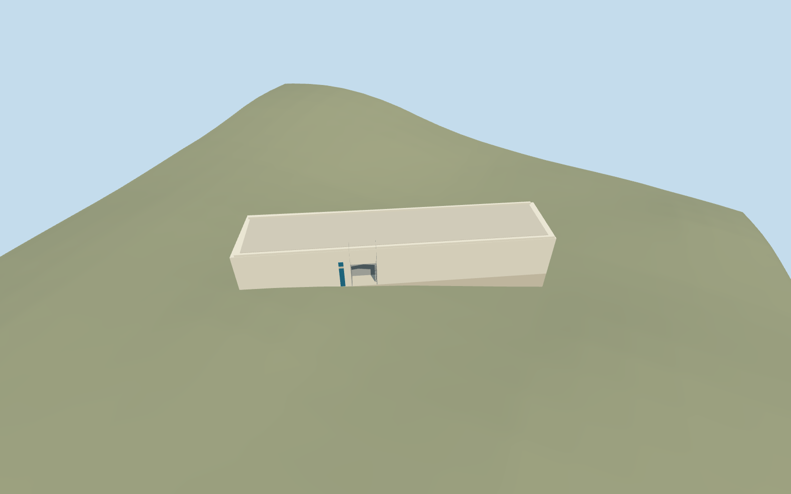

# Museum of Holocaust Art, Yad Vashem

Museum of Holocaust Art, Yad Vashem: distinct mapped long narrow concrete gallery, nearly blank courtyard elevation, deep rectangular entry and metal-lined vestibule with a recessed side door, pale roof slab/parapet and a plain blue wayfinding banner. The entry remains a real recess at all four LODs. Keep the independently mapped Exhibition Pavilion, Square of Hope courtyard, gardens, other campus buildings and underground museum rooms outside this asset.

## Evidence and reconstruction

Published dimensions and reconstructed details are separated in spec.json. Primary references:

- [Reference](https://www.yadvashem.org/museum/art/about.html)
- [Reference](https://commons.wikimedia.org/wiki/File:Yad_Vashem_View.jpg)

Museum of Holocaust Art, Yad Vashem: distinct mapped long narrow concrete gallery, nearly blank courtyard elevation, deep rectangular entry and metal-lined vestibule with a recessed side door, pale roof slab/parapet and a plain blue wayfinding banner. The entry remains a real recess at all four LODs. Keep the independently mapped Exhibition Pavilion, Square of Hope courtyard, gardens, other campus buildings and underground museum rooms outside this asset.

## Model and axes

334 triangles; 906 vertices; 5 material groups; 40,008 bytes. Native bounds: -15.420, -3.935, -22.401 to 15.040, 7.210, 22.528. Source hash: `sha256:0ff3d04fd8bb0ad059a75b5b9f4f4008a24698018add06b51f9507efb028df2f`.

{"x":"east","y":"up","z":"south"}

The geographic proposal uses exact-QID OpenStreetMap evidence. Map-derived orientation and estimated architectural details require real-site visual review; preview eligibility is distinct from geographic/fidelity approval. Map attribution: © OpenStreetMap contributors, ODbL-1.0.

## Reproduce

Run `node packages/worldgen/scripts/generate-additional-landmarks.mjs --ids=N0748_ART` (or add `--check`). The generator preserves manually edited masters by checking their baseline hashes. Import through the standard authored-model workflow with optimization disabled; then capture all QA cameras, including shared-surface views.

## Pending work

- Museum of Holocaust Art, Yad Vashem: distinct mapped long narrow concrete gallery, nearly blank courtyard elevation, deep rectangular entry and metal-lined vestibule with a recessed side door, pale roof slab/parapet and a plain blue wayfinding banner. The entry remains a real recess at all four LODs. Keep the independently mapped Exhibition Pavilion, Square of Hope courtyard, gardens, other campus buildings and underground museum rooms outside this asset.
- Shared campus Q156591 with independent way74078306/native35184446167138. The named map POI lies beside the southwest long face; the museum's own labelled entry and Square of Hope photos identify that face and the deeply recessed portal. The ordinary campus aerial confirms the narrow gallery along the courtyard. Internal +X follows the mapped long axis south-southeast; +Z faces west-southwest into the courtyard. Heading0 bakes these signed axes into world east/south. Portal location at internalX -5.1m is an approximation guided by the named map point, not a surveyed entrance. No independent member Wikidata ID is asserted.
- No map height exists. Picture-led working courtyard wall/roof height6.8m, portal4.2m tall and3.8m wide/depth2.32m, recessed side doors2.6m tall, parapet0.35m. Hidden rear/roof and underground galleries are not verified. The roof uses a light shared gravel substitute; planted upper terraces, irrigation, roof gardens and actual roof services are not reconstructed. Banner is a plain colour cue without copied art, text or inscriptions.
- Use the original Protomaps20261020/Mapzen201x201/6m hill, with no custom terrain. Uncovered courtyard attachment internal[-5.1,7.2], datum804.8569433196519m, floor0.06m above it. Original outside ground and entry approach stay intact; only occupied gallery floor is cut and sealed. The footprint-limited protective foundation covers the lowest original boundary sample. Coarse hillside levels are not the real excavated, flat Square of Hope: review the approach, portal and exposed foundation before activation. Do not flatten the independent courtyard or claim surveyed thresholds.

This bundle follows the medium-fi standard. Medium-fi appearance and geographic fit are reviewed separately. Hash-bound visual acceptance is recorded separately after capture inspection.
