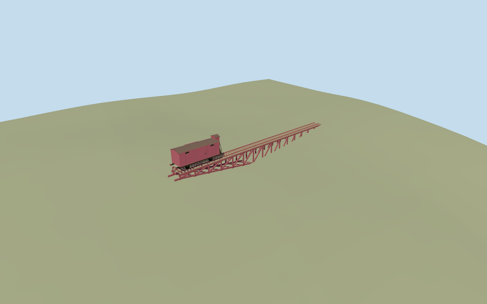

# Cattle Car Memorial to the Deportees, Yad Vashem

Cattle Car Memorial to the Deportees, Yad Vashem: independent red-brown two-axle wooden wagon on the mapped truncated railway, with shallow barrel roof, closed sliding doors, recessed upper side vents, metal ribs/chassis, buffers/coupler and the distinctive raised end brake cabin with three inset windows, side access steps and handrails. A tapered steel cantilever truss, cross bracing, ties and rails continue toward the higher land end. No copied lettering, car interior, visitors, forest, plaques or independent campus structures.

## Evidence and reconstruction

Published dimensions and reconstructed details are separated in spec.json. Primary references:

- [Reference](https://commons.wikimedia.org/wiki/File:Yad_Vashem_Israel_Memorial_Deportees.jpg)
- [Reference](https://commons.wikimedia.org/wiki/File:Yad_Vashem_Holocaust_Memorial_Cattle_Car_(43274171421).jpg)

Cattle Car Memorial to the Deportees, Yad Vashem: independent red-brown two-axle wooden wagon on the mapped truncated railway, with shallow barrel roof, closed sliding doors, recessed upper side vents, metal ribs/chassis, buffers/coupler and the distinctive raised end brake cabin with three inset windows, side access steps and handrails. A tapered steel cantilever truss, cross bracing, ties and rails continue toward the higher land end. No copied lettering, car interior, visitors, forest, plaques or independent campus structures.

## Model and axes

6,780 triangles; 15,716 vertices; 5 material groups; 650,560 bytes. Native bounds: -5.453, -7.870, -9.752 to 41.230, 4.690, 3.213. Source hash: `sha256:1fd0d261f1d357ce949b6e965da02038466a9a39f72a26014a28930803d28387`.

{"x":"east","y":"up","z":"south"}

The geographic proposal uses exact-QID OpenStreetMap evidence. Map-derived orientation and estimated architectural details require real-site visual review; preview eligibility is distinct from geographic/fidelity approval. Map attribution: © OpenStreetMap contributors, ODbL-1.0.

## Reproduce

Run `node packages/worldgen/scripts/generate-additional-landmarks.mjs --ids=N0748_CATTLECAR` (or add `--check`). The generator preserves manually edited masters by checking their baseline hashes. Import through the standard authored-model workflow with optimization disabled; then capture all QA cameras, including shared-surface views.

## Pending work

- Cattle Car Memorial to the Deportees, Yad Vashem: independent red-brown two-axle wooden wagon on the mapped truncated railway, with shallow barrel roof, closed sliding doors, recessed upper side vents, metal ribs/chassis, buffers/coupler and the distinctive raised end brake cabin with three inset windows, side access steps and handrails. A tapered steel cantilever truss, cross bracing, ties and rails continue toward the higher land end. No copied lettering, car interior, visitors, forest, plaques or independent campus structures.
- Shared campus Q156591 plus distinct named node5477091205/native17597663135621. Mapped disused rail ways1435803658/1435803659 (native35185807892490/491) fix the east-northeast long axis and real rail endpoints; the western end terminates by the wagon. The side and brake-cabin photographs fix the wagon/cantilever relationship and land-facing brake cabin at+X. Node is an approximate wagon location; rail center is offset0.8239509538657814m in internal+Z. Photo GPS can be displaced (the Gary Todd metadata points elsewhere on campus); named PMTiles node/rail geometry controls placement, not that GPS.
- Map supplies a point and two rail segments, no wagon/truss heights. Body8.6m long/2.68m wide, floor1.14m above rail, barrel crest3.96m above rail, raised brake cabin4.65m, two axles/four wheels of0.43m radius and working1.435m gauge are picture-led visualization estimates. Truss depth tapers0.65..7.2m over the mapped45m approach. Exact wagon class, dimensions, axle spacing, truss/panel/step/rivet inventory, hidden underside, cabin interior and memorial inscriptions are unverified. Existing painted metal approximates weathered/rusted steel; no private patina texture.
- Use original Protomaps20261020/Mapzen201x201/6m hill. Uncovered higher-land control internal[44.45803999180143,4.323950953865781] has datum797.6488511081272m; rail head is0.35m above original sampled grade at the mapped land end (modelY0.020151626910410392). Keep original ground under the elevated wagon/track and let the reconstructed truss root enter the retained bank; no ground/building cutout and no owned building. No raised terrain, invented pier or precinct flattening. Standard hill does not supply the exact excavated bank/cliff or track bed; inspect exposed truss, land attachment and approach before activation. Use the existing replaceRoads outline over the two authored disused rail ways, including their shared connected approach. After successful model loading only, suppress the covered bridge/rail visual; failed loading keeps it. Preserve original input data and every unrelated road/path. No terrain cutout or height modification. Corrected native whole/side/cabin/under-truss views inspected during this authoring pass. Approximate exterior fit accepted: the truncated western end stays elevated, open trusses enter the retained bank toward higher land, and the far rail end meets native grade at the working0.35m lift. Existing replaceRoads removes the duplicate procedural bridge/connected rail approach only after load. Original terrain, unrelated roads/paths and buildings remain intact. The coarse hill partly buries the deeper landward truss; exact historical cliff, bank excavation, pedestrian clearance and track-bed engineering are unverified.

This bundle follows the medium-fi standard. Medium-fi appearance and geographic fit are reviewed separately. Hash-bound visual acceptance is recorded separately after capture inspection.
