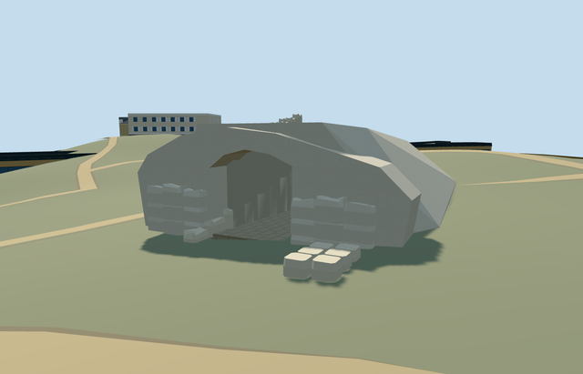

# N0748_CHILDREN — Children's Memorial, Yad Vashem

Reviewed2026-10-22. **Completed medium-fi exterior with an approximate point-anchored native placement.**

## Built and inspected

Authored the exterior rock-cut portal, real clear sloping aisle, closed cave roof and finite rear, ascending hewn approach blocks, adjoining low stone support and twenty picture-led unfinished pillars. Two ordinary attributed photos and the existing named PMTiles point guided this continuous pass. Corrected an overly boxy surround with sloping rock shoulders, seated front blocks on retained grade, simplified their tops and aligned all LODs with the same shared surfaces. No mirrored candle chamber, recordings, portrait, copied inscriptions/dedication imagery or independent campus buildings.

## Shared surfaces and browser LODs

Two existing 256px shared graphs across four roles and two textured draws: stone_limestone_raw supplies continuous grain for the modeled rock/lining/pillars; stone_limestone supplies paving joints on the aisle. Pale rock, lining and pillar tints are shared stylistic approximations. No new graph, private atlas or embedded image. Skyline uses a baked mean-color palette. Every requested graph reads once and all model geometries are released on unload.

| Level | Triangles | Bytes | Draws |
| --- | ---: | ---: | ---: |
| skyline | 828 | 77688 | 1 |
| district | 908 | 79824 | 2 |
| street | 1900 | 161244 | 2 |
| closeup | 2748 | 227388 | 2 |

Four authored LODs: 828 / 908 / 1900 / 2748 triangles; 77688 / 79824 / 161244 / 227388 bytes. Initial skyline plus district geometry is157512 bytes. One skyline draw/two textured draws; separate POSITION/NORMAL streams and equal CPU/GPU accounting. Six GLBs have zero Khronos errors/warnings.282 actual mesh/contact probes and48 current source/shared/medium-fi/native frames were inspected. Phone/tablet/laptop and dense-city physical measurements remain pending.

## Geographic placement

Approximate native exterior fit accepted at shared campus Q156591 plus distinct named node13197000158/native17605383044574. The2019 photo camera lies about23m east of the named point; model+X faces east/forecourt, passage extends west, +Z is south. Facing has an explicit25-degree approximation. Two actual level15 POI records confirm the identity/anchor; no matching13/14 POI was present. No building is owned or replaced: all153 resident and257 wider independent buildings remain. Original201x201/6m hill, roads and zero-water-area input are retained. Only the narrow aisle cuts terrain and is sealed by an authored sloping floor/lining/roof. Outside hill, pillar-field ground and uncovered front control remain. Every LOD, failed loading and unloading restore ground/water with zero live model geometries; modelWorldY approximately0. Pillar roots contact the low support. The coarse path line touches that reconstructed support, so exact pedestrian clearance, walkability, threshold and accessibility remain unverified. No terrain flattening or bespoke survey data.

## Fidelity and limits

Completed as an exterior medium-fi point-anchored visualization, not a surveyed reconstruction. The map supplies a named point, no footprint/height/facing. Entrance dimensions, cave direction,20-pillar inventory/layout, broken heads, hidden roof/back, mound and stone support are picture-led approximations. The finite cave volume is an exterior proxy and omits the actual underground chamber. Commons category metadata links Q1188026 to a conflicting distant coordinate and Pavilion way245190611; that cached identity was not used to move this memorial or change the Pavilion. All other Yad Vashem models remain independent. History, Visitors Centre, Art Museum and Pavilion remain inactive fit drafts; North remains reference-pending.

## Targeted checks

Six GLBs, zero Khronos errors/warnings;282 mesh/contact probes;two actual level15 POI cases;48 inspected frames. Selected generation/import/placement, strict medium-fi, scene/sim30 and lint pass. Sim30 sha256:46788401045b8f6a4b9c8ade43cedcbd74c697a71eb51af96eb146ece94bc7de. Current pins: [qa.json](qa.json). Editable controls: [map-frame.json](map-frame.json).

## Completion checklist

- [x] Reproducible source/import, four authored LODs and existing shared surfaces.
- [x] Current geometry, source/shared/LOD/native images and loading lifecycle reviewed in this pass.
- [x] Distinct named point, approximate facing and exterior terrain contact reviewed.
- [ ] Complete the remaining eight Yad Vashem members; this memorial does not complete the campus.

## Viewed references

- https://commons.wikimedia.org/wiki/File:Children%27s_Memorial,_Yad_Vashem,_2019_(01).jpg — Bahnfrend; 2019-04-18 20:15:37; CC-BY-SA-4.0. Viewed only; no copied pixels.

- https://commons.wikimedia.org/wiki/File:Yad_Vashem-children%27s_monument.jpg — Joshuapaquin (Flickr); 2005-06-03; CC-BY-2.0. Viewed only; no copied pixels.

- https://www.openstreetmap.org/node/13197000158 — named independent memorial point. ©OpenStreetMap contributors, ODbL1.0.
