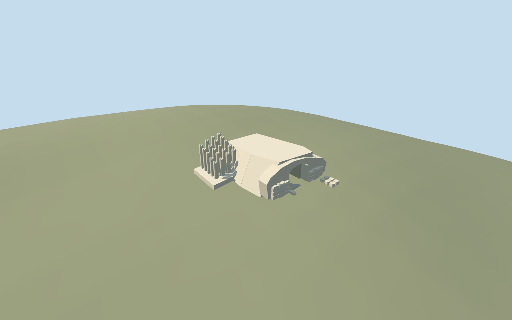

# Children's Memorial, Yad Vashem

Children's Memorial, Yad Vashem: exterior-only rock-cut entrance, low sloping stone-lined approach, hewn blocks rising toward a rough bedrock arch, closed cave roof and finite dark rear, adjoining fieldstone support and twenty picture-led unfinished square pillars with broken heads. Keep original ground around the pillar field and outside the entrance. No mirrored candle chamber, recordings, portrait, copied inscriptions/dedication imagery or independent campus buildings. Sloping outer rock shoulders blend to original sampled grade; small entry blocks seat on that same retained grade. Exterior mound and hidden back shape are picture-led approximations.

## Evidence and reconstruction

Published dimensions and reconstructed details are separated in spec.json. Primary references:

- [Reference](https://commons.wikimedia.org/wiki/File:Children%27s_Memorial,_Yad_Vashem,_2019_(01).jpg)
- [Reference](https://commons.wikimedia.org/wiki/File:Yad_Vashem-children%27s_monument.jpg)

Children's Memorial, Yad Vashem: exterior-only rock-cut entrance, low sloping stone-lined approach, hewn blocks rising toward a rough bedrock arch, closed cave roof and finite dark rear, adjoining fieldstone support and twenty picture-led unfinished square pillars with broken heads. Keep original ground around the pillar field and outside the entrance. No mirrored candle chamber, recordings, portrait, copied inscriptions/dedication imagery or independent campus buildings. Sloping outer rock shoulders blend to original sampled grade; small entry blocks seat on that same retained grade. Exterior mound and hidden back shape are picture-led approximations.

## Model and axes

2,748 triangles; 6,422 vertices; 2 material groups; 266,164 bytes. Native bounds: -10.500, -1.091, -6.200 to 8.710, 4.858, 8.500. Source hash: `sha256:15ad2737247728496166ae5d26fcec587418802d8bc6fec89b2b110428f041f7`.

{"x":"east","y":"up","z":"south"}

The geographic proposal uses exact-QID OpenStreetMap evidence. Map-derived orientation and estimated architectural details require real-site visual review; preview eligibility is distinct from geographic/fidelity approval. Map attribution: © OpenStreetMap contributors, ODbL-1.0.

## Reproduce

Run `node packages/worldgen/scripts/generate-additional-landmarks.mjs --ids=N0748_CHILDREN` (or add `--check`). The generator preserves manually edited masters by checking their baseline hashes. Import through the standard authored-model workflow with optimization disabled; then capture all QA cameras, including shared-surface views.

## Pending work

- Children's Memorial, Yad Vashem: exterior-only rock-cut entrance, low sloping stone-lined approach, hewn blocks rising toward a rough bedrock arch, closed cave roof and finite dark rear, adjoining fieldstone support and twenty picture-led unfinished square pillars with broken heads. Keep original ground around the pillar field and outside the entrance. No mirrored candle chamber, recordings, portrait, copied inscriptions/dedication imagery or independent campus buildings. Sloping outer rock shoulders blend to original sampled grade; small entry blocks seat on that same retained grade. Exterior mound and hidden back shape are picture-led approximations.
- Shared campus Q156591 plus named node13197000158/native17605383044574. The2019 entrance photo is explicitly labelled Children's Memorial and records its camera at31°46′29.1″N35°10′34.3″E, about23m east of the mapped memorial point. Heading0 puts the approach on model+X/east and underground passage toward-X/west, with+Z/south as the left side from that approach. Entrance, pillar-field offset and facing are approximate picture-led controls, not a surveyed plan. The Commons category links Q1188026 to a conflicting distant coordinate and way245190611; do not borrow that way or move this asset away from the named node.
- No measured footprint or height is supplied by the point. Working entrance arch about3.2m clear/high3.95m, aisle width2.8m and length11.5m, and pillar profile/spacing are estimated from the two ordinary photos. Twenty visible/reconstructed pillars use varied heights roughly2.4..4.7m on a low stone support. Layout, stone inventory, hidden roof/back, precise cave direction and threshold/accessibility are unverified. The finite roof/lining/rear is an exterior visualization proxy, not the full underground memorial chamber.
- Use the original Protomaps20261020/Mapzen201x201/6m hill. Uncovered forecourt control internal[6.2,0], datum806.5489990840487m; entrance floor0.06m above it, falling0.04m per metre into the passage. A narrow entrance-aisle opening is sealed by authored floor, side lining and rock roof. Keep original surrounding hill, uncovered forecourt and pillar-field terrain. The pillar support follows the original local grade; post roots seat into that support. No native building footprint is owned or removed, no broad ground slab, no custom terrain or precinct flattening. Inspect rock/hill and portal contact before activation. Corrected native entrance, pillar-field and whole-site views inspected in this authoring pass. Approximate exterior fit accepted: the aisle is unobstructed and sealed, front blocks seat on retained sampled grade, sloping rock shoulders meet original grade, and pillar roots contact their low support. Original hill, independent buildings and paths remain unchanged; the coarse path line touches the reconstructed pillar support, so exact path clearance, walkability and threshold/accessibility are unverified. The point supplies no dimensions or orientation. The cave roof, finite rear and mound are explicitly exterior proxies; the candle chamber is not modeled. Do not infer a surveyed site plan from this placement.

This bundle follows the medium-fi standard. Medium-fi appearance and geographic fit are reviewed separately. Hash-bound visual acceptance is recorded separately after capture inspection.
