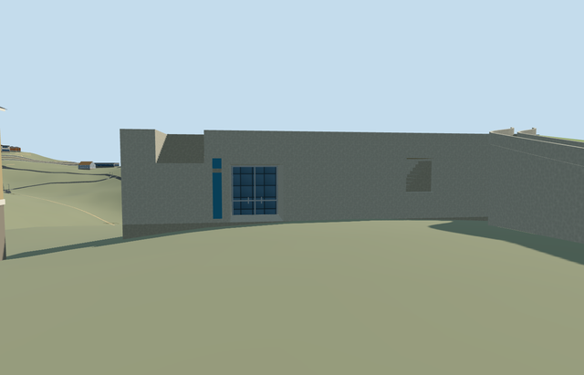

# N0748_EXHIBITIONS — Exhibition Pavilion, Yad Vashem

Reviewed 2026-10-22. **Authored and imported exterior draft. Native terrain fit rejected; placement inactive and member incomplete.**

## Built and inspected

Authored the distinct nine-corner Pavilion range as an open courtyard and occupied L-shaped exterior: near-blank end wall with a genuine deep portal, upper stair notch and smaller real stair-window aperture; curved rising external stair with two closed continuous concrete guards; low-frequency green planted roof and restrained blue wayfinding cue. The existing ordinary campus aerial was actually zoomed to full3840px detail, with the already reviewed official courtyard photo. Corrected the curve that initially hid the stair window, aligned continuous guard sweeps with tread stations, and lowered the final courtyard camera to inspect the entrance in this author/inspect/fix pass. Courtyard paving, trees, benches, the Art Museum and independent upper plaza remain outside this model. No copied pixels, artwork, text or inscriptions.

## Shared surfaces and browser LODs

Four existing256px graphs across six roles/five textured draws: concrete_plain for walls, floors and stairs; storefront for recessed opaque glazing; metal_painted for frames and the plain blue banner; green-tinted stucco as a shared low-frequency substitute for the planted roof. The planting treatment reproduces the broad green area without claiming botanical grass detail or introducing a private roof texture. No new graph, private atlas or embedded image. Each requested graph reads once; all model geometry is released on unload.

| Level | Triangles | Bytes | Draws |
| --- | ---: | ---: | ---: |
| skyline | 768 | 67100 | 1 |
| district | 1304 | 110036 | 5 |
| street | 1700 | 141732 | 5 |
| closeup | 2020 | 167232 | 5 |

Four distinct authored LODs:768/1304/1700/2020 triangles. Initial skyline plus district geometry is177136 bytes; close-up167232 bytes. One skyline draw/five textured draws. Separate POSITION/NORMAL buffer views and equal CPU/GPU accounting. Six GLBs have zero Khronos errors/warnings;180 actual mesh/contact probes;47 current inspected source/shared/medium-fi/native frames. The open court, portal and both stair apertures survive all levels; distance treads/guards simplify together. Physical phone/tablet/laptop and dense-city timings remain pending.

## Geographic placement — pending

Native terrain fit rejected; placement remains inactive draft. Shared campus Q156591 plus distinct way245190611/native35184617279443 fixes the independent mapped range. The ordinary pictures and official Pavilion page guide the courtyard-facing end, open court and curved planted stair assignment; internal+X follows the mapped southeast axis and the end-wall portal faces-X. Three actual PMTiles13/14/15 overlap cases pass. Replacement retains all152 independent resident/all256 wider records, including the four earlier Yad Vashem models. Original201x201/6m hill, roads and zero-water-area input remain unchanged. The mapped parent outline owns the building replacement, but only the occupied end and curved wing cut terrain. Open courtyard/anchor, original approach and uncovered attachment remain uncut. The floor sits1.4800885896520959m above the uncovered working control, sampled from the retained ground near the portal plus0.06m. Failure keeps153 originals; every LOD unload restores ground/water and zero live geometry. ModelWorldY is approximately0. The original hill still lacks the excavated level square and exact lower/upper stair landings: part of the lower approach/treads is embedded and footing exposure varies. Do not activate or count this member complete; no precinct flattening or custom terrain was used.

## Fidelity and limits

Source exterior reviewed as a medium-fi picture-led reconstruction; geographic completion pending. No mapped heights or internal plan exist. End wall6.8m, portal4.3m high/4m wide/3.8m recess, upper notch4.4..6.8m, window2.1..4.8m, stair rise about6.3m, curves, tread inventory, guard heights and roof planting extent are reconstructed estimates. Green stucco is an explicit broad vegetation substitute. Underlying nine-corner building geometry does not describe the courtyard void; the open volume comes from the actual photos. Hidden galleries, precise roof extent, threshold/accessibility levels, upper-plaza connection, escalator and underground circulation remain unverified. Keep the site QID rather than inventing a member QID. No exhibition interiors, copied imagery/art/text, independent courtyard objects/buildings or bespoke terrain research. Hall of Remembrance stays ready; History Museum, Visitors Centre, Art Museum and Pavilion remain inactive fit drafts.

## Targeted checks

Six GLBs, zero Khronos errors/warnings; 180 mesh/contact probes; three actual map-overlap cases; 47 inspected frames. Selected generation/import/draft placement, strict medium-fi, scene/sim30 and lint checks pass. Sim30 sha256:1a0198c758d5157c5e3f93ab5a9f5a7c1244ea2094d768e39e34f17b02d5d9f1. Pins: [qa.json](qa.json). Editable controls: [map-frame.json](map-frame.json). Native fit remains rejected.

## Completion checklist

- [x] Reproducible source/import, four authored LODs and existing shared material bindings.
- [x] Current source/shared/LOD/native images, geometry and lifecycle reviewed in this authoring pass.
- [ ] Resolve native lower stair, courtyard threshold and upper-landing fit; inspect before activation.
- [ ] Complete all ten Yad Vashem members; currently only Hall of Remembrance is ready.

## Viewed references

- https://commons.wikimedia.org/wiki/File:Yad_Vashem_View.jpg — Andrew Shiva / Wikipedia (Godot13); 2013-11-15; CC-BY-SA-4.0; attribution-only permission also stated. Viewed only; no copied pixels.

- https://www.yadvashem.org/museum/art/about.html — Yad Vashem; photographer uncredited; undated; Copyright Yad Vashem; viewed only, no copied pixels. Viewed only; no copied pixels.

- https://www.openstreetmap.org/way/245190611 — independent nine-corner mapped Pavilion range. ©OpenStreetMap contributors, ODbL1.0.

- https://www.yadvashem.org/museum/exhibitions-pavilion — Pavilion identity and its position between Art Museum and Book of Names; shared site identity retained.
