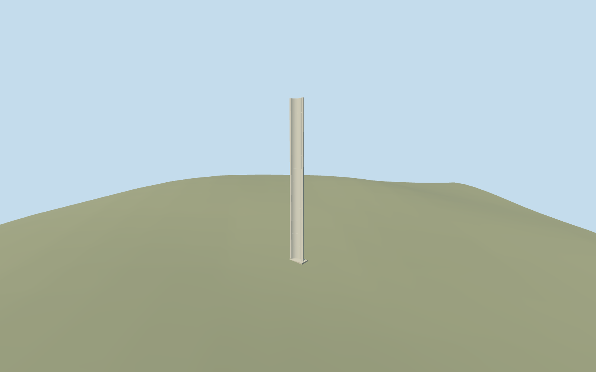

# Pillar of Heroism, Yad Vashem

Pillar of Heroism, Yad Vashem: tall independent curved C-section concrete memorial with an open concave face, closed thin curved top/side edges, pale inset concrete face, sparse horizontal facing joints at near levels and a small closed contact footing. Preserve its narrow silhouette and open cross-section at every LOD. No copied inscription, invented writing, broad plaza, surrounding truncated blocks, trees, benches or independent campus structures.

## Evidence and reconstruction

Published dimensions and reconstructed details are separated in spec.json. Primary references:

- [Reference](https://commons.wikimedia.org/wiki/File:Yad_Vashem_Pillar_of_Heroism.jpg)
- [Reference](https://commons.wikimedia.org/wiki/File:Pillar_of_Heroism_at_Yad_Vashem,_Israel.jpg)
- [Reference](https://commons.wikimedia.org/wiki/File:PikiWiki_Israel_12497_pillar_of_heroism_at_yad_vashem.jpg)

Pillar of Heroism, Yad Vashem: tall independent curved C-section concrete memorial with an open concave face, closed thin curved top/side edges, pale inset concrete face, sparse horizontal facing joints at near levels and a small closed contact footing. Preserve its narrow silhouette and open cross-section at every LOD. No copied inscription, invented writing, broad plaza, surrounding truncated blocks, trees, benches or independent campus structures.

## Model and axes

4,224 triangles; 10,532 vertices; 2 material groups; 431,860 bytes. Native bounds: -1.669, -0.220, -0.891 to 0.891, 21.180, 1.669. Source hash: `sha256:5e91c42f2da5ab15598061c5c475352a683828673fa879453b808ae7c26b8864`.

{"x":"east","y":"up","z":"south"}

The geographic proposal uses exact-QID OpenStreetMap evidence. Map-derived orientation and estimated architectural details require real-site visual review; preview eligibility is distinct from geographic/fidelity approval. Map attribution: © OpenStreetMap contributors, ODbL-1.0.

## Reproduce

Run `node packages/worldgen/scripts/generate-additional-landmarks.mjs --ids=N0748_HEROISM` (or add `--check`). The generator preserves manually edited masters by checking their baseline hashes. Import through the standard authored-model workflow with optimization disabled; then capture all QA cameras, including shared-surface views.

## Pending work

- Pillar of Heroism, Yad Vashem: tall independent curved C-section concrete memorial with an open concave face, closed thin curved top/side edges, pale inset concrete face, sparse horizontal facing joints at near levels and a small closed contact footing. Preserve its narrow silhouette and open cross-section at every LOD. No copied inscription, invented writing, broad plaza, surrounding truncated blocks, trees, benches or independent campus structures.
- Shared campus Q156591 plus distinct named node6406261262/native17598592305678. Ordinary photos explicitly identify the Pillar of Heroism; their Commons structured data also links independent artwork Q56696132. The existing collection retains its campus identity and unique node. The southwest approach in the standard map and the Children's Memorial behind/left in the base photo support a southwest-facing concavity. Heading0 bakes internal+X southeast/+Z southwest into world east/south; facing uncertainty25degrees is explicit, not a surveyed bearing.
- Named point has no height, footprint or section. Working height21m, outer radius1.12m, wall thickness0.28m and150-degree C-shaped section are picture-led estimates from the tall narrow concave profile, thin vertical edges and curved cut top. The shared pale concrete treatment follows the photographed appearance; metal relief lettering is omitted and exact cladding distribution, panel count, top/back and underground foundation remain unverified. The inscription is not reproduced; no invented pseudo-lettering.
- Use the original Protomaps20261020/Mapzen201x201/6m hill. Uncovered attachment internal[0,3.5] has datum802.5362818088785m. A small closed footing follows the working local contact height, about0.075m above the sampled point; no precinct slab. Ground is cut only under this closed footing, never under its open surroundings. No building is owned or removed. Keep all roads, independent buildings and water input. Inspect native base contact before activation; exact forecourt/threshold/accessibility is unverified. Corrected native whole/base/top/rear views inspected during this authoring pass. Approximate exterior fit accepted: the small contact footing seats in original grade and its inset cutout is covered by the closed floor/edge. A modest exposed curb and slight uphill burial reflect the original coarse slope. Narrow curved section and open concavity survive every level; no broad plaza or independent footprint is replaced. Exact height/section, inscription, forecourt and accessibility are unverified. Pale concrete was selected from the actual photographed appearance after rejecting an overly dark metallic treatment.

This bundle follows the medium-fi standard. Medium-fi appearance and geographic fit are reviewed separately. Hash-bound visual acceptance is recorded separately after capture inspection.
