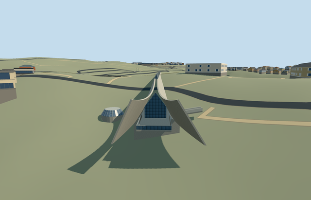

# N0748_HISTORY — Holocaust History Museum, Yad Vashem

Reviewed 2026-10-22. **Authored and imported exterior draft. Native terrain fit rejected; placement inactive and member incomplete.**

## Built and inspected

Authored medium-fi exterior of the named Holocaust History Museum: long triangular concrete prism, continuous framed glazed ridge, actual recessed southeast side entry and triangular terminal glazing, two open concave western wings, inset exit doors and projecting balcony/rails. Low circular Hall of Names roof light is part of this underground museum. Softened the over-strong concrete grid to the existing plain-concrete graph and widened the sloping west wing faces during this same authoring pass. Three ordinary pictures and the standard extract guided it. Heights, opening inventory and the roof-light position are explicit reconstructions, not surveyed controls.

## Shared surfaces and browser LODs

Three existing 256 px graphs over five material roles: plain concrete walls/floor, storefront glass, and painted-metal frames/roof cap. Five near/district draws and one skyline draw. No new graph, private atlas or embedded images. Shared opaque glass substitutes for custom green ridge glazing. Each requested graph reads once; all model geometry is released on unload. Flat fixtures cannot certify a partly underground museum and hide/expose some terrain-specific pieces.

| Level | Triangles | Bytes | Draws |
| --- | ---: | ---: | ---: |
| skyline | 262 | 26360 | 1 |
| district | 1114 | 113536 | 5 |
| street | 3062 | 305020 | 5 |
| closeup | 3882 | 374416 | 5 |

Four authored LODs 262/1114/3062/3882 triangles. Skyline plus district 139896 bytes; close-up 374416 bytes. Separate POSITION/NORMAL buffer views and equal CPU/GPU accounting. Six GLBs have zero Khronos errors/warnings; 156 actual geometry/contact probes; 47 current inspected portable/shared/medium-fi/native views. Physical laptop/phone/tablet and dense-city timings remain pending.

## Geographic placement — pending

Native placement is rejected and stays inactive draft. Named OSM way 74078313 / native 35184446167145 establishes the distinct museum; heading 0 with signed southeast/southwest internal axes baked into geometry. Four actual overlap cases at 13/14/15 pass. The test replaces only that one record and retains all 152 independent resident/all 256 wider records, including the other campus ranges. Load failure retains 153 original resident records. Original 201x201/6 m hill, roads and zero-water-area input remain unchanged. No ground cutout: preserve the natural overburden over this partly underground museum. Uncovered approach control, modelWorldY 0, material sharing and unload/restoration pass. However, the coarse hill lacks the real lateral earth cover/approach levels: long side faces and a deep southeast foundation are too exposed, and the approach floats relative to the map. This is not an accepted fit and cannot be counted complete.

## Fidelity and limits

Source exterior and browser budgets reviewed, geographic completion pending. Working absolute floor 794.2 m/concrete apex 12.7 m/glazed ridge 1.7 m are picture-led. Hall of Names roof-light placement internal[-70,-19], radius4.8 m and profile have about 10 m horizontal uncertainty and no map footprint. Underground galleries, furnished interiors/artwork, exact thresholds/accessibility, retaining-landscape construction and independently mapped campus buildings/memorials are not reconstructed here. Yad Vashem is declared as ten required independent members, not one centroid model. Northern range functional labels remain provisional. No bespoke terrain research or fabricated native-fit approval.

## Targeted checks

Selected source generation/import/draft placement checks, scene validation/sim30 and lint passed. Eleven collection tests pass, including node-mapped memorial identity. Six GLBs, zero Khronos errors/warnings; 156 mesh/contact probes; 4 map-overlap cases; 47 inspected frames. Sim30 sha256:8bb791c069ecab45dc0edf92829f155e5ef146a6e01766d888b0741a42bd276c. Pins: [qa.json](qa.json). Editable controls: [map-frame.json](map-frame.json). Native fit remains rejected.

## Completion checklist

- [x] Reproducible source, imported asset, four authored LODs and shared material bindings.
- [x] Geometry, map ownership, current source/shared/LOD/native images inspected in this authoring pass.
- [ ] Correct native earth-cover and southeast approach fit, then inspect current placement before activation.
- [ ] Finish all ten independent required Yad Vashem members; this draft does not complete the campus.

## Viewed references

- https://commons.wikimedia.org/wiki/File:Yad_Vashem_View.jpg — Andrew Shiva / Wikipedia (Godot13); 2013-11-15; CC-BY-SA-4.0 and attribution-only permission. Viewed only; no copied pixels.

- https://commons.wikimedia.org/wiki/File:ExteriorHolocaustHistoryMuseumYadVashemMar112023_08.jpg — Hagai Agmon-Snir; 2023-03-11; CC-BY-SA-4.0. Viewed only; no copied pixels.

- https://commons.wikimedia.org/wiki/File:Yad_Vashem_entrance.jpg — deror avi; 2006 per page; EXIF 2005-11-08; Attribution-only permission. Viewed only; no copied pixels.

- https://www.openstreetmap.org/way/74078313 — named Holocaust History Museum. ©OpenStreetMap contributors, ODbL1.0.
