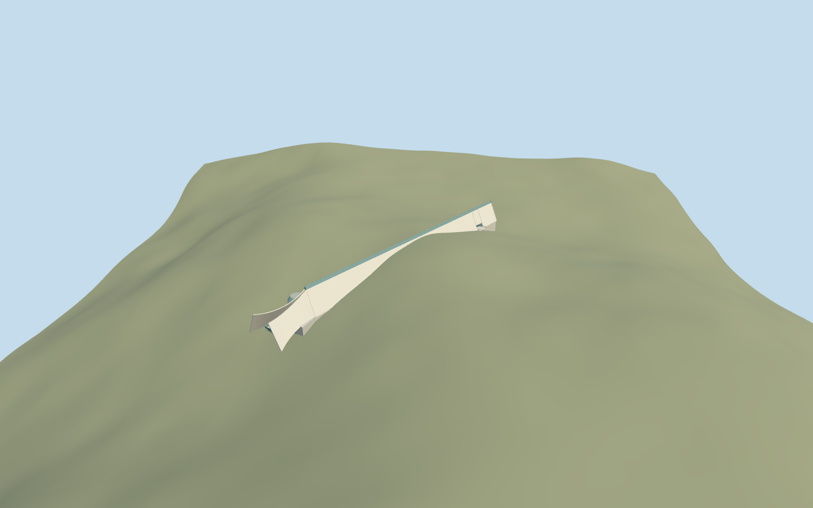

# Holocaust History Museum, Yad Vashem

Holocaust History Museum, Yad Vashem: mapped long triangular concrete prism, narrow glazed ridge, recessed southeast side entrance and glazed end, western concave flared concrete wings, inset exit doors and open balcony, and the low circular Hall of Names roof light belonging to the same underground museum. The independent memorial hall, visitor centre, art/exhibition buildings, northern ranges, Children's Memorial, Pillar of Heroism and Cattle Car remain separate required collection members. Underground galleries/rooms and exhibition artwork are not reconstructed.

## Evidence and reconstruction

Published dimensions and reconstructed details are separated in spec.json. Primary references:

- [Reference](https://commons.wikimedia.org/wiki/File:Yad_Vashem_View.jpg)
- [Reference](https://commons.wikimedia.org/wiki/File:ExteriorHolocaustHistoryMuseumYadVashemMar112023_08.jpg)
- [Reference](https://commons.wikimedia.org/wiki/File:Yad_Vashem_entrance.jpg)

Holocaust History Museum, Yad Vashem: mapped long triangular concrete prism, narrow glazed ridge, recessed southeast side entrance and glazed end, western concave flared concrete wings, inset exit doors and open balcony, and the low circular Hall of Names roof light belonging to the same underground museum. The independent memorial hall, visitor centre, art/exhibition buildings, northern ranges, Children's Memorial, Pillar of Heroism and Cattle Car remain separate required collection members. Underground galleries/rooms and exhibition artwork are not reconstructed.

## Model and axes

3,882 triangles; 11,240 vertices; 5 material groups; 454,640 bytes. Native bounds: -92.131, -10.540, -67.767 to 84.273, 15.334, 61.448. Source hash: `sha256:20ec562f1424e27b2a8c6b5b83fffcb4fb921b350ed304e136bff559e98fb045`.

{"x":"east","y":"up","z":"south"}

The geographic proposal uses exact-QID OpenStreetMap evidence. Map-derived orientation and estimated architectural details require real-site visual review; preview eligibility is distinct from geographic/fidelity approval. Map attribution: © OpenStreetMap contributors, ODbL-1.0.

## Reproduce

Run `node packages/worldgen/scripts/generate-additional-landmarks.mjs --ids=N0748_HISTORY` (or add `--check`). The generator preserves manually edited masters by checking their baseline hashes. Import through the standard authored-model workflow with optimization disabled; then capture all QA cameras, including shared-surface views.

## Pending work

- Holocaust History Museum, Yad Vashem: mapped long triangular concrete prism, narrow glazed ridge, recessed southeast side entrance and glazed end, western concave flared concrete wings, inset exit doors and open balcony, and the low circular Hall of Names roof light belonging to the same underground museum. The independent memorial hall, visitor centre, art/exhibition buildings, northern ranges, Children's Memorial, Pillar of Heroism and Cattle Car remain separate required collection members. Underground galleries/rooms and exhibition artwork are not reconstructed.
- Shared Yad Vashem Q156591; distinct named OSM way74078313/native35184446167145 is the History Museum, not the whole campus. The fifteen-point PMTiles outline fixes the southeast entrance, northwest flare and signed long axis. Heading0 with internal+X toward southeast/+Z southwest baked into east/south model coordinates. Hall of Names skylight internal[-70,-19] is a picture-led integrated roof estimate, not a separate mapped building or surveyed position. Preserve all independent buildings, including Hall of Remembrance way74078348.
- No height is supplied by the standard map. Working occupied floor794.2m absolute, concrete apex12.7m above floor and1.7m glazed ridge are picture-led estimates. Original coarse terrain rises over the buried central prism; no excavated corridor, broad slab or precinct flattening. West wing curvature, glazing/door inventory and Hall of Names roof position/radius/profile are reconstructions, not measurements.
- Retain original Protomaps20261020 and unmodified Mapzen201x201/6m hill. Uncovered southeast approach provider internal[72,13], datum793.3169542466442m. No ground cutout: the museum is partly underground, so its original hillside must continue over buried lower faces. Only the named native building is replaced. Foundation below the occupied prism and a closed balcony retain contact where coarse grade falls. Exact entrances, thresholds/accessibility and underground terrain/interiors are unverified.

This bundle follows the medium-fi standard. Medium-fi appearance and geographic fit are reviewed separately. Hash-bound visual acceptance is recorded separately after capture inspection.
