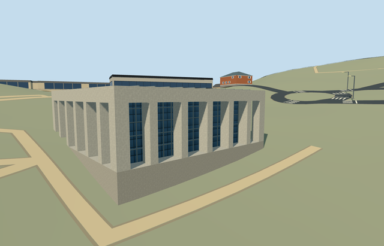

# N0748_VISITORS — Visitors Centre, Yad Vashem

Reviewed 2026-10-22. **Authored and imported exterior draft. Native terrain fit rejected; placement inactive and member incomplete.**

## Built and inspected

Authored the distinct mapped Visitors Centre exterior: pale square frame with six reconstructed bays on each side, shared corner piers and deep open colonnades, recessed full-height mullioned glass, actual upper-fascia notch and inset glazing/doors at the car-park entrance, clipped gridded roof and selected end-bay louvres. Two ordinary exterior photographs and the previously viewed annotated aerial guided this continuous author/inspect/fix pass. The car-park view fixes the +X entrance face and notch offset. No copied posters, visitors/cars, furnishings or independent campus structures.

## Shared surfaces and browser LODs

Three existing 256px graphs across six roles and five textured draws: plain concrete shared by the structural frame and floor, storefront glazing, and painted metal for mullions/grilles and the blue-grey roof panels. The painted-metal graph is a low-frequency stylistic substitute for the roof-panel appearance; its actual function/material is unverified. Clipped geometric roof framing supplies the visible grid without a private atlas or doubled window texture pattern. Opaque shared glazing substitutes for photographed green reflections. No new graph or embedded images. Each requested graph reads once; all model geometry is released on unload.

| Level | Triangles | Bytes | Draws |
| --- | ---: | ---: | ---: |
| skyline | 528 | 46648 | 1 |
| district | 2004 | 174388 | 5 |
| street | 3252 | 281240 | 5 |
| closeup | 3956 | 337160 | 5 |

Four distinct authored LODs: 528 / 2,004 / 3,252 / 3,956 triangles. Initial skyline plus district geometry is 221,036 bytes; close-up is 337,160 bytes. One skyline draw and five textured draws. Separate POSITION/NORMAL buffer views and equal CPU/GPU accounting. Six GLBs have zero Khronos errors/warnings; 144 actual mesh/contact probes; 47 current inspected source/shared/medium-fi/native views. Physical phone/tablet/laptop and dense-city timings remain pending.

## Geographic placement — pending

Native fit is rejected; placement remains inactive draft. Shared campus Q156591 plus distinct way 74078297 / native 35184446167129 identifies this member. The map fixes its four roof corners; two photographs and their camera bearings fix the east-northeast car-park entrance and south-southeast colonnade. Two actual overlapping PMTiles 14/15 cases pass; no overlapping level 13 feature was present. Replace only the Visitors Centre record and retain all 152 independent resident/all 256 wider records, including History Museum and Hall of Remembrance. Original 201x201/6m hill/roads and zero-water-area input remain unchanged. Ground is cut only inside the recessed glass core; original portico/forecourt ground and the uncovered car-park control remain. Failure retains 153 originals; all LOD unloads restore ground/water and zero live geometry. ModelWorldY is approximately 0. However, the coarse boundary ground spans -3.59 to +2.33 m around the working control: the southwest footing is overexposed and uphill terrain enters the open portico, unlike the level approaches in the photos. A 0.06 m control offset alone does not resolve this. Do not count the model complete or activate this proposal.

## Fidelity and limits

Source exterior reviewed as a medium-fi reconstruction; geographic completion is pending. No mapped height exists. Column/porch height 7.4 m, beam to 9.2 m, notch 0.75 m, bay/pier inventory, roof grid, louvres and hidden elevations are picture-led estimates. The roof pattern is not certified as solar panels or glazing; its material uses a shared stylistic substitute. The deep protective foundation is a coarse-terrain accommodation, not a verified architectural basement. Retain the shared site QID and independent OSM identity rather than inventing a member QID. Visitor facilities/interiors, posters, furnishings, site landscape and other campus buildings are excluded. No precinct flattening or bespoke terrain research was used. Hall of Remembrance remains ready; History Museum remains an inactive native-fit draft.

## Targeted checks

Six GLBs, zero Khronos errors/warnings; 144 mesh/contact probes; two actual map-overlap cases; 47 inspected frames. Selected generation/import/draft placement, strict medium-fi, scene/sim30 and lint checks pass. Sim30 sha256:92e77c85fc00e647c41cc33997980d9fa12085b6c1da56739f3d41b677f12365. Pins: [qa.json](qa.json). Editable controls: [map-frame.json](map-frame.json). Native fit remains rejected.

## Completion checklist

- [x] Reproducible source/import, four authored LODs and existing shared material bindings.
- [x] Current source/shared/LOD/native images, geometry and lifecycle reviewed in this authoring pass.
- [ ] Resolve native footing, forecourt and portico fit; inspect before activation.
- [ ] Complete all ten Yad Vashem members; currently only Hall of Remembrance is ready.

## Viewed references

- https://commons.wikimedia.org/wiki/File:Visitors%27_Center,_Yad_Vashem,_2019_(02).jpg — Bahnfrend; 2019-04-18 20:28:34; CC-BY-SA-4.0. Viewed only; no copied pixels.

- https://commons.wikimedia.org/wiki/File:Visitors%27_Center,_Yad_Vashem,_2019_(01).jpg — Bahnfrend; 2019-04-18 19:45:22; CC-BY-SA-4.0. Viewed only; no copied pixels.

- https://commons.wikimedia.org/wiki/File:Yad_Vashem_View.jpg — Andrew Shiva / Wikipedia (Godot13); 2013-11-15; CC-BY-SA-4.0 and attribution-only permission. Viewed only; no copied pixels.

- https://www.openstreetmap.org/way/74078297 — distinct mapped Visitors Centre roof. ©OpenStreetMap contributors, ODbL1.0.

- https://commons.wikimedia.org/wiki/Category:Visitors%27_Center,_Yad_Vashem — building location at 31.774258,35.176556; no separate member Wikidata identity asserted.
