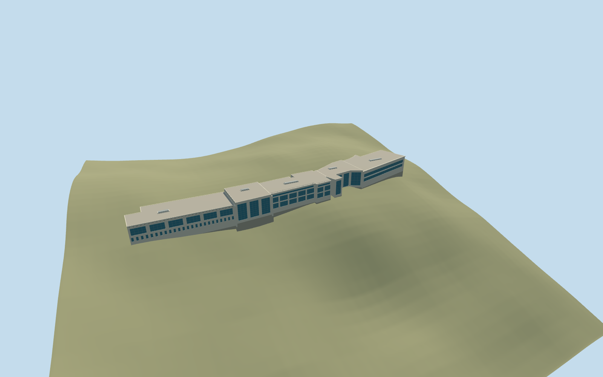

# Northern archives and study range, Yad Vashem

An individually modeled Yad Vashem northern campus range with five joined limestone and glass volumes on the wooded hillside.

## Evidence and reconstruction

Published dimensions and reconstructed details are separated in spec.json. Primary references:

- [Reference](https://tafnit-eng.com/en/project/yad-vashem-archives-and-library-building/)
- [Reference](https://tafnit-eng.com/en/project/international-school-for-holocaust-studies-yad-vashem/)
- [Reference](https://www.ibtimes.co.uk/yad-vashem-new-building-holocaust-education-289787)
- [Reference](https://services.arcgisonline.com/ArcGIS/rest/services/World_Imagery/MapServer)

No third-party geometry, photograph or bitmap texture is embedded. Shared surface graphs come from the central library; vertex tints carry model colors. Glazing uses PBR materials; transparent surfaces are declared per model.

## Model and axes

3,397 triangles; 6,837 vertices; 5 material groups; 290,312 bytes. Native bounds: -88.735, 0.000, -20.412 to 103.080, 21.230, 26.401. Source hash: `sha256:6a5c0e278685670e948ea304645311a0579e1ea216e3bd50a134d4101b9c93b7`.

undefined

The geographic proposal uses exact-QID OpenStreetMap evidence. Map-derived orientation and estimated architectural details require real-site visual review; preview eligibility is distinct from geographic/fidelity approval. Map attribution: © OpenStreetMap contributors, ODbL-1.0.

## Reproduce

Run `node packages/worldgen/scripts/generate-additional-landmarks.mjs --ids=northern_archives_and_study_range_yad_vashem` (or add `--check`). The generator preserves manually edited masters by checking their baseline hashes. Import through the standard authored-model workflow with optimization disabled; then capture all QA cameras, including shared-surface views.

## Pending work

- Facade placement and visible height are inferred from the order of volumes in the exterior photographs and overhead view. Roof equipment, rear bays, and facade counts are approximate.
- The separate study wing, detached retaining walls, bridge connections between buildings, and interior rooms remain outside this asset.

This bundle follows the medium-fi standard. Medium-fi appearance and geographic fit are reviewed separately. Hash-bound visual acceptance is recorded separately after capture inspection.
