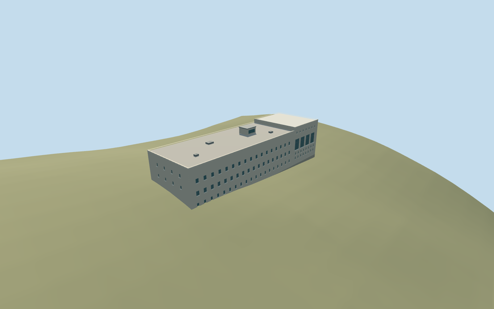

# Administration and Research Building, Yad Vashem

Detached pale limestone administration and research building at Yad Vashem. Raised western hall with four grouped lights, central stair bulkhead and regular eastern punched-window rows.

## Evidence and reconstruction

Published dimensions and reconstructed details are separated in spec.json. Primary references:

- [Reference](https://www.traveldojo.com/yad-vashem/)
- [Reference](https://www.giorgioperlasca.it/yad-vashem/)
- [Reference](https://naphtali.smugmug.com/Travel/ISRAEL/ISRAEL-9-Yad-Vashem)
- [Reference](https://www.yadvashem.org/de/visiting/map-of-yad-vashem.html)
- [Reference](https://services.arcgisonline.com/ArcGIS/rest/services/World_Imagery/MapServer)

No third-party geometry, photograph or bitmap texture is embedded. Shared surface graphs come from the central library; vertex tints carry model colors. Glazing uses PBR materials; transparent surfaces are declared per model.

## Model and axes

4,124 triangles; 8,248 vertices; 5 material groups; 349,832 bytes. Native bounds: -28.684, 0.000, -8.593 to 27.791, 15.880, 8.593. Source hash: `sha256:59ab9e9c51c042e774ee7728a2b594510ba18c36257dbe80449ccc8ae90d5c30`.

{"x":"east","y":"up","z":"south"}

The geographic proposal uses exact-QID OpenStreetMap evidence. Map-derived orientation and estimated architectural details require real-site visual review; preview eligibility is distinct from geographic/fidelity approval. Map attribution: © OpenStreetMap contributors, ODbL-1.0.

## Reproduce

Run `node packages/worldgen/scripts/generate-additional-landmarks.mjs --ids=northern_detached_study_wing_yad_vashem` (or add `--check`). The generator preserves manually edited masters by checking their baseline hashes. Import through the standard authored-model workflow with optimization disabled; then capture all QA cameras, including shared-surface views.

## Pending work

- Roof heights, sill dimensions and smaller courtyard openings are estimated from the aerial photos. The central roof stair and the four-light western window group are specific to the pictured building.
- The asset covers the exterior, with nearby terrain, paths and main campus volumes supplied by the host.

This bundle follows the medium-fi standard. Medium-fi appearance and geographic fit are reviewed separately. Hash-bound visual acceptance is recorded separately after capture inspection.
