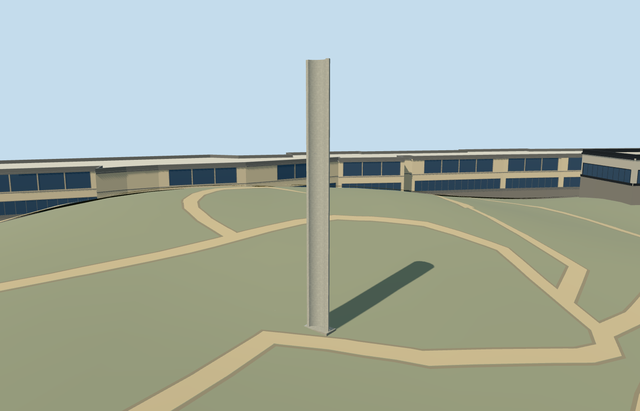

# pillar_of_heroism_yad_vashem — Pillar of Heroism, Yad Vashem

Reviewed2026-10-22. **Completed medium-fi exterior with an approximate point-anchored native placement.**

## Built and inspected

Built the point-anchored Pillar of Heroism as a tall narrow C-section memorial: concave open front, convex rear, real curved top cap/thin vertical edges, inset facing and a small closed contact footing. Near LODs include sparse horizontal facing joints. Three ordinary photos and the existing named PMTiles point/approach guided this continuous author/inspect/fix pass. Replaced the overly dark metallic test with pale shared concrete, widened base/rear cameras and inset the footing cutout. No invented writing, copied inscription, broad plaza or surrounding independent objects.

## Shared surfaces and browser LODs

One existing256px graph, concrete_plain, across three roles and two textured draws. Pale wall/face tints and a slightly darker footing preserve the photographed concrete appearance. Material distribution and any metallic lettering remain unverified/omitted. No new graph, private atlas or embedded image. One skyline draw uses the shared mean-color palette. Each requested graph reads once; every model geometry is released on unload.

| Level | Triangles | Bytes | Draws |
| --- | ---: | ---: | ---: |
| skyline | 64 | 6632 | 1 |
| district | 212 | 18776 | 2 |
| street | 1580 | 116352 | 2 |
| closeup | 4224 | 290012 | 2 |

Four authored LODs:64/212/1580/4224 triangles;6632/18776/116352/290012 bytes. Initial skyline plus district geometry is25408 bytes. One skyline/two textured draws, separate POSITION/NORMAL streams and equal CPU/GPU accounting. Six GLBs have zero Khronos errors/warnings;72 actual mesh/contact probes;48 current source/shared/medium-fi/native frames inspected. Physical phone/tablet/laptop and dense-city timings remain pending.

## Geographic placement

Approximate native exterior fit accepted. Shared campus Q156591 plus distinct named node6406261262/native17598592305678 fixes the independent point. Southwest-facing concavity follows the ordinary photo context and standard mapped approach, with25-degree uncertainty. Photo metadata also links independent artwork Q56696132; this model retains its declared collection campus QID and unique node. One actual level15 POI case confirms the point/name; no matching13/14 record. All153 resident and257 wider independent buildings retained; no owned building/footprint replacement. Original201x201/6m hill, roads and zero-water-area input remain unchanged. Cut only an inset area under the small closed footing. Uncovered approach/attachment, all four LODs, failed loading and unload/ground-water restoration/zero live geometry pass. ModelWorldY approximately0. A modest exposed curb and slight uphill burial reflect coarse original grade; exact plaza/accessibility is unverified.

## Fidelity and limits

Completed as a medium-fi point-anchored exterior visualization. The map supplies no height, footprint or facing. Working21m height,1.12m outer radius,0.28m wall thickness and150-degree curved section are picture-led estimates, not certified dimensions. Core/face treatment, panel inventory, hidden top/rear and foundation are reconstructed. The real raised Hebrew inscription is deliberately omitted; no pseudo-lettering substitutes for it. The surrounding truncated concrete objects, approach walls, benches, trees and other campus models remain independent. History, Visitors Centre, Art Museum and Pavilion remain inactive fit drafts; North remains reference-pending. No bespoke terrain research or precinct flattening.

## Targeted checks

Six GLBs, zero Khronos errors/warnings;72 mesh/contact probes;one actual level15 POI case;48 inspected frames. Selected generation/import/placement, strict medium-fi, scene/sim30 and lint pass. Sim30 sha256:dc49573e17e60c14b437539acc9d795d1824a3515c34d2708ba3820ac072c664. Current pins: [qa.json](qa.json). Editable controls: [map-frame.json](map-frame.json).

## Completion checklist

- [x] Reproducible source/import, four authored LODs and existing shared surfaces.
- [x] Current geometry, source/shared/LOD/native images and loading lifecycle reviewed in this pass.
- [x] Distinct named point, approximate facing and exterior terrain contact reviewed.
- [ ] Complete the remaining seven Yad Vashem members; this memorial does not complete the campus.

## Viewed references

- https://commons.wikimedia.org/wiki/File:Yad_Vashem_Pillar_of_Heroism.jpg — James Emery; 2007-05-08; CC-BY-2.0. Viewed only; no copied pixels.

- https://commons.wikimedia.org/wiki/File:Pillar_of_Heroism_at_Yad_Vashem,_Israel.jpg — Daniel Case; 2009-04-14; CC-BY-SA-3.0. Viewed only; no copied pixels.

- https://commons.wikimedia.org/wiki/File:PikiWiki_Israel_12497_pillar_of_heroism_at_yad_vashem.jpg — Avishai Teicher; 2011-04-11; CC-BY-2.5. Viewed only; no copied pixels.

- https://www.openstreetmap.org/node/6406261262 — named independent memorial point. ©OpenStreetMap contributors, ODbL1.0.
