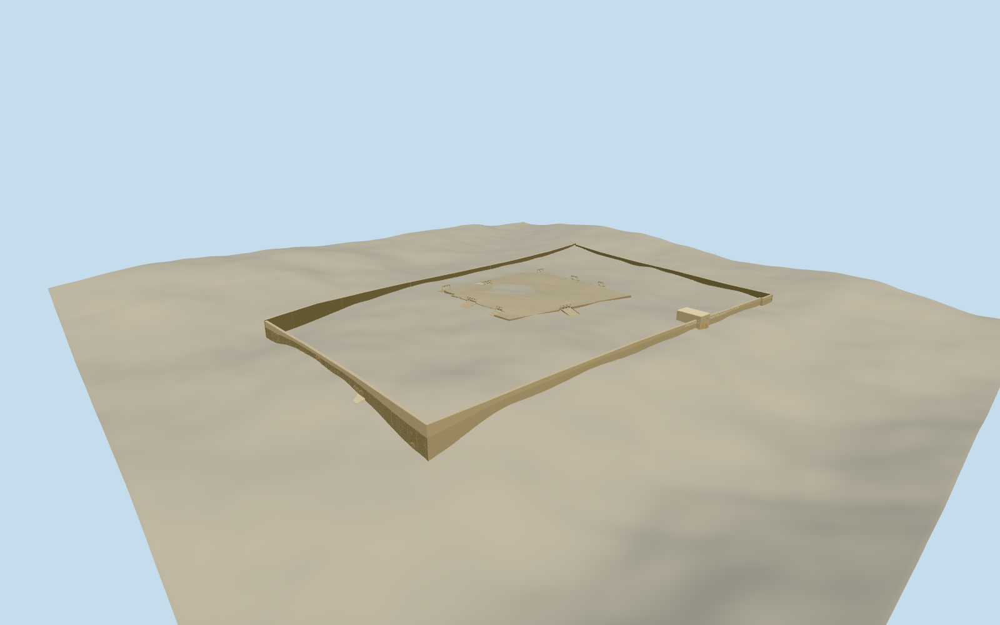

# Temple Mount / Haram al-Sharif

The limestone Temple Mount / Haram al-Sharif enclosure, with its long retaining walls, Gate of Mercy, blocked southern gates, surviving Robinson’s Arch masonry and the stepped arcades of the Rock Square.

Authoring state: **review-in-qa.json**. Current completion evidence is in [qa.json](qa.json) and the [completion ledger](../../../../qualla-structures/batches/qualla-003.PROGRESS.md).

- [Temple Mount](https://qualla.com/temple-mount/)

The adopted outline is the named current OpenStreetMap enclosure. Historical photographs from 2007–2009 establish the surviving walls, platforms and details. Later fixtures and exact restoration states are approximate.

Visible wall crests, thicknesses, gate reliefs, stair runs and paving planes are proportional estimates against the frozen elevation field and dated photographs.

The model covers the retaining enclosure, stone approaches and upper square. The Dome of the Rock and Al-Aqsa Mosque have existing independent placements.

Build: `node content/worldgen/source/places/sv/sv9/temple_mount/models/generate-temple-mount.mjs`. Add `--check` to verify exact regeneration. 22928 triangles; 4 materials; no embedded photographs.
