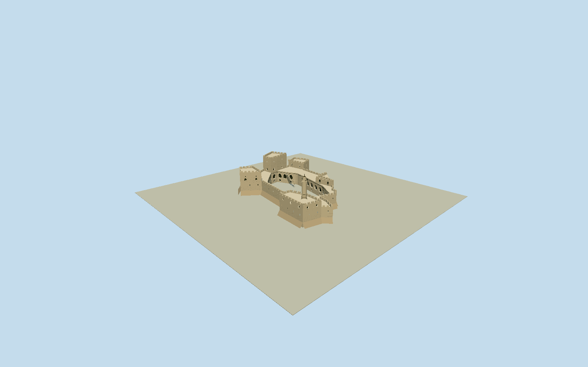

# Tower of David, Jerusalem Citadel

Whole surviving JerusalemCitadel/TowerofDavid principal fortified exterior: exact34vertex outer building and original18vertex openarchaeologicalcourtyard, continuous defensive walls/intrinsic batteredbases/cornerprojections, northeast survivingkeep/other native towers/barbican, southwestcylindricalminaret with balcony/cap, pointedcourtyard galleries, intrinsic roofwalks/stairs and bounded original ruinwalls. Not a lone minaret or idealized rectangularcastle. Exclude surrounding OldCitywalls/JaffaGate/Kishle/detachedmuseumannexes/outermoatlandscape/streets/precinct/trees/people/flags/temporaryaudienceseats/soundlightshowequipment/interiorrooms/undergroundvisitorcenter. No whole-site floor. Wholeoriginal34outer/18courthole, fiveasymmetricnativeprojectionsandNElargekeep; broadbatteredstonebase/flatwalltopwalk/crenellations/realslitrecesses, cylindricalSWminaret/annularbalcony/shortconicalcappedlantern andfinial. Longwestcourtyardgalleryofpointedarchedrecesses/darkdoors andnorthtowerarchedopenings, intrinsicsmallroofstairs/metalrails, coarselowarchaeologicalwallfragments/intrinsicroundearlyIslamictower. Keepcourtyardopen andavoidfabricatedfloor/filledruins. Build boundedoriginal coarsearchaeology ratherthanclaimsurveyedindividualstrata. Body/tower/minaret exactheights and internalpartpartitions are photoestimates, retained independentlyofDEM. Separateflagposts/banners/trees/stagechairs/showhardware/neighboringJaffaGatewalls/Kishle/undergroundmuseum excluded. Preserve wholeindependent400mfield beforegeometry; nofit/flatten/reacquire.

Authoring state: **review-in-qa.json**. Current completion evidence is in [qa.json](qa.json) and the [completion ledger](../../../../qualla-structures/batches/qualla-002.PROGRESS.md).

- [Tower of David](https://qualla.com/tower-of-david/)

Complete named OSMrelation136164/Q1177765 with34originalouterway126781855vertices and18originalcourtyardway54484258vertices. Fixed geographic anchor[35.22795,31.77595]/northup0heading, +Xeast/+Zsouth/+Yup. Wholemetricouter/courtyardshape, no singleminaret/component substitute; separate publicnative surroundingmap used only for identitycontext. Minaretposition/keeperfootprint partitions/heights/batteredbasewidth/fine masonry and archaeologicalruinwalls are bounded photographic estimates, not surveyedparts. Mainfortwall12m/keep26m/minaret37.5m estimates; originalcourtyard terrainhole remains open atalllevels.

Whole34vertexouter/18vertexopencourt nativecitadel with allprincipalfortifiedwings/towers/NEkeep/SWminaret.12mcurtain/26mkeep/37.5mminaret and internalpartpartition/batter widths/currentfinefinish are boundedphotographicestimates, not measuredsurvey. No minaretonly orancientreplicacastle substitute.

Qualla-first30familieschecked; publishedcourtyardimage inspected but missinglocalmachineboundPD-basis omitted, no metadata edits. Five exact ownphotographerPD-self/Ownworknativeoriginals individuallyinspected/SHA1matched/grantsbound:Mattes2011courtyard/keep/galleries/ruins/wholeuppercourtyard andBertholdWerner2008exterior/minaret/batter. GaryToddcandidates notadopted; existingpolicy unchanged. No restrictedoperatorphotos/diagrams/phototextures/generatedbitmap/downloadedmesh/signartwork.

Allnativecourtyardvertices physicallyretained. Detailedpointedarcades/blindrecesses/slitopenings havetruejambs/soffits/darksetback, merlons separatevolumes, roofstairs/railsintrinsic. Distantlevels reducearch/masonrycensus. Coarse lowarchaeologicalroundtower/wallfragments/openarch are originalboundedlayout/rubbleestimates, not archaeologicallysurveyedstrata/exactstonecensus; absentvegetation/fineunderground/interiorrooms/showhardware/stagechairs/tempawnings.

NeighboringJaffaGate/OldCitywalls/Kishle/detachedmuseumannexes/streets/outermoatlandscape excluded. Intrinsicbatteredfootings are structuregeometry, no whole-site floor orrectangularsitebase. Minaretposition/annularbalcony/cap/bands and finialcoarseoriginalarchitecturalsilhouette, no surveyedstonepattern.

Independent400m129x129field/16641originalvalues/rawtilebytes frozen beforegeometry andunchanged. UrbancompositeDEMmayinterpolatestructures/trees/coarsersourceheights; actualcourtyardfloor/moat/thresholdclassification notsurveyed. Portable/shared/contextflatstage separate; ordinarynativepreview/replaceFootprint=false; livehostgrade/contactnotcertified.

Build: `node packages/worldgen/scripts/generate-authored-places.mjs --ids=tower_of_david`. Add `--check` to verify exact regeneration. 20610 triangles; 5 materials; no embedded photographs.
