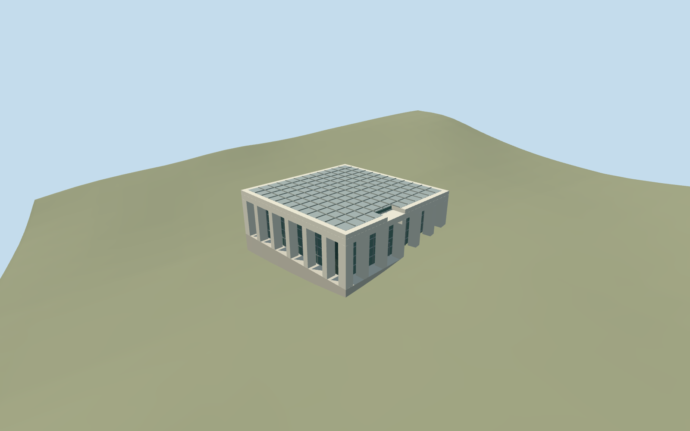

# Visitors Centre, Yad Vashem

Visitors Centre, Yad Vashem: mapped square pale-concrete frame with six reconstructed bays per side, deep open perimeter colonnades, tall recessed mullioned glass, a car-park entrance below a notch in the upper fascia, low-frequency roof-panel grid and selected end-bay louvres. All four LODs keep the frame, recesses and roof notch. Interior visitor facilities, signs/photographic posters, benches, visitors, cars, trees and independent campus buildings remain context.

## Evidence and reconstruction

Published dimensions and reconstructed details are separated in spec.json. Primary references:

- [Reference](https://commons.wikimedia.org/wiki/File:Visitors%27_Center,_Yad_Vashem,_2019_(02).jpg)
- [Reference](https://commons.wikimedia.org/wiki/File:Visitors%27_Center,_Yad_Vashem,_2019_(01).jpg)
- [Reference](https://commons.wikimedia.org/wiki/File:Yad_Vashem_View.jpg)

Visitors Centre, Yad Vashem: mapped square pale-concrete frame with six reconstructed bays per side, deep open perimeter colonnades, tall recessed mullioned glass, a car-park entrance below a notch in the upper fascia, low-frequency roof-panel grid and selected end-bay louvres. All four LODs keep the frame, recesses and roof notch. Interior visitor facilities, signs/photographic posters, benches, visitors, cars, trees and independent campus buildings remain context.

## Model and axes

3,956 triangles; 11,844 vertices; 5 material groups; 477,264 bytes. Native bounds: -17.895, -3.794, -17.705 to 17.895, 9.425, 17.832. Source hash: `sha256:0d37156dbbe56c80bf2c43ca9f7e50840ab1138194f703af9ecb6a6ab7bc535b`.

{"x":"east","y":"up","z":"south"}

The geographic proposal uses exact-QID OpenStreetMap evidence. Map-derived orientation and estimated architectural details require real-site visual review; preview eligibility is distinct from geographic/fidelity approval. Map attribution: © OpenStreetMap contributors, ODbL-1.0.

## Reproduce

Run `node packages/worldgen/scripts/generate-additional-landmarks.mjs --ids=visitors_centre_yad_vashem` (or add `--check`). The generator preserves manually edited masters by checking their baseline hashes. Import through the standard authored-model workflow with optimization disabled; then capture all QA cameras, including shared-surface views.

## Pending work

- Visitors Centre, Yad Vashem: mapped square pale-concrete frame with six reconstructed bays per side, deep open perimeter colonnades, tall recessed mullioned glass, a car-park entrance below a notch in the upper fascia, low-frequency roof-panel grid and selected end-bay louvres. All four LODs keep the frame, recesses and roof notch. Interior visitor facilities, signs/photographic posters, benches, visitors, cars, trees and independent campus buildings remain context.
- Shared campus Q156591 with distinct OSM way74078297/native35184446167129. The Commons category locates the Visitors Centre at31.774258,35.176556, about6m from the mapped roof centroid; its two ordinary exterior photographs and the annotated campus aerial identify this particular building. Internal+X points east-northeast toward the car park; internal+Z south-southeast toward the long colonnade. The east car-park photo fixes the fascia notch and entry on the+X face, offset toward+Z. Heading0 with these signed axes baked into model east/south coordinates. No invented member Wikidata identity; all other campus members remain independent.
- No map height is supplied. Picture-led working column/porch height7.4m, roof beam to9.2m,0.75m upper notch, six bays per side,1.1m intermediate piers and1.6m corners. Roof grid function and hidden rear facade inventory are unverified; it is modeled as a visible panel/skylight pattern, not certified solar equipment. Mullions, grilles, thresholds and room arrangements are reconstructions.
- Reuse the original Protomaps20261020 and unmodified Mapzen201x201/6m hill. Uncovered car-park control internal[16,2.3], datum792.7608351373401m; working floor0.06m above it. Seal the occupied recessed glass core with its floor and retain original ground in the exterior portico/forecourt. A footprint-limited protective foundation follows the lowest original boundary level. The coarse slope varies nearly6m across this small roof; inspect exposed footings and buried porch areas before any placement approval. No custom terrain or precinct flattening.

This bundle follows the medium-fi standard. Medium-fi appearance and geographic fit are reviewed separately. Hash-bound visual acceptance is recorded separately after capture inspection.
