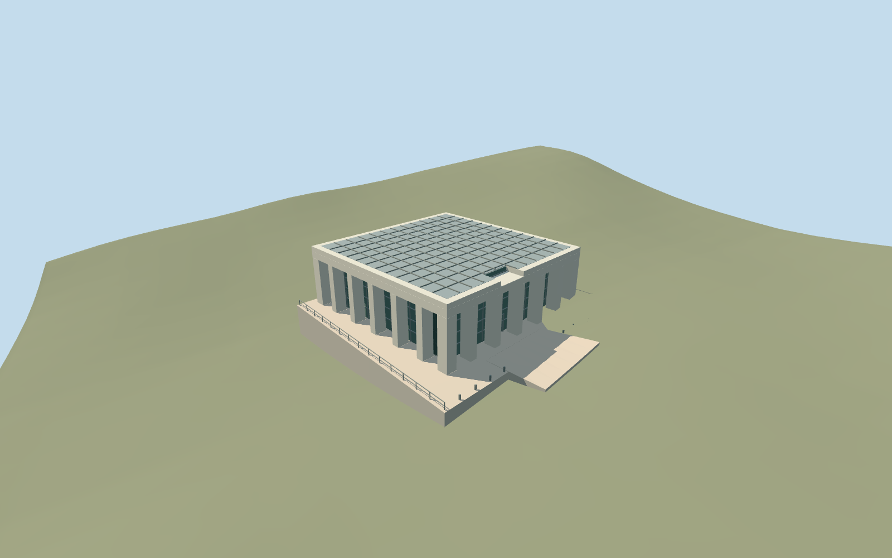

# Visitors Centre, Yad Vashem

The square Visitors Centre retains its six-bay pale concrete frame, deep colonnades, recessed glazing, offset car-park entry, gridded roof and south terrace. The fitted deck exposes all four arcades and keeps the parking approach connected.

## Evidence and reconstruction

Published dimensions and reconstructed details are separated in spec.json. Primary references:

- [Reference](https://commons.wikimedia.org/wiki/File:Visitors%27_Center,_Yad_Vashem,_2019_(02).jpg)
- [Reference](https://commons.wikimedia.org/wiki/File:Visitors%27_Center,_Yad_Vashem,_2019_(01).jpg)
- [Reference](https://commons.wikimedia.org/wiki/File:Yad_Vashem_View.jpg)

The square Visitors Centre retains its six-bay pale concrete frame, deep colonnades, recessed glazing, offset car-park entry, gridded roof and south terrace. The fitted deck exposes all four arcades and keeps the parking approach connected.

## Model and axes

4,358 triangles; 12,966 vertices; 6 material groups; 522,960 bytes. Native bounds: -19.661, -5.280, -19.682 to 25.394, 9.425, 20.924. Source hash: `sha256:963cfe4d91e46138a54cf650331165ddf4f3321e715750ee26dedef60b82a48f`.

{"x":"east","y":"up","z":"south"}

The geographic proposal uses exact-QID OpenStreetMap evidence. Map-derived orientation and estimated architectural details require real-site visual review; preview eligibility is distinct from geographic/fidelity approval. Map attribution: © OpenStreetMap contributors, ODbL-1.0.

## Reproduce

Run `node packages/worldgen/scripts/generate-additional-landmarks.mjs --ids=visitors_centre_yad_vashem` (or add `--check`). The generator preserves manually edited masters by checking their baseline hashes. Import through the standard authored-model workflow with optimization disabled; then capture all QA cameras, including shared-surface views.

## Pending work

- The slope and terrace height use ordinary photographs and the standard terrain sample. The guard and the exact changes in paving grade are approximate. The visitor facilities and interiors are outside the exterior scope.

This bundle follows the medium-fi standard. Medium-fi appearance and geographic fit are reviewed separately. Hash-bound visual acceptance is recorded separately after capture inspection.
