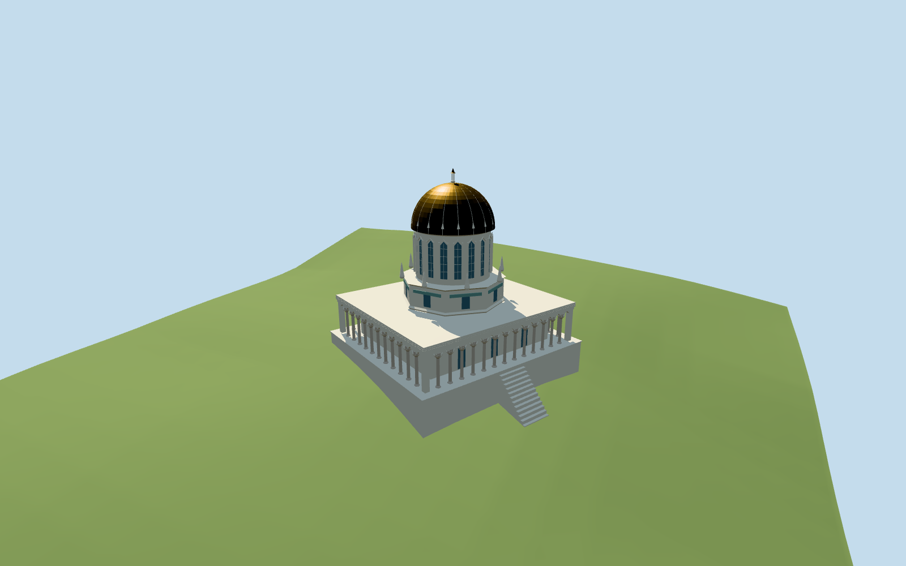

# Shrine of the Báb

Golden near-hemispherical ribbed dome and small open finial lantern, eighteen-window round drum with pointed surrounds, octagonal middle stage with corner pinnacles, rectangular stone shrine core and covered open colonnade with pink stone shafts/leaf capitals, turquoise/pale patterned infill as broad shared-material geometry, paved apron/retaining base and short approximate terrain-seated approaches. Gardens/major terraces/neighboring buildings remain host context. No furnished/navigable sanctuary or exact sacred calligraphy.

## Evidence and reconstruction

Published dimensions and reconstructed details are separated in spec.json. Primary references:

- [Reference](https://commons.wikimedia.org/wiki/File:Shrine_of_The_Bab.jpg)
- [Reference](https://commons.wikimedia.org/wiki/File:Shrine_of_the_B%C3%A1b_and_Bah%C3%A1%27%C3%AD_Gardens_34.JPG)
- [Reference](https://news.bahai.org/story/1764/shrine-of-the-bab-recent-work-at-the-shrine-completed)

Two registered recipes build the gold-domed shrine, eighteen-window drum, octagonal stage, eight pinnacles, open pink-shaft arcade and retained-hillside apron using five shared 256² graphs, metric UVs and linear tints. No embedded images or unique atlas.

## Model and axes

24,264 triangles; 72,792 vertices; 5 material groups; 2,915,116 bytes. Native bounds: -23.083, -4.387, -22.509 to 23.083, 33.294, 22.509. Source hash: `sha256:58bd22b4516c5877f145b7ca873dab8b2b53f5940aa8fb370aa632ae4092adac`.

{"x":"east","y":"up","z":"south"}

The geographic proposal uses exact-QID OpenStreetMap evidence. Map-derived orientation and estimated architectural details require real-site visual review; preview eligibility is distinct from geographic/fidelity approval. Map attribution: © OpenStreetMap contributors, ODbL-1.0.

## Reproduce

Run `node packages/worldgen/scripts/generate-additional-landmarks.mjs --ids=shrine_of_the_bab` (or add `--check`). The generator preserves manually edited masters by checking their baseline hashes. Import through the standard authored-model workflow with optimization disabled; then capture all QA cameras, including shared-surface views.

## Pending work

- Golden near-hemispherical ribbed dome and small open finial lantern, eighteen-window round drum with pointed surrounds, octagonal middle stage with corner pinnacles, rectangular stone shrine core and covered open colonnade with pink stone shafts/leaf capitals, turquoise/pale patterned infill as broad shared-material geometry, paved apron/retaining base and short approximate terrain-seated approaches. Gardens/major terraces/neighboring buildings remain host context. No furnished/navigable sanctuary or exact sacred calligraphy.
- Q1462314 / way91970948 identifies the shrine; standard PMTiles record35184464059780 fixes its 32.1 by29.2m rectangular arcade plan and mapped center. Native +X east/+Z south and runtime heading0; the internal architectural angle0.503874710567rad follows the mapped rectangle. The garden/terrain direction puts the approximate front approach toward local-V/northeast/downhill. Exact doorway facing, individual shaft spacing and interior partitions remain picture-led approximations. Preserve independent surrounding buildings and garden context.
- The inspected 2019 exterior and recent ordinary arcade photo guide a broad golden ribbed hemisphere, eighteen-window round drum, octagonal middle stage, eight pinnacles, pale carved pointed arcade and pink round shafts/leaf capitals. Picture-led height is about31m above its level platform; no surveyed height is asserted. The approximate bay rhythm uses48 round shafts plus four white corner piers; this is not a certified historic column inventory. Exact inscriptions, ornate mosaics and interior sanctuary are simplified or omitted.
- Pinned standard Protomaps2026-10-14 and Mapzen13–14 extract. Retain the original six-meter native terrain grid and water. A level shrine apron clears the sampled native grade, with a buried retaining base and short stair toward the downhill garden axis. The coarse hillside DEM does not resolve the actual terrace/threshold engineering: platform level, retaining-wall exposure and approach rise are approximate. No terrain/water cutout, garden reconstruction or bespoke topography.
- The rectangular shrine outline is mapped; upper-stage dimensions, shaft/bay rhythm, carved profiles and terrace levels are picture-led estimates. Garden terraces and independent buildings remain host context; no furnished or navigable sanctuary, exact inscriptions or certified historic column inventory is claimed.

This bundle follows the medium-fi standard. Medium-fi appearance and geographic fit are reviewed separately. Hash-bound visual acceptance is recorded separately after capture inspection.

## Additional geographic data

©OpenStreetMap contributors; Protomaps; Mapzen/USGS terrain.
