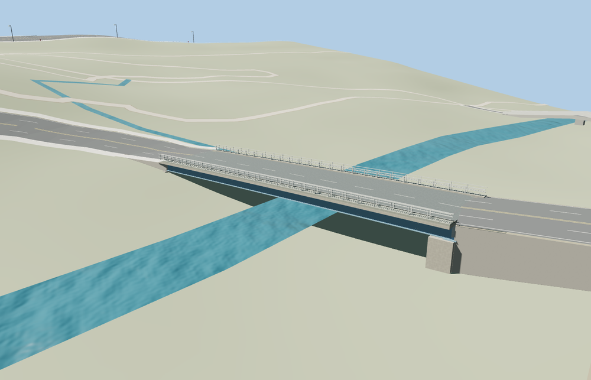

# Daughters of Jacob Bridge

**Viewer readiness passed for the current Route91 crossing.**

Current Route91 Daughters of Jacob Bridge: full low blue plate-girder road deck, transverse floor beams and diaphragms, pale roadside barriers and outer rails, narrow raised verge walks, reinforced-concrete bank abutments and bearings, road center/edge markings. The separate tan lattice old bridge about130m north remains native context; it is not substituted for this crossing.

The retained Q2916595/way30613435 centerline is47.176m. The original source models the low blue girder crossing with short end abutments; the tan lattice bridge about130m north remains native. The public Jan2020 panorama, ordinary site picture and standard PMTiles establish this distinction. Concealed beam/support details remain approximate.

Source6,672 triangles; skyline/district/street/close-up168 /1,188 /3,144 /5,328. Combined initial tiers109,912 bytes; close-up400,424 bytes. Two shared material graphs, metric UVs and zero embedded images. Six clean GLBs;34 distinct current images inspected:10 portable plus24 native. The shared-material frame reuses one native view. Seventeen native frames cover silhouette, three distances, noon/late lights, shadowless reduced-resolution Economy/High and all four LOD transitions.

Actual native placement passes21 join-width and8 approach probes. The original river is five water features with eight retained line ribbons, sampled through Molen’s actual native renderer, rather than a fabricated flat plane. The standard terrain and independent roads remain unchanged. The older bridge receives no authored connections/profiles. All four tiers dispose their model/support geometry on unload; failed loads preserve the original terrain/water/crossing. The existing steep eastern fallback/stub artifact remains visible when this model is absent and is outside this model correction.

Ordinary-picture exterior approximation. The public Jan2020 Yair SarfaTi panorama viewed south from the northern old crossing identifies the low blue road bridge and pale barriers; the older tan lattice photographs are excluded as primary geometry references. Current PMTiles and retained Q2916595/way30613435 control placement and signed axis. The source envelope includes short end abutments beyond the47.176m retained centerline. Width, plate-girder depth, floor-beam/bearing details and concealed bank foundations are approximate. No assertion of a surveyed engineering arrangement, no private photo textures, readable signs, vehicles or copied meshes. Native terrain is coarse; physical-device timing remains unmeasured. Native water follows the original standard terrain as river ribbons; no flat water plane or bespoke terrain is authored. The failed-load image preserves the original automatic crossing, including its existing steep eastern fallback/stub artifact. The authored-model view has graded, tested joins; no claim is made that the fallback artifact was fixed. No below-deck road crossing is mapped here, so no engineering road/rail clearance certification is claimed.

Rebuild: `node packages/worldgen/scripts/generate-daughters-of-jacob-bridge.mjs` (append `--check` for exact bytes). Target import, LOD generation and readiness with `--ids=daughters_of_jacob_bridge`. No engine CI, dependency audit, Git mutation or upload was performed.
