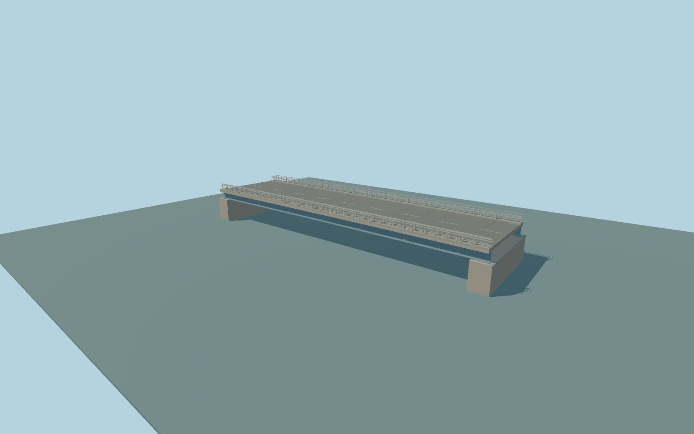

# Daughters of Jacob Bridge

Current Route91 Daughters of Jacob Bridge: full low blue plate-girder road deck, transverse floor beams and diaphragms, pale roadside barriers and outer rails, narrow raised verge walks, reinforced-concrete bank abutments and bearings, road center/edge markings. The separate tan lattice old bridge about130m north remains native context; it is not substituted for this crossing.

Rebuild: `node packages/worldgen/scripts/generate-daughters-of-jacob-bridge.mjs`;append `--check` for exact source bytes. Select import/LOD/placement with `--ids=daughters_of_jacob_bridge`. Detailed source and four browser tiers are separate ignored GLB outputs.

Ordinary-picture exterior approximation. The public Jan2020 Yair SarfaTi panorama viewed south from the northern old crossing identifies the low blue road bridge and pale barriers; the older tan lattice photographs are excluded as primary geometry references. Current PMTiles and retained Q2916595/way30613435 control placement and signed axis.

The source envelope includes short end abutments beyond the47.176m retained centerline. Width, plate-girder depth, floor-beam/bearing details and concealed bank foundations are approximate. No assertion of a surveyed engineering arrangement, no private photo textures, readable signs, vehicles or copied meshes. Native terrain is coarse; physical-device timing remains unmeasured.

Original geometry:repository license. Map:© OpenStreetMap contributors,ODbL-1.0;Protomaps. Standard terrain:terrain-grid.json. Ordinary pictures stay local and are not redistributed or used as textures. Current acceptance:qa.json.
