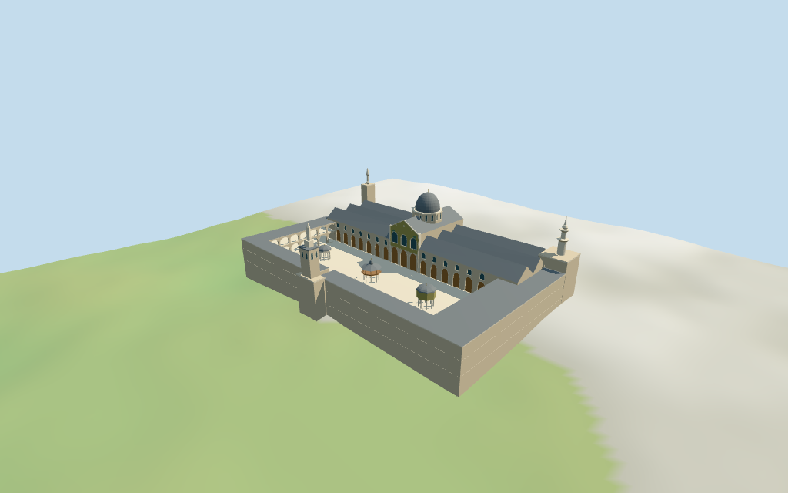

# N0416 — Umayyad Mosque

Reviewed2026-10-16 against current model bytes. Accepted for the stated medium-fi exterior and approximate horizontal fit. Nominal heights,picture-led pavilion placements,fine architecture/current finish and exact terrain/site joins retain explicit limits.

## Built exterior

Inspected all11 current portable views,including the1024×640 summary. Individual Damascus mosque:three parallel grey pitched prayer-hall roofs on each side of a tall mosaic-faced gabled transept and octagonal Eagle drum/dome. Open two-tier court arcades,raised octagonal Treasury,open Clock pavilion and two-level wood/stone fountain. Bride,Qaitbay and Jesus minarets retain distinct mapped positions and canopy/balcony/shaft silhouettes. Corrected a missing annulus at the fountain cupola shoulder and rear windows mistakenly distributed along a short end edge. The widened pavilion camera shows both Treasury and fountain. Tall outer footings remain visible against the coarse DEM;exact site contact is unverified.

## Shared surfaces and browser levels

Inspected all11 current shared/geographic views. Six existing256² limestone,raw limestone,standing-seam metal,plain wood,mosaic and bronze graphs;seven merged groups including local blue-green glass. Muted green/gold tile fields abstract historic mosaics without copied artwork or inscriptions. Linear colors,metric UVs and faceted architectural forms;zero embedded images,new facade bitmaps or baked lighting. Each canonical graph read once;unload to zero live model geometries. Geographic views use flat terrain;source/medium-fi retain the standard DEM. Flat geographic views do not establish exact ground contact.

| Level | Triangles | Bytes | Draws |
| --- | ---: | ---: | ---: |
| skyline | 989 | 85,992 | 1 |
| district | 3,547 | 308,852 | 7 |
| street | 12,121 | 1,121,924 | 7 |
| closeup | 19,001 | 1,876,928 | 7 |

Initial skyline plus district geometry: **394,844 bytes**. Master **2,354,952 bytes /19,589 triangles**;runtime **2,354,304 bytes**. Six shared256² graphs,seven groups,zero embedded images. Shared graph definitions/runtime texture generation are additional.

Inspected all27 current medium-fi views:Economy/High,noon/late,three distances,silhouette,six details,four matched whole levels and four transitions. Skyline989 retains six roof ranges,the Eagle dome and gable,three distinct minarets,open court and reduced gallery/pavilion support silhouettes. District3547 adds shared surfaces,sparse closed recessed hall/drum lights/doors and coarser two-tier arches. Street12121 adds full hall/rear window rhythm,open round-arched gallery tiers,pavilion columns,wood upper fountain posts and minaret fields/balconies. Close-up19001/master19589 refine curves,reveals and surrounds. Bride minaret window fields are applied simplified panes,not recessed openings. Synthetic context and physical laptop/phone timing unverified.

## Geographic fit and limits

Retained exact way/315255977 /Q183562 identifies Umayyad Mosque (Omayyad Mosque),Damascus. Current whole35184687344809 and selected hall/gallery/roof/minaret controls match the retained perimeter and current same-ID named POI. Anchor[36.306650188,33.511602424] and heading0.080762031862rad unchanged,no horizontal rescale. Native+X east-northeast toward southeast Jesus minaret,+Z south-southeast prayer hall/mihrab,−Z north-northwest open courtyard/Bride minaret. Pictures resolve signed court/hall facing with approximate3° uncertainty. Treasury,Clock and fountain are photo-led placements inside the mapped court,not independent PMTiles footprints;working horizontal uncertainty about8m. Separate Saladin mausoleum/tomb,northern buildings,markets,streets and Roman propylaeum remain host content.

Current hall roof controls20m,central transept28m,Eagle drum22–30m/cap40m,galleries14m,north Bride stages14/28/28.5/31.5/40m,southwest Qaitbay19/26/27/31/32/34/39m and southeast Jesus30/42m are nominal map tags. Earlier width50m/length125m facts have no linked reference URLs and do not survey the whole157×107m precinct. Picture-led partitions:aisle eaves14m/ridges20m;central transept eaves22m/ridge28m;Eagle drum24–30m/cap40m/finial42m;gallery ground arches0–6.6m,upper7.5–12.3m/eave/low roof13m (map14m nominal). Minaret profiles follow mapped stages with estimated balconies,canopies,windows and caps. Treasury11m,Clock9m and wood/stone fountain12m are photo estimates;their plans/positions,facade bays,mosaic abstractions,unseen sides and exact levels/current finish unverified.

Standard viewer DEM datum695.751299m;whole perimeter-9.26 to-1.45m relative to it. Floor2.800m is maximum anchor/perimeter/interior-grid sample plus0.35m,an approximate raised attachment plane. Interior samples prevent the coarse central terrain hump from covering court paving. Stone footings crossY=0 and extend below retained terrain. No terrain flattening,ground cutout or road replacement. Exact door/step/court/street/base joins,altitude,walking and current construction finish remain unverified.

Retained exact way/315255977 /Q183562 identifies Umayyad Mosque (Omayyad Mosque),Damascus. Current whole35184687344809 and selected hall/gallery/roof/minaret controls match the retained perimeter and current same-ID named POI. Anchor[36.306650188,33.511602424] and heading0.080762031862rad unchanged,no horizontal rescale. Native+X east-northeast toward southeast Jesus minaret,+Z south-southeast prayer hall/mihrab,−Z north-northwest open courtyard/Bride minaret. Pictures resolve signed court/hall facing with approximate3° uncertainty. Treasury,Clock and fountain are photo-led placements inside the mapped court,not independent PMTiles footprints;working horizontal uncertainty about8m. Separate Saladin mausoleum/tomb,northern buildings,markets,streets and Roman propylaeum remain host content. Current hall roof controls20m,central transept28m,Eagle drum22–30m/cap40m,galleries14m,north Bride stages14/28/28.5/31.5/40m,southwest Qaitbay19/26/27/31/32/34/39m and southeast Jesus30/42m are nominal map tags. Earlier width50m/length125m facts have no linked reference URLs and do not survey the whole157×107m precinct. Picture-led partitions:aisle eaves14m/ridges20m;central transept eaves22m/ridge28m;Eagle drum24–30m/cap40m/finial42m;gallery ground arches0–6.6m,upper7.5–12.3m/eave/low roof13m (map14m nominal). Minaret profiles follow mapped stages with estimated balconies,canopies,windows and caps. Treasury11m,Clock9m and wood/stone fountain12m are photo estimates;their plans/positions,facade bays,mosaic abstractions,unseen sides and exact levels/current finish unverified. Standard viewer DEM datum695.751299m;whole perimeter-9.26 to-1.45m relative to it. Floor2.800m is maximum anchor/perimeter/interior-grid sample plus0.35m,an approximate raised attachment plane. Interior samples prevent the coarse central terrain hump from covering court paving. Stone footings crossY=0 and extend below retained terrain. No terrain flattening,ground cutout or road replacement. Exact door/step/court/street/base joins,altitude,walking and current construction finish remain unverified. All954 actual viewer-footprint checks cover28 retained controls and preserve131 separate mapped buildings across source,runtime and four browser levels,including Saladin and neighboring markets.  Native+X east-northeast toward southeast Jesus minaret,+Z south-southeast prayer hall/mihrab,−Z north-northwest courtyard/Bride. Exact retained whole/QID identity and approximate horizontal fit accepted;no surveyed facade/base claim. No cutout,flattening or road replacement.

## Verification

**49 current frames inspected;778 front-side geometry checks;954 viewer-footprint checks.** Six Khronos validations:zero errors/warnings/images. Targeted source byte reproduction,scene validation,30-tick simulation and current source/import/LOD/input/recipe/capture-image/report/material bindings pass. Canonical graphs read once;unload to zero geometries. Full source checkpoint remainsN0410–N0427.

Source: sha256:f70d36dc8cbcca093bcda0701d4037b83ce1b292d7a83ff39d57b6bdac6c55b4

Runtime: sha256:2da070b8974068eba021d5ca7b1b493dbd48fd84bc8040d5ec099c8d1ab5054c

Input: sha256:a622dd0f86fcce9c4ba5532d8fc6473b7979aaa1b86f39131c880617d8700441

Simulation: sha256:862939753af84c80d7ec2249645fa00f828ef29e459517ad94c2321dc8ef6512

Commands:targeted generate/import/LOD/register --ids=N0416;generation --check;portable reflections/antialias/fitted shadows;shared reflections/adaptive clipping/bounded placement;medium-fi reflections;scene validation and30-tick simulation. Bulk captures remain ignored.

## Inspected references

[Jerzy Strzelecki — 2001](https://commons.wikimedia.org/wiki/File:Courtyard2(js).jpg). CC-BY-SA-3.0. Inspected full courtyard/prayer-hall exterior:long lead-grey pitched hall roofs flank a taller gabled transept with large green/gold mosaic face,three lower arched entries,three upper arched lights and round gable fields. Octagonal Eagle drum has paired pointed lights below a ribbed grey cap/finial. Hall has large lower arched wood/glass bays and smaller upper arched windows. A minaret projects behind the roof. Courtyard gallery has two tiers of round arches;central fountain pavilion has lower stone columns,upper open wooden gallery and pitched lead roof. Hidden plans/current finish not established.

[Dosseman — 2009-04-04](https://commons.wikimedia.org/wiki/File:Damascus_courtyard_of_Umayyad_Mosque_from_northeast_side_7990.jpg). CC-BY-SA-4.0. Inspected northeast courtyard view:prayer hall/mosaic gable on south side,stacked open gallery arches on west/north sides,bright marble court,central two-level wood/stone fountain pavilion and raised octagonal Treasury on slender columns under shallow lead dome. The ornate western minaret has stacked faceted balconies/neck and pointed finial;Clock pavilion columns crop the near left edge. Photographic pavilion placement is approximate;people,loose stone remnants,fixtures and current finish excluded.

[James Gordon — 2006-10-03](https://commons.wikimedia.org/wiki/File:The_Great_Umayyed_Mosque_of_Damascus,_Syria,_and_Dome_of_the_Clock.jpg). CC-BY-2.0. Inspected full portrait through an arcade:Clock pavilion is an open ring of slender stone columns with broad octagonal entablature and ribbed shallow lead dome/finial. Behind it the north Bride minaret has a square arched-light stage and wide dark overhanging canopy below a slender upper ornamented shaft/pavilion and finial. Upper gallery has paired small round openings over larger lower arches. Fine carved capitals,clock devices/lettering and hidden profiles remain estimated or abstracted.

## Remaining scope

Individual medium-fi familiar Damascus Umayyad Mosque exterior from three actually inspected2001/2006/2009 courtyard,prayer-hall and minaret pictures plus standard viewer PMTiles/DEM. Earlier exact way/315255977 /Q183562 candidate retained verbatim. Current whole35184687344809 and28 selected controls retain166 raw outline points and properties. Anchor/heading unchanged;about3° facing uncertainty. Six nominal20m aisle ranges,28m transept,30m drum/40m Eagle dome,13m gallery roofs and three mapped minaret stage groups guide the exterior. Roof/door/light/mosaic/column/balcony/finial partitions and unseen sides are estimated;earlier width50m/length125m facts do not survey the whole157×107m precinct. Treasury11m,Clock9m and fountain12m are picture-led estimates,with about8m working placement uncertainty inside mapped court. Eagle drum lights meet the roof at lower edges;upper visible portions verified. Bride fields are applied panes. Shared tile/color abstraction does not replicate historic artwork,calligraphy or clock mechanisms. Fine carving,engineering,prayer-hall interior,fixtures,current restoration/construction finish and exact court/door/step/street/base/altitude/walking joins excluded or unverified. Main hall fields terminate closed;gallery/pavilion columns have open exterior voids,no prayer-hall traversal claim. Saladin mausoleum/tomb,northern markets,streets and Roman propylaeum remain separate host content. No bespoke surveys or redistributed photographs;physical-device timing unverified.
