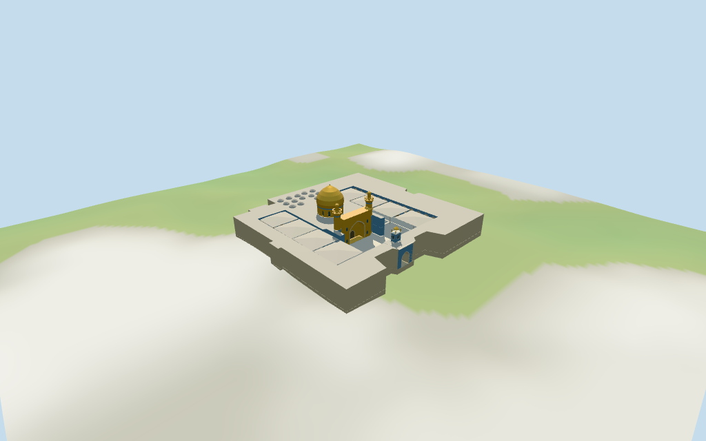

# Imam Ali Mosque

Individual medium-fi historic Imam Ali Shrine core:large golden bulbous dome/blue drum band,twin gilded cylindrical minarets with corbelled open galleries/lobed caps,deep gilded pointed iwan/projecting cornice,tiled side and two-tier courtyard fields,low mapped enclosure,fourteen small rear caps,east clock gate with four clock faces/open gold pavilion and eight mapped shade pavilions. Six existing shared256² material graphs,seven merged groups,four authored browser levels. Raw controls retained separately from estimated architecture;large western expansion and city surroundings stay host content. Interiors,unseen roofs/fine inscriptions,current finish and exact terrain/threshold joins omitted or unverified.

## Evidence and reconstruction

Published dimensions and reconstructed details are separated in spec.json. Primary references:

- [Reference](https://commons.wikimedia.org/wiki/File:Shrine_of_Imam_Ali_Najaf_August_2023.jpg)
- [Reference](https://commons.wikimedia.org/wiki/File:Meshed_ali_usnavy_(PD).jpg)
- [Reference](https://commons.wikimedia.org/wiki/File:Imam_Ali_Mosque_in_Najaf.JPG)
- [Reference](https://commons.wikimedia.org/wiki/File:Imam_Ali_Mosque_in_Najaf_(2).JPG)
- [Reference](https://commons.wikimedia.org/wiki/File:Ali%27s_shrine_in_the_morning.jpg)

Six existing shared256² sandstone,marble,cast-bronze,mosaic,lime-plaster and wood graphs;seven merged groups. Gold leaf uses a warm tint on shared neutral cast bronze,not a unique texture. Metric UVs,linear tints,zero embedded images,baked lighting or copied tile/calligraphy art. Broad original facets abstract the gilded muqarnas.

## Model and axes

17,475 triangles; 52,425 vertices; 7 material groups; 2,101,224 bytes. Native bounds: -61.502, -4.252, -59.331 to 61.326, 33.580, 59.315. Source hash: `sha256:b81356f8e094b157ef683a5a89685f192a05ea8be83de4b1b0c376dce19eb0af`.

{"x":"approximately south,opposite north","y":"up","z":"approximately west shrine ranges,opposite east clock gate"}

Standard viewer DEM datum66.748046m;historic-core perimeter-3.90..0.93m relative to anchor. Working courtyard floor1.580m is maximum bilinear DEM sample over the core at2m spacing plus0.3m;not surveyed paving elevation. Raw DEM retained without cutout/flattening. Foundations extend below it and crossY=0. Model paving stays inside the core. The larger western expansion,roads,city buildings and outer public realm remain host content. Shade state is an open-canopy approximation from the2023 rooftop image;the2025 image shows folded umbrellas. Exact altitude,threshold/ground joins,canopy operating state and walking unverified.

## Reproduce

Run `node packages/worldgen/scripts/generate-additional-landmarks.mjs --ids=imam_ali_mosque` (or add `--check`). The generator preserves manually edited masters by checking their baseline hashes. Import through the standard authored-model workflow with optimization disabled; then capture all QA cameras, including shared-surface views.

## Pending work

- Retained exact relation/14116182 /Q838359 matches current PMTiles whole52776572249430 (3*2^44+14116182). Preserve the earlier32-point outer/29-point court control separately from the current27-point outline/23-point court hole and nested mapped buildings/parts. Anchor[44.314709856,31.995905481] and heading−1.544292501434rad unchanged;no horizontal rescale. Native+X approximately south,−X north,+Z west shrine/rear ranges,−Z east clock gate. Exact current footprint locates the historic core;the large western Fatimah expansion and separate city buildings remain host content. Current circular parts locate dome/minarets;the east clock control and eight court shade polygons retain their outlines. Individual facade subdivisions/door centers and roof profiles are picture-led estimates within about2.5m/facing about3°.
- Retained Wikidata facts have no numerical height/width/length claims. Current whole/main hall tags height12.5m;overlapping dome components23.5m and32m;twin minarets29m;fourteen small roof parts min_height12.5m/height14.5m;clock pedestal min_height12.5m/height20m;two front annex strips6m. Clock roof part retains inconsistent min_height20m/height1.5m and is interpreted as a1.5m roof rise,not a top below its base. Working hall/outer ranges12.5m,drum12.5–18.5m,gold dome18.5–31m and finial32m,minaret galleries22–24.6m/caps27–28.6m/tips29m,gilded iwan18.8m,clock body12.5–18.2m/open upper pavilion18.2–20m/cap20–21.5m/finial22m. Shade top12.5m and all untagged roof/door/arcade/cornice dimensions are estimates. Nested23.5m dome part is retained as an overlapping nominal envelope,not a cuboid. These are visualization dimensions,not a survey. Interiors,current finish and exact site joins remain unverified. Clock gate starts at the current reentrant outer edgeZ−51.55m and reaches the inner court edge atZ−40.75m;door width/arch profile remain picture estimates. Initial gate geometry started inside the wall and was corrected after exterior render inspection.
- Standard viewer DEM datum66.748046m;historic-core perimeter-3.90..0.93m relative to anchor. Working courtyard floor1.580m is maximum bilinear DEM sample over the core at2m spacing plus0.3m;not surveyed paving elevation. Raw DEM retained without cutout/flattening. Foundations extend below it and crossY=0. Model paving stays inside the core. The larger western expansion,roads,city buildings and outer public realm remain host content. Shade state is an open-canopy approximation from the2023 rooftop image;the2025 image shows folded umbrellas. Exact altitude,threshold/ground joins,canopy operating state and walking unverified.
- Individual historic shrine exterior from five inspected2003/2014/2023/2025 photographs. Gold/blue dome,twin minarets,deep gilded iwan,east clock gate,two-tier tiled courtyard,small rear caps and eight mapped open shade pavilions. Shared mosaic approximates facade color;fine tile/calligraphic art,flags,banners,strings,scaffolding,fixtures and furnishings omitted. Gallery/iwan fields close before interiors;clock gate is an exterior passage. Unseen roofs,current finish/canopy state,exact terrain/threshold joins,interiors and engineering unverified. The large western expansion and city buildings remain host content. No enclosed-interior/free walking claim. Physical-device performance remains unmeasured.

This bundle follows the medium-fi standard. Medium-fi appearance and geographic fit are reviewed separately. Hash-bound visual acceptance is recorded separately after capture inspection.

## Additional geographic data

©OpenStreetMap contributors;Protomaps;Mapzen/USGS terrain tiles.
