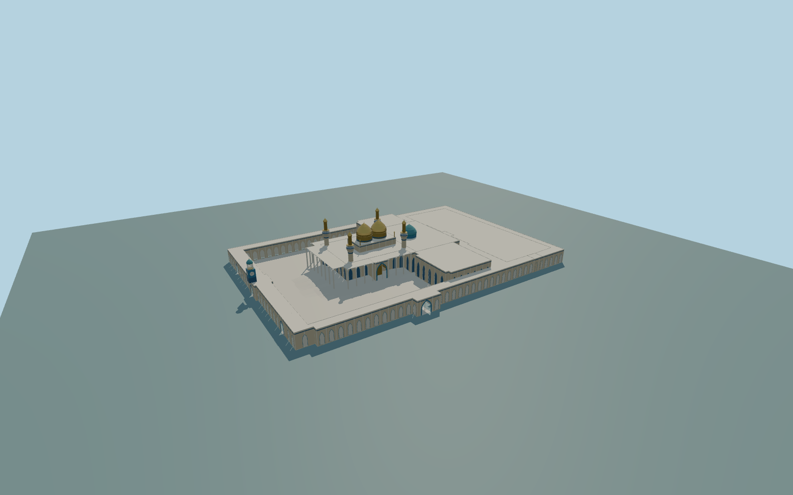

# Al-Kadhimiya Mosque

Complete buff/blue courtyard shrine with separate sanctuary and northern/lateral ranges,open white-columned U-shaped porch,two gold onion domes/blue rear dome,four tall staged minarets/four small roof lanterns,perimeter arcades/four mapped open gates and south middle-gate clock/belfry.

Rebuild checked-in source with `node packages/worldgen/scripts/generate-al-kadhimiya-mosque.mjs`;append `--check` for exact bytes. Import/LOD selection:`--ids=al_kadhimiya_mosque`. GLBs are ignored build outputs;detailed source and four browser tiers remain separate.

The retained Q154116 campus has separate sanctuary/ranges and an open courtyard. Native15m U-shaped porch is roof plus columns. Two gold domes and a blue rear dome,four minarets/four small roof lanterns,perimeter arcades/four mapped gateways and south middle-gate clock remain distinct. Native heights are generalized envelopes;fine clock/gate/ornament/column inventories and site grades are original approximations. Six existing256px material graphs are shared;no private or embedded images. Scope/current review:model-brief.json and qa.json.

The unmodified coarse50m-center terrain includes urban roof returns,which can distort paving or hide lower architecture. Foundations/aprons sample it;court paving conservatively follows the field with shared vertices. Exact thresholds/grades/accessibility are not surveyed.

Original geometry uses the repository license. Maps:© OpenStreetMap contributors,ODbL-1.0;Protomaps. Standard terrain attribution:terrain-grid.json. Ordinary reference photographs remain local and are not redistributed or used as textures.
