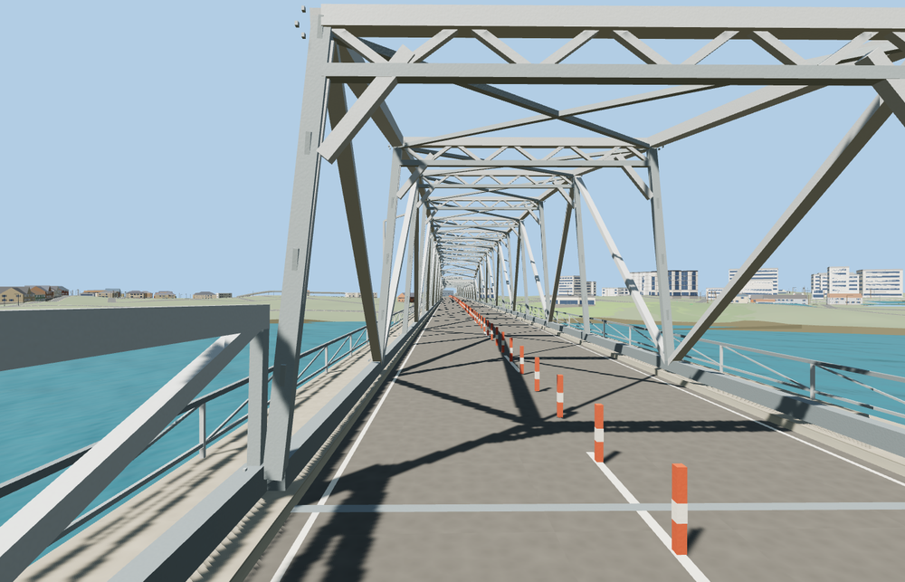

# Al-Sarafiya Bridge

The historic Al-Sarafiya Bridge crosses the Tigris on two high steel through-trusses and a lower central span. Open cross-bracing, pale gray lattice, red-and-white road separators, sidewalks and the long approach spans follow the photographed bridge.

The 60,264-triangle source rebuilds byte for byte. Skyline, district, street and close-up use 876, 3,896, 11,872, 50,496 triangles. Skyline and district total 388,012 bytes. Six GLBs validated and 36 current views were inspected.

Nine pier and two abutment probes, 40 deck probes and six landing samples pass at each level. Both travel lanes stay clear through all three river trusses. The largest landing height difference is 0.018 m. The sampled clearance across the three main spans over mapped water is at least 14.5 m in the viewer fixture. The original highway crossing returns if the model load fails.

The model depicts the historic Al-Sarafiya crossing and approaches. The mapped relation also includes the separately built second span. Its outline remains in the source controls and its construction and future road alignment are outside this landmark replacement. Truss stations, pier dimensions, grades and painted details are exterior reconstructions from ordinary photos and the standard viewer terrain. The native river surface remains and exposed pier heights vary with the host water level.

Rebuild with `node packages/worldgen/scripts/generate-al-sarafiya-bridge.mjs`. Append `--check` to compare exact bytes. Use `--ids=al_sarafiya_bridge` for targeted import, LOD, placement and readiness.
