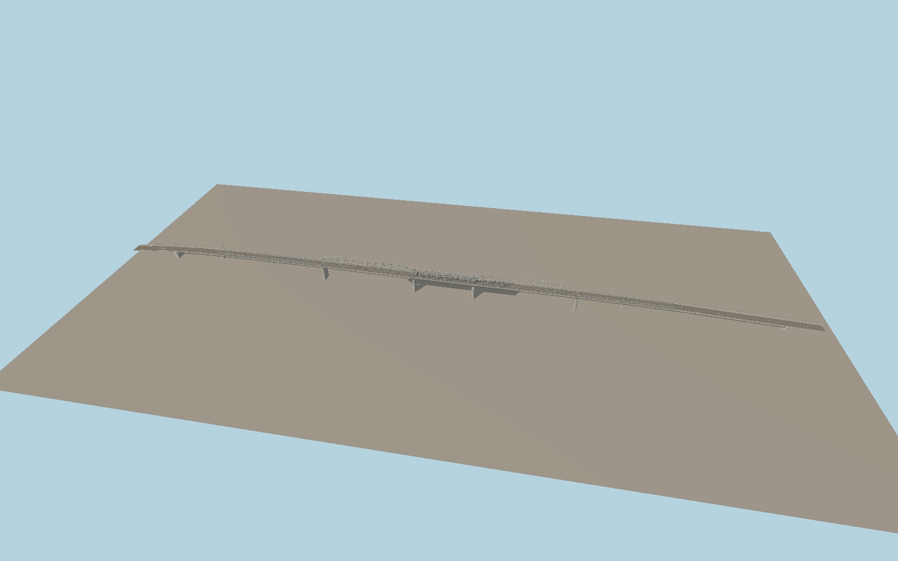

# Al-Sarafiya Bridge

The historic Al-Sarafiya Bridge crosses the Tigris on two high steel through-trusses and a lower central span. Open cross-bracing, pale gray lattice, red-and-white road separators, sidewalks and the long approach spans follow the photographed bridge.

Run `node packages/worldgen/scripts/generate-vushtrri-stone-bridge.mjs` to rebuild the source master. Append `--check` to compare the exact bytes. Use `--ids=al_sarafiya_bridge` for targeted import, LOD generation and placement.

The model depicts the historic Al-Sarafiya crossing and approaches. The mapped relation also includes the separately built second span. Its outline remains in the source controls and its construction and future road alignment are outside this landmark replacement.

Truss stations, pier dimensions, grades and painted details are exterior reconstructions from ordinary photos and the standard viewer terrain. The native river surface remains and exposed pier heights vary with the host water level.

Original geometry follows the repository license. Map data is © OpenStreetMap contributors under ODbL-1.0 via Protomaps. Terrain samples are described in terrain-grid.json. Ordinary pictures stay local and are not redistributed or used as textures. Current acceptance is recorded in qa.json.
