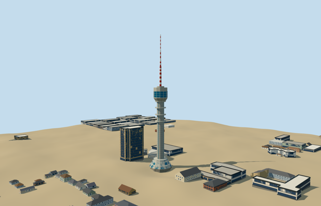

# baghdad_tower — Baghdad Tower

Reviewed 2026-10-20 in one continuous author/build/inspect/fix round.

## Appearance

Inspected51 final source/shared/context/native views during one continuous author/build/fix round. Three individually flared base tiers carry blue arched closed glazing and broad pale frames; a panel-clad shaft with four approximate recessed strips supports three service collars, a flared lower bowl/blue windowed head, twelve mapped crown sectors around a central well, separate cap and complete segmented205m mast. Upper warning bands, rails and glazing schedule are simplified original details. Removed numerical shell slivers and widened the square mast camera before acceptance. The adjacent Ma'mun Centre remains host context; no furnished restaurant, copied identity text, image atlas or precinct slab.

## Shared materials and browser levels

Three existing256-square graphs (concrete_plain, concrete_panel, metal_painted) supply shared structural cladding and paint, with texture-free blue PBR glazing. Five merged material groups/at most five runtime draws, metric UV repeats/linear tints, zero embedded images and separate GPU streams. Source15356triangles/1846032bytes. Graph reads occur once per model fixture; CPU/GPU byte counts agree and eviction disposes all model geometry.

| Level | Triangles | Bytes | Draws |
| --- | ---: | ---: | ---: |
| skyline | 864 | 86540 | 1 |
| district | 2948 | 254804 | 5 |
| street | 11708 | 1061080 | 5 |
| closeup | 15356 | 1411912 | 5 |

Inspected street/block/skyline noon and late-afternoon Economy/High views, silhouette, four details and all four transitions. LODs864/2948/11708/15356triangles remain below1000/4000/16000/64000 ceilings. Skyline+district total341344bytes, below3MB phones/6MB laptops. Fine frames/rails drop at distance while three base tiers, collars, flared head and mast stages remain. Local context crops intentionally examine the head/shaft; whole-source/native views include the entire structure. Synthetic terrain-tile edges are fixture boundaries. Physical-device/dense-city timing remains pending.

## Approximate map fit

Exact-QID OSMway1091808365/PMTiles35185463897197 is the lowest0.44m plinth. Its120 associated native building parts form the same tower up to205m;0.44m is not the total tower height. Their common center[0.04876941509099453,0.030473715795521272]m, profiles/collars/crown radial sectors and antenna intervals fix native placement relative to anchor44.354264361,33.303258825, heading0/east-south axes. The dodecagonal crown gives internal phase3.0594266204088822rad. Generic window/entrance inventory and signed facing remain photo-led30degree/2m approximations; no surveyed facade or datum accuracy is claimed. Preserve original6m standard Mapzen terrain, native roads/water and every independent neighboring building including the54m Ma'mun Centre west of the tower. Replace only the121 corresponding tower/plinth/part shells. A bounded level occupied footing is set above the highest sampled plinth edge with buried sides below the lowest; no whole-precinct platform or ground/water cutout. Coarse DEM, floor and foundation engineering remain explicit visualization estimates. Building replacement uses the bounded convex envelope of the same121 tower parts with5cm radial clearance, covering tiny reentrant plinth corners and avoiding numerical shell slivers. It does not cut terrain or water; native integration must preserve every independent building. All four loaded levels remove all121 corresponding native tower/plinth shells with zero residual, preserve129 independent resident buildings out of250 original inputs, and retain the unmodified6m standard terrain, paths and zero-water condition. Failed loading restores all250 original inputs; unloading releases all geometry and restores terrain/water bindings. The54m Ma'mun Centre west of the tower is preserved as an independent host building.

## Limits

Retained Wikidata205m height has no point-of-measurement qualifier; native parts reach205m and support the same nominal overall extent. Map lower tiers0..12.69m, shaft9.54..108.17m, collars71.19/81.51/92.17m, flared crown101.87..108.62m, windowed house108.62..118.72m, radial sectors118..124m and central cap122.16..126m guide geometry. Mast stages126/147/156.5/166.3/175/181/189/197/205m are retained. Smoothed low-tier profiles, pane/slot schedule, rails, mast paint bands and cladding remain picture-led visualization approximations. Preserve original6m standard Mapzen terrain, native roads/water and every independent neighboring building including the54m Ma'mun Centre west of the tower. Replace only the121 corresponding tower/plinth/part shells. A bounded level occupied footing is set above the highest sampled plinth edge with buried sides below the lowest; no whole-precinct platform or ground/water cutout. Coarse DEM, floor and foundation engineering remain explicit visualization estimates. Building replacement uses the bounded convex envelope of the same121 tower parts with5cm radial clearance, covering tiny reentrant plinth corners and avoiding numerical shell slivers. It does not cut terrain or water; native integration must preserve every independent building. Shaft/window inventory, rounded pane profiles, paint bands, guard schedule and head details are picture-led medium-fi approximations. No surveyed facade, restaurant interior, machinery or contemporary repair inventory. Two ordinary whole/base photographs carried through construction; source pictures were viewed, not copied.

## Selected checks

Six Khronos files: zero errors/warnings.270 actual mesh/material/contact checks; 51 current inspected views. Scene validation/sim30 and strict selected medium-fi audit pass. Source/runtime/LOD hashes and material bindings verified.

Rebuild: node packages/worldgen/scripts/generate-additional-landmarks.mjs --ids=baghdad_tower; node packages/worldgen/scripts/import-structure-models.mjs --ids=baghdad_tower; node packages/tooling/scripts/generate-landmark-lods.mjs --ids=baghdad_tower --force.

Source: sha256:5fd2db5fc212e0d2e5d6dc111a9bbf4d4e1f778e128b83c9b64a05fb34598fef

Runtime: sha256:d6769e4c57e7105570503800f00ab12198e4a1eaaf1229a414cdeb2b605b0e70

Input: sha256:c18e72d26eb17b52f72f81d9f464e9876d7513a23577be9696f33c59a56c0cfc

## Viewed ordinary pictures

https://commons.wikimedia.org/wiki/File:برج_بغداد.png — MohammadHuzam; CC-BY-SA-4.0. Viewed only; no pixels copied.

https://commons.wikimedia.org/wiki/File:Baghdad_Tower_Center.JPG — Makaay31; CC0-1.0. Viewed only; no pixels copied.
