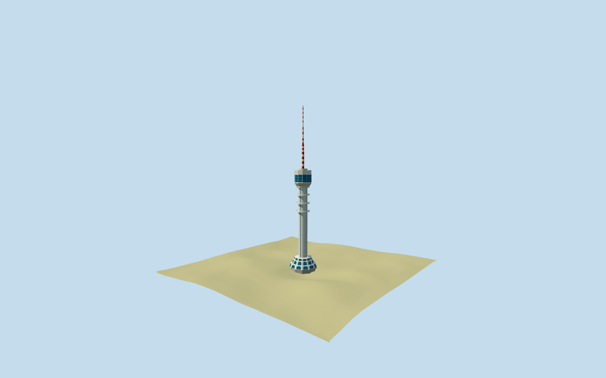

# Baghdad Tower

Specific Baghdad Tower exterior: mapped205m overall height, panel-clad cylindrical shaft/dark vertical strips, three service collars, three flared base tiers/blue arched closed glazing, broad flared lower crown/blue windowed head, twelve map-derived radial crown sectors and long segmented warning-painted mast. Original shared concrete/panel/paint surfaces and texture-free blue PBR glazing. Keep the separate Ma'mun Centre and neighborhood in the host scene. No furnished restaurant, machinery/interior, copied identity text, image atlas, precinct slab or terrain/water cutout.

## Evidence and reconstruction

Published dimensions and reconstructed details are separated in spec.json. Primary references:

- [Reference](https://commons.wikimedia.org/wiki/File:برج_بغداد.png)
- [Reference](https://commons.wikimedia.org/wiki/File:Baghdad_Tower_Center.JPG)

Specific Baghdad Tower exterior: mapped205m overall height, panel-clad cylindrical shaft/dark vertical strips, three service collars, three flared base tiers/blue arched closed glazing, broad flared lower crown/blue windowed head, twelve map-derived radial crown sectors and long segmented warning-painted mast. Original shared concrete/panel/paint surfaces and texture-free blue PBR glazing. Keep the separate Ma'mun Centre and neighborhood in the host scene. No furnished restaurant, machinery/interior, copied identity text, image atlas, precinct slab or terrain/water cutout.

## Model and axes

15,356 triangles; 46,068 vertices; 5 material groups; 1,846,032 bytes. Native bounds: -17.544, -3.026, -17.563 to 17.642, 207.143, 17.624. Source hash: `sha256:5fd2db5fc212e0d2e5d6dc111a9bbf4d4e1f778e128b83c9b64a05fb34598fef`.

{"x":"east","y":"up","z":"south"}

The geographic proposal uses exact-QID OpenStreetMap evidence. Map-derived orientation and estimated architectural details require real-site visual review; preview eligibility is distinct from geographic/fidelity approval. Map attribution: © OpenStreetMap contributors, ODbL-1.0.

## Reproduce

Run `node packages/worldgen/scripts/generate-additional-landmarks.mjs --ids=baghdad_tower` (or add `--check`). The generator preserves manually edited masters by checking their baseline hashes. Import through the standard authored-model workflow with optimization disabled; then capture all QA cameras, including shared-surface views.

## Pending work

- Specific Baghdad Tower exterior: mapped205m overall height, panel-clad cylindrical shaft/dark vertical strips, three service collars, three flared base tiers/blue arched closed glazing, broad flared lower crown/blue windowed head, twelve map-derived radial crown sectors and long segmented warning-painted mast. Original shared concrete/panel/paint surfaces and texture-free blue PBR glazing. Keep the separate Ma'mun Centre and neighborhood in the host scene. No furnished restaurant, machinery/interior, copied identity text, image atlas, precinct slab or terrain/water cutout.
- Exact-QID OSMway1091808365/PMTiles35185463897197 is the lowest0.44m plinth. Its120 associated native building parts form the same tower up to205m;0.44m is not the total tower height. Their common center[0.04876941509099453,0.030473715795521272]m, profiles/collars/crown radial sectors and antenna intervals fix native placement relative to anchor44.354264361,33.303258825, heading0/east-south axes. The dodecagonal crown gives internal phase3.0594266204088822rad. Generic window/entrance inventory and signed facing remain photo-led30degree/2m approximations; no surveyed facade or datum accuracy is claimed.
- Retained Wikidata205m height has no point-of-measurement qualifier; native parts reach205m and support the same nominal overall extent. Map lower tiers0..12.69m, shaft9.54..108.17m, collars71.19/81.51/92.17m, flared crown101.87..108.62m, windowed house108.62..118.72m, radial sectors118..124m and central cap122.16..126m guide geometry. Mast stages126/147/156.5/166.3/175/181/189/197/205m are retained. Smoothed low-tier profiles, pane/slot schedule, rails, mast paint bands and cladding remain picture-led visualization approximations.
- Preserve original6m standard Mapzen terrain, native roads/water and every independent neighboring building including the54m Ma'mun Centre west of the tower. Replace only the121 corresponding tower/plinth/part shells. A bounded level occupied footing is set above the highest sampled plinth edge with buried sides below the lowest; no whole-precinct platform or ground/water cutout. Coarse DEM, floor and foundation engineering remain explicit visualization estimates. Building replacement uses the bounded convex envelope of the same121 tower parts with5cm radial clearance, covering tiny reentrant plinth corners and avoiding numerical shell slivers. It does not cut terrain or water; native integration must preserve every independent building.
- Two ordinary photographs carried through construction: whole skyline and close base. Fine glazing inventory, signed facade facing, rails and mast colors remain picture-led approximations. Preserve the adjacent Ma'mun Centre; no furnished restaurant or copied identity text.

This bundle follows the medium-fi standard. Medium-fi appearance and geographic fit are reviewed separately. Hash-bound visual acceptance is recorded separately after capture inspection.
