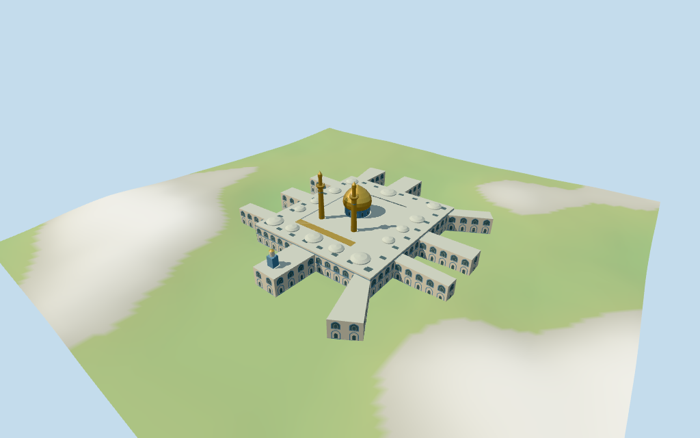

# N0463 — Imam Husayn Mausoleum

Reviewed 2026-10-18 for the stated medium-fi exterior and approximate geographic fit. Current named PMTiles controls supply the core, gallery, gate masses, roof caps, dome and paired minaret positions. Total mapped heights are retained; detailed profiles, internal levels and facade facing remain estimates.

## Exterior and shared materials

Inspected all 11 final portable views including the curated 1024×640 preview. Individual Imam Husayn shrine has a pointed golden bulb on blue drum, two mapped cylindrical gold minarets with broad balconies and smaller upper caps, a five-bay gold-columned pointed portico, covered central court/gallery, ten mapped gate ranges, shallow roof caps and Qibla upper clock stage. Added inward outer-wall skin and the missing covered-roof underside, then moved the portico camera below that roof before final review. Dome and shafts remain deliberately faceted at medium-fi scale. Portable grazing shadow striping remains visible around the portico bands. Fine inscriptions, faience artwork, festival lighting, flags, crowds, chandeliers, crypts and furnished interiors are omitted.

Inspected all 11 shared-material/geographic-flat views, including the placement overlay. Six existing shared 256² stucco, raw limestone, lime plaster, marble, cast bronze and mosaic graphs serve seven merged roles including local opaque blue-grey fields. Metric UVs, linear colors and no embedded images or copied photographs. All graphs are read once; unloading leaves zero model geometries and restores ground. Retained reference anchor is fixed; exact current core edge supplies the axis. Main gallery cutout follows its raw outer outline. Ten separately mapped gate roofs retain their native outlines and small quantization gaps, with their own foundations; the model does not invent a connected city-wide footprint. Flat ground verifies transform, material reuse and replacement, not actual grade.

## Browser levels

| Level | Triangles | Bytes | Draws |
| --- | ---: | ---: | ---: |
| skyline | 826 | 86920 | 1 |
| district | 3697 | 389192 | 7 |
| street | 13828 | 1455980 | 7 |
| closeup | 43824 | 4712732 | 7 |

**476,112 bytes for initial skyline plus district**, plus shared textures. Six existing shared 256² graphs, seven merged roles, zero embedded images.

Inspected all 27 final medium-fi frames: Economy/High, noon/late light, three distances, untextured silhouette, six details, four matched LODs and four transitions. The matched skyline was also inspected at full size. Skyline 826 triangles retains all gate masses, covered gallery, main gold dome, two minaret silhouettes, low roof caps and Qibla upper stage, but drops facade fields, railings and rooflights. District 3697 restores sparse lower facade fields, blue drum bands and more curved caps. Street 13828 restores two-level fields, rooflights and balcony rails with fewer bays and simple inner door/window panes. Closeup 43824 adds denser facade rhythm, inner gallery fields and detailed pointed surrounds. Initial skyline plus district is 476112 bytes plus shared textures, one/seven draws. Sparse far roof caps and facade density visibly change between levels; static transition shots and synthetic neighbors do not establish full-city frame rate. Physical phone/tablet/laptop timings remain pending.

## Placement and limits

Retained Q773704 reference anchor [44.0325,32.616388888] is unchanged. The older record is reference-only. Current named shrine POI 52776572251048, courtyard/gallery 52776572301940, tomb 35185528314643 and Qibla Gate 17601319459877 support this identity. Main gallery 52776572301940 surrounds the exact central four-vertex core 35185434669244. Dome 35185101411085 and paired balcony/upper-minaret controls fix their own centers. Ten mapped gate roofs and small 14.5 m roof caps are retained individually. Heading -0.22117434116265272 radians aligns the front core edge with positive X east-southeast; positive Z south-southwest faces the minarets and principal portico. Current ring is mapped as roofed, and the supplementary courtyard photograph shows rooflights: the model follows that covered footprint, not the earlier open-court photograph. Facade facing and internal bays are picture-led approximations. External western expansion, crypts, tomb furniture, streets and surrounding city remain host content or omitted. Normal viewer DEM datum 36.01129166781902 m; working floor -0.09479425652329782 m is outside-perimeter median plus 0.3 m (124 samples). 899 raw central-footprint samples span -1.695055331448394..0.9917247749518623 m. Adaptive foundation and paving cover the central gallery outer footprint; gate foundations follow their own outlines. Preview terrain seats this outline and 1.5 m margin. Exact street thresholds, drains, crypt levels and present grade joins remain unverified. Independently reproduced all 33 map controls and 332 raw outline/hole vertices, four named POIs, original reference anchor and the heading from the first core edge. The gallery hole exactly matches the central core; current roofed mapping is retained rather than opening a historical courtyard. All 234 actual renderer footprint checks pass across six GLBs: all 33 selected controls covered and six exterior host controls remain separate. The separate western expansion remains host content. All 1791 FrontSide probes pass for golden dome, minaret caps and mapped balconies, covered roof/soffit, five portico passages/intradoses, fourteen shallow roof caps, Qibla upper stage and current facade fields. Reproduced 899 raw central-footprint DEM samples, 124 perimeter samples and 868 seated preview points. Cutout covers only the central gallery; each gate foundation follows its own raw outline. Exact street approaches, thresholds, drainage, crypt levels and present terrain joins remain unverified.

Individual medium-fi Imam Husayn shrine: mapped covered gallery and central core, golden pointed bulb dome on blue drum, two tall golden balcony minarets, gold-columned front portico, ten mapped gate ranges, Qibla gate upper clock stage and repeated shallow courtyard roof caps. Coarse blue faience fields and pale stone surfaces use six existing shared 256² graphs across seven merged roles. Four independent browser LODs. Component centers and total map heights are controlled; internal profiles, bays, facade facing, rooflights and ornament are explicit visualization estimates. Separate expansion, fine calligraphy/artwork, furnishings, crypts, festivals and city omitted. Current map: gallery 12.5 m, core 12 m, golden dome 32 m with min_height 12 m, minaret balconies 34–34.5 m and upper minaret parts 34.5–44 m. Gate roofs 11.3 m; small roof caps 14.5 m; Qibla gate upper square 17.3 m and octagonal upper control 21.3 m. Total heights are honored. Internal picture-led estimates: main blue drum 12–17 m, golden bulb to 31.4 m and finial to 32 m; gold shafts to 32.5 m, projecting balcony to 34.5 m, slender upper stage to 40 m, cap/finial to 44 m. Covered-court rooflights, entrance arch divisions, dome/minaret curves, gold portico spacing and clock divisions are estimates. Coarse map heights do not establish those internal levels. No surveyed engineering or furnished interior claim. Two actually inspected pictures guide the golden portico, dome/minaret silhouettes and covered-court material rhythm. An earlier night exterior shows an open court; the supplementary picture shows a covered courtyard with rooflights. The model follows current roofed map geometry without claiming a precise historical snapshot. The first photograph has uncertain original provenance and conflicting title/date metadata; the second has an unreliable default-looking EXIF date. Photographs are viewed only. Current total height and upper-part tags are honored, but internal profiles, facade facing, bay counts, rooflight locations and exact clock structure remain estimates. Orientation uncertainty is recorded as 30 degrees; no surveyed engineering, furnished or collision-certified interior claim. Exact finishes, hidden rooms and physical-device timings remain unverified.

## Verification

49 final views inspected; 1791 FrontSide probes; 234 actual renderer footprint checks; six Khronos checks with zero errors/warnings. Current source/runtime/input/LOD/material/frame/report/placement hashes agree. All 33 raw controls, four named POIs, orientation and required 16-bit terrain fixture reproduced. Source --check, placement --check, scene validate/sim30, independent LOD layout and recipe/registration Biome pass.

Source: sha256:ae7a3982a393f4a48c3910d22fd6fc860be9eacdb60ffd7644878d8390450b9d

Runtime: sha256:2f91929aaf768c17724b12459a03e7d75b5daf3de136a32ae990b9b9b6b19b0e

Input: sha256:3212ad05d2ac0f48b0daaed8d0e711e14f0e6731adbe646b3ef6b399861526e2

Commands: targeted generate-additional-landmarks/import-next-1000-models/generate-landmark-lods/register-landmark-previews --ids=N0463; source/placement --check; capture-next-1000-models --reflections --antialias --fit-shadows; capture-landmark-library --reflections --adaptive-clipping --bounded-placement; capture-medium-fi --ids=n0463_imam_husayn_mausoleum --reflections; selected LOD check; scene validate/sim30; recipe/registration Biome. Bulk captures remain ignored. Prior full source checkpoint N0432–N0449; next routine checkpoint N0450–N0469.

## Inspected picture references

[J. Ansari; Commons source is Pinterest, original provenance uncertain — Commons metadata 2018-05-17; title says 2019](https://commons.wikimedia.org/wiki/File:Karbala_in_2019.jpg). Commons states CC-BY-SA-4.0; viewed only, no pixels redistributed. Inspected complete 960×641 night courtyard photograph. Golden pointed bulb dome, two cylindrical gold minarets with projecting balconies and narrower upper stages; open gold/light-column entrance portico with pointed arches and blue/pale faience bands. Earlier open courtyard is visible. Festival red lighting, flags, crowds, banners, inscriptions and fine artwork not copied.

[Md iet — Capture date unknown; uploaded 2019-04-28; default-looking EXIF 2000-01-02 is not accepted as capture date](https://commons.wikimedia.org/wiki/File:A_view_court_yard_Imam_Husayn_shrine.jpeg). CC-BY-SA-4.0; viewed only. Inspected complete 960×720 covered courtyard/interior view: two levels of pointed faience fields, patterned soffits and rectangular rooflights. This view supports the covered court and coarse pale/blue material rhythm; it does not control the exterior dome profile or exact rooflight plan. Chandeliers, people and fine art omitted.
