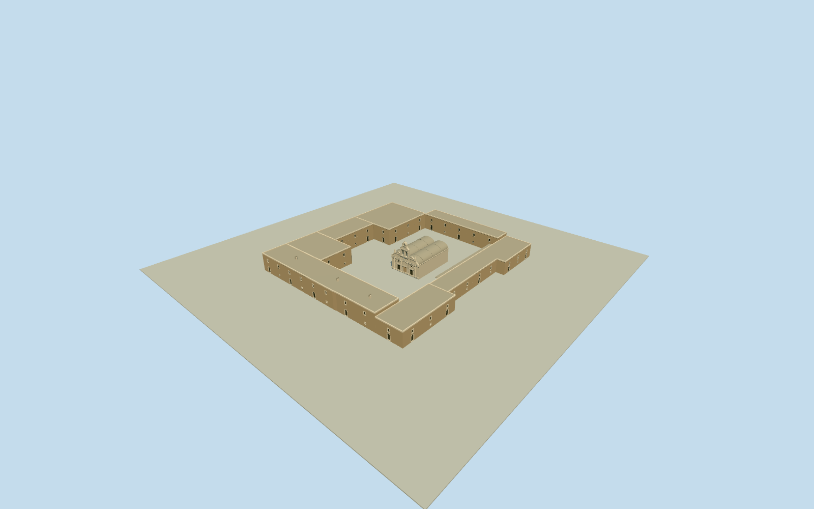

# Arkadi Monastery

Surviving Arkadi monastery on ten distinct native building/roof plans around a genuinely open court: warm rubble enclosing cell/gate/museum wings with recessed dressed openings and parapets, open southern covered walk, and pale limestone double-aisle church with twin vault roofs, two west doors/oculi and blind central niche, engaged columns/cornices, curved paired gables/pinnacles and a genuinely open2+1bell crown with its circular void.

Authoring state: **review-in-qa.json**. Current completion evidence is in [qa.json](qa.json) and the [completion ledger](../../../../qualla-structures/batches/qualla-002.PROGRESS.md).

- [Arkadi Monastery](https://qualla.com/arkadi-monastery/)

Named original monastery way361128301/Q541696 is a site identity envelope, not an extruded building. Ten separate original building/roof ways retain their signed position, including Katholikon, surrounding wings and explicit open covered roofs; the large court remains unmeshed. Detached ossuary/memorial, restaurant, other detached buildings and landscape excluded.

Exact public-domain Klaas1978church-front and CC0Cmessierwest-wing originals provide exterior controls after a Qualla-first search; each has an explicit own-work creator release and matching pinned primary/native-file hash. No battle/old engraving, source with uncertain authorship, attribution/share-alike photo, unrelated Preveli/Phaistos image or street sign was used. Source photos are references, not textures.

Church body5.8m, twin roof rise2.15m and bell/cross crown13.6m, main wings5.3–7m and the open walk3.35m are medium-fi photographic estimates, not surveyed heights. Paired vault curvature, engaged column sections, arch/window rhythm, hidden roofs/apse caps, wing chimneys and sculptural mouldings are simplified; no lettering, portrait sculpture or precise surviving ruin reconstruction is claimed.

Exterior assembly only: two recessed church doors and blind center niche match the photographed west front; bell-gable openings and southern covered walk are physically open, while ordinary dark door/window recesses are closed. No religious interiors, people, vegetation, signage,1866battle reconstruction or historical vanished structures.

Foundations extend.4m below a fixed dry west-gate approach datum. Actual courtyard, ruin-edge and local wing ground contact are approximate; source terrain remains unchanged, with no whole-site platform or blanket terrain opening.

Build: `node packages/worldgen/scripts/generate-authored-places.mjs --ids=arkadi_monastery`. Add `--check` to verify exact regeneration. 32308 triangles; 6 materials; no embedded photographs.
