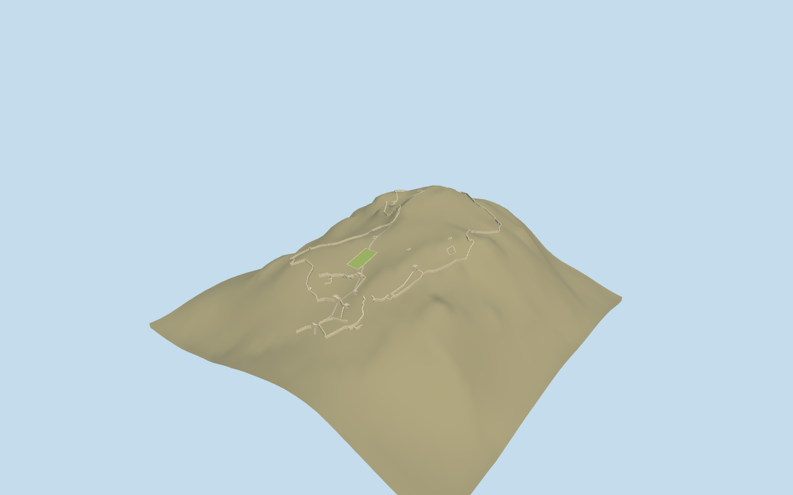

# Acrocorinth

Fortified twin ridge with three successive western gates,surviving terrain-following curtains,inner towers,rectangular Ottoman summit keep,citadel,cistern terrace and selected roofless remains. A relative terrain study,not a flat site-boundary extrusion.

## Evidence and reconstruction

Published dimensions and reconstructed details are separated in spec.json. Primary references:

- [Reference](https://castleroute.culture.gov.gr/en/acrocorinth/)
- [Reference](https://www.ascsa.edu.gr/excavations/ancient-corinth/digital-corinth/maps-gis-data-and-archaeological-data-for-corinth-and-greece)
- [Reference](https://github.com/tilezen/joerd/blob/master/docs/data-sources.md)
- [Reference](https://github.com/tilezen/joerd/blob/master/docs/attribution.md)
- [Reference](https://www.openstreetmap.org/way/146863144)

Model geometry adapts licensed archaeological wall data,under CC-BY-SA-4.0;see LICENSE.md. Terrain grid is produced using Copernicus data and information funded by the European Union - EU-DEM layers,through Mapzen/Terrain Tiles. Research photographs remain external evidence,never textures or bundled images. Existing shared surface graphs carry their own repository license.

## Model and axes

5,422 triangles; 16,266 vertices; 4 material groups; 653,328 bytes. Native bounds: -428.849, -151.079, -260.021 to 404.490, 64.520, 266.434. Source hash: `sha256:3cac2e543c7a1151aa6e1a70030536982b5fa2c3929f5d628b1e8d246410f0d9`.

{"up":"+Y","longitudinal":"+X approximately east along the ridge","lateral":"+Z approximately south toward the Ottoman keep","origin":"Site anchor; Y0 standard viewer PMTiles anchor datum. Original terrain patch omitted from runtime."}

The inspected aerial picture confirms the twin rocky ridge, terrain-following curtains, three successive western gates and small southwest keep. Standard viewer PMTiles set approximate ridge fit in the retained site frame. The runtime derivative omits the embedded research terrain mesh and samples its architectural footing functions directly from standard viewer PMTiles, using a0.7m working clearance. The old relative258.37m datum remains only in the preserved source master. The broad site ring is contextual; footprint replacement stays off. Anchor 22.873283683,37.891346465; heading -0.026117351143; standard PMTiles datum 510.43219632278726m. Floors are reconstructed and foundations extend below the coarse sampled ground.

## Reproduce

Run `node packages/worldgen/scripts/generate-signature-towers.mjs --ids=N0281` (or add `--check`). The generator preserves manually edited masters by checking their baseline hashes. Import through the standard authored-model workflow with optimization disabled; then capture all QA cameras, including shared-surface views.

## Pending work

- Approximate current surviving exterior from inspected picture and standard viewer PMTiles; no bespoke survey or exact thresholds.
- Original detailed master and adapted ASCSA wall data preserved with their CC-BY-SA attribution. Independent derivative uses viewer terrain for footing and omits embedded hill mesh.
- Twin ridge curtains, successive gates, inner towers, Ottoman keep/citadel, cistern terrace and selected roofless remains retain identity. Architectural heights and thresholds reconstructed.
- Site boundary is context, not a wall footprint; replacement remains off. Selected surviving walls and remains do not imply archaeological completeness.
- Host provides ridge terrain. Modern roads, vegetation, fixtures, interiors, buried remains and lost roofs excluded.
- Two common material graphs and local recess color; no embedded images. Physical-device timing pending.

This bundle follows the medium-fi standard. Medium-fi appearance and geographic fit are reviewed separately. Hash-bound visual acceptance is recorded separately after capture inspection.

## Additional geographic data

James A.Herbst,Corinth Excavations,American School of Classical Studies at Athens;© OpenStreetMap contributors;Hellenic Ministry of Culture;Mapzen/Terrain Tiles;produced using Copernicus data and information funded by the European Union - EU-DEM layers.
